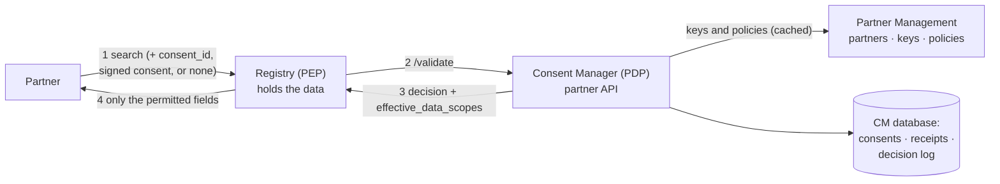

# Architecture

## The PDP / PEP model

The Consent Manager (CM) is a **Policy Decision Point (PDP)**. A service that holds personal data, primarily an OpenG2P registry, is a **Policy Enforcement Point (PEP)**: it holds the data, asks the CM, and releases only what the CM permits.

The registry forwards what the partner sent (or, with nothing, the person searched), receives a decision with the **effective data scopes** and the consent's subject, and releases only those scopes' fields. The flow and its checks: [Verification & enforcement](verification-and-enforcement.md). The registry side: [Registry integration](registry-integration.md).

The CM keeps **no partner records**. Partners, keys and access policies are in Partner Management (PM), where changes are approved; the CM console links to PM's UI (**Partners & policies**). See [Partner Management integration](partner-management-integration.md).

## One shared CM per install

One CM serves every data-holding module of an install (farmer registry, social registry, …), so consents, decisions, audit and the signing key are in one place. There is no global data controller: each registry names itself as `data_controller` on `/validate`, and the CM evaluates only that registry's grant against the partner's policy for that registry.

## APIs by audience

The CM follows the platform's **4-API audience pattern**: one image and one Helm chart, a Deployment per audience, selected by `CONSENT_MANAGER_API_AUDIENCE`. There is no agent API.

| Audience | Auth | Serves |
| --- | --- | --- |
| **staff** | Keycloak, staff realm (`CONSENT_MANAGER_ADMIN`, `CONSENT_MANAGER_APPROVER`); the partner portal API checks partner-realm tokens | The decision log (console **Access Log**), verification of assisted consents (console **Consent Approvals**), consents by ID and their revocation on the subject's request, the partner portal API |
| **partner** | **No Keycloak.** Called in-cluster only (Istio mTLS); a partner-signed consent is verified against PM keys | `/validate`, consent status, consent-token status, receipts, `/.well-known/jwks.json`. Mounts the `.p12` signing key |
| **beneficiary** | Keycloak, beneficiary realm | `/my/*` (subject rights) and the origination API. **Off by default** |

Endpoints: [API Reference](../api/README.md). Which paths are reachable from outside the cluster: [Deployment](../deployment/README.md#what-is-reachable-from-outside).

## Components

| Component | Audience | Responsibility |
| --- | --- | --- |
| **Verification** | partner | `/validate`: finds or verifies the consent, applies the policy, returns the decision |
| **Policy evaluation** | all | Applies the partner's PM policy to a consent; computes the effective scopes. Deterministic |
| **PM client** | all | Reads partner keys and policies from PM; caches them per pod |
| **Signing** | partner | The CM's own key (`.p12`): signs receipts and consent tokens; publishes the JWKS |
| **Artefacts and receipts** | partner · staff · beneficiary | Stores the canonical consent artefact and its CM-signed receipt |
| **Exchange** | partner | Issues consent tokens (Exchange role) and accepts them (department role); opt-in |
| **Assisted consent** | staff | Partner portal requests, evidence upload (object storage), the subject's national-ID login, staff verification, the partner's consent record |
| **Origination and subject rights** | beneficiary | The origination API and `/my/*` |
| **Decision log** | staff (view) | Append-only record of every decision |
| **Expiry** | — | A CronJob that marks consents past `valid_until` as expired |
| **Console** and **partner portal** | — | Web UIs: the staff console (Consent Approvals, Access Log, consent pages, link to PM) and the partner portal for partner users |

## Information flow

<figure><figcaption>
End-to-end information flow across subject, identity provider, registry, and Consent Manager.
</figcaption></figure>
