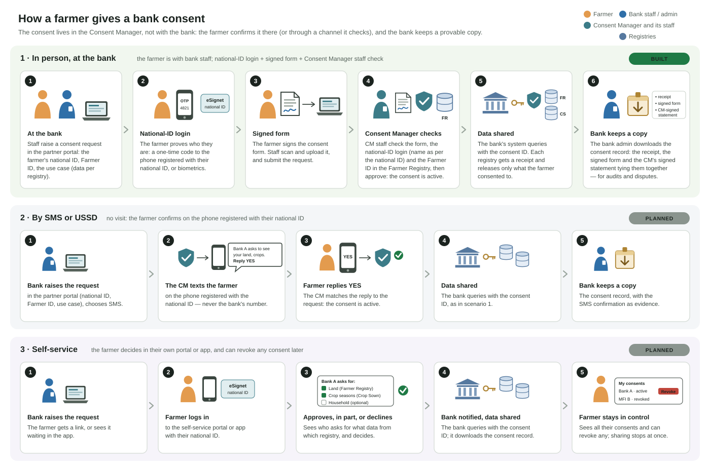

# Consent collection

A partner (e.g. a bank) needs a subject's (e.g. a farmer's) consent before it can receive the subject's data from registries. **Seeking** (the partner asks) and **giving** (the subject agrees) both go through the Consent Manager (CM), so that the consent is evidence the CM holds, not a claim the partner makes.


**Roles, as everywhere in OpenG2P:** *staff* (government users), *agents* (government field users), *partners* (organisations such as banks, onboarded in Partner Management), *beneficiaries* (subjects, e.g. farmers). A partner's own employees using the partner portal are **partner users**.


<figure><figcaption>
The three consent scenarios
</figcaption></figure>

## Principle

**The subject's confirmation happens at the CM, or through a channel the CM verifies, never on the partner's word.** The CM records how the subject confirmed (the **assurance**), and a policy can demand a minimum assurance for a purpose.

## Scenarios

### 1. In person, assisted (subject at the partner's office, or the partner's user in the field)

1. A partner user creates the consent request in the partner portal: the use case (or purpose and registries), the subject's ID, the validity.
2. The subject is authenticated on the spot through national ID (e.g. Fayda): OTP to the phone registered with the ID, or biometrics. The CM records the authentication (provider, method, time).
3. The subject signs a consent form; the partner user uploads it as evidence.
4. Staff check the uploaded form (it matches the subject and the request) and verify it. Only then is the consent active.

### 2. Confirmation by SMS or USSD

As scenario 1, but instead of (or as well as) the signed form, the CM sends the subject an SMS ("Bank X asks to see … — reply YES to agree") or a USSD prompt; the subject replies to a trusted number. The reply approves the request with no staff step. **The phone number must be the subject's own**, taken from the national ID or the registry, never from the partner.

### 3. Self-service

The subject logs in to a self-service portal or app (national ID login), sees the pending request (who asks, for what, which data from which registry), and approves (all or part) or declines. The same place lists the subject's consents and lets them revoke any.

## What the CM has today

| Capability | Status |
| --- | --- |
| Consent request (subject, partner, purpose, grants per registry and scopes, validity) | **Built** (`POST /consent/v1/consent-requests`; staff or service callers) |
| Subject authentication: an OIDC ID token, checked against the identity provider's JWKS; the token's subject must be the request's subject; provider, method (`amr`) and time recorded | **Built** (`…/authenticate`) |
| Approve (per registry) or deny; a consent record (`originated`) with its signed receipt | **Built** |
| Subject's own consents and revocation | **Built** (`/consent/v1/my/…`) |
| Subject-facing pages: a consent request page and "my consents" | **Built**, but they log in through the staff Keycloak, not national ID |
| Partner-signed consent presented in each query, checked at `/validate` | **Built** (the path in use today; see the gap below) |
| **Scenario 1, phase 1:** partner portal and partner realm; requests by partner users, signed-form upload (evidence in object storage), submit, staff verification in the CM console, consents with assurance and receipts; `/validate` by `consent_id` (receipts in an exchange deployment); the composite accepts `message.consent_id` | **Built** ([deployment](../deployment/README.md#partner-portal-and-consent-evidence-optional)) |
| **Scenario 1, phase 2:** the subject's national-ID login (eSignet: OTP or biometrics) from the partner portal, matched to the request's subject; mandatory when on, together with the signed form and the staff check | **Built** ([how it works](#national-id-authentication-in-the-partner-portal), [deployment](../deployment/README.md#national-id-authentication-of-the-subject-esignet)) |

## Gaps

| Gap | Scenarios | Notes |
| --- | --- | --- |
| ~~A consent the subject gave cannot be used in a query~~ | all | **Done** in an exchange deployment (`/validate` with `consent_id` issues registry receipts; registries unchanged). To do: a single install (no exchange CM). |
| **Partner-signed consent proves nothing about the subject.** The CM checks the partner's signature, its policy, the subject in the consent against the subject in the request, validity and replay; nothing shows the subject took part | today's path | Keep it only for partners trusted to collect consent offline, clearly marked, or retire it. |
| ~~**National ID authentication**~~ for the subject on a partner user's device | 1 | **Done** for scenario 1 (eSignet). To do: scenario 3 (the subject's own login on the self-service pages). |
| ~~Evidence~~ (signed form on a request) | 1 | **Done** (bucket `consent-evidence`). To do: encryption at rest beyond the store's, retention and deletion rules. |
| ~~Staff verification~~ of assisted consents | 1 | **Done** in the CM console (Consent verifications). To do: optionally through an AWE task. |
| **Assurance** on each consent | all | **Recorded** (method, evidence, verifier, whether the subject was authenticated). To do: a minimum assurance per policy. |
| ~~Partner access~~ | 1, 2 | **Done**: partner realm and the partner-portal API. To do: partner user management from the portal (staff create users today), a partner-signed API for partners with their own systems. |
| **SMS / USSD**: sending the prompt, and an inbound webhook that matches the reply to the request | 2 | Through the platform's notification service (Novu) or the national SMS gateway. |
| **Back to the partner**: redirect to the partner's app with the consent ID, or a notification, when the subject approves | 3 | |

## National ID authentication in the partner portal

When it is on, every assisted request needs **three** things before the consent is active: the subject's national-ID login, the signed form, and a CM staff member's verification. The design is the registry's beneficiary authentication for credentials, with the CM's own code.

1. The partner user opens the request and chooses **Authenticate with national ID**. The CM starts a login at eSignet: authorization code with PKCE, a single-use `state` and a `nonce`, `acr_values` (e.g. a one-time code), and the `individual_id` claim (the national ID; eSignet's `sub` is pairwise, so it cannot be compared). The request's subject ID type must be a national ID type (e.g. `FAYDA_FAN`).
2. eSignet opens in a popup. The person logs in there (the OTP goes to the phone registered with their ID), on the partner user's device or their own.
3. eSignet redirects to the CM's callback on the portal host. The CM claims the `state` once (an atomic update, so a replayed or concurrent callback finds nothing), exchanges the code with `private_key_jwt`, and checks the ID token's signature (eSignet's JWKS), `iss`, `aud`, `exp` and `nonce`. It reads the userinfo straight from eSignet over HTTPS with the access token, which is what makes it authentic (OIDC Core 5.3.2): eSignet passes on the identity system's signed answer, with that system's key (not published by eSignet) and its own `iss`, so the signature is checked only when the key is one eSignet publishes; its `aud` must be this client and its `sub` the ID token's (the same pairwise ID). The `individual_id` must equal the request's subject ID.
4. The portal follows the result (polling) and shows it; **Submit** is possible only after a successful login and the signed-form upload.
5. Staff see the authentication on the verification page. On approval the consent's **assurance** records it: `subject_authenticated: true` and `subject_authentication` (provider, method, ACR, time).

Stored: the method, ACR, time, the ID token's hash and the configured claims (default the name); not the tokens. Login state is a row in the CM's database (5 minutes), so no cache is needed.

## Identifiers and demographics

**The consent is about the person, keyed by the national ID.** The subject proves they own it by the national-ID login (an exact match of `individual_id`), and that is the subject ID of the request and the consent.

**Other identifiers of the subject** (e.g. the **Farmer ID** in Agri Stack) are carried with the request and everything made from it: the partner portal's request and consent pages, the staff verification page, the consent, and the partner's consent record. A deployment lists the ones every request must carry (`partnerPortal.requiredSubjectIdentifiers`, e.g. `[FARMER_ID]`); a request without them is refused. The CM does not look them up: **the approver checks them in the registry** (the registry is the source of truth for the link between the national ID and, e.g., the Farmer ID) and ticks that they did; approval is refused otherwise, and the consent's assurance records it (who, when). The consent receipt is unchanged.

**Identifiers decide; demographics never do.** Names and dates of birth differ between the national ID, the registry and a paper form (spelling, transliteration, script, outdated records), so they are never compared automatically and never block anything. The demographics shown are those the identity provider returned at the login (e.g. the name **as per the national ID**), always labelled with their source, **not** the registry's record; they help the approver judge the signed form. The registry stays the source of truth for the subject's data.

## The partner's copy of a consent

For disputes and audits a partner keeps its own copy. On a consent in the partner portal, **Download consent record** gives one ZIP:

| File | What it is |
| --- | --- |
| `consent-receipt.json` | The consent receipt as the CM issued it. **Unchanged**: the record only adds files around it |
| `evidence/…` | The documents uploaded on the request (the subject's signed form) |
| `consent-record.jws` | A statement signed by the CM (same key and public JWKS as the receipts) that ties them together: the consent, the SHA-256 of the receipt and of each document, whether and how the subject authenticated with national ID (provider, method, time), and when the CM verified the evidence |
| `consent-record.json` | The same statement, readable |
| `summary.html` | A printable one-page summary |
| `cm-jwks.json`, `README.txt` | The CM's public key at download time, and how to check the record |

With it a partner can show, without the CM, that this exact signed form backed this consent: check the statement's signature against the CM's published JWKS, then the files' SHA-256 values. The staff member who verified is not named (only the time); that stays in the CM's audit trail. The statement is signed when the record is downloaded; the facts in it are those recorded at approval. If a stored document no longer matches the SHA-256 recorded at upload, the download is refused.

## Partner portal

Most partners will not build their own consent screens, so a central **partner portal** is the main way in; partners with their own systems use the same APIs.

* **Consent (backed by the CM):** create a request (pick a use case or purpose, enter the subject's ID, choose how the subject confirms: in person with national ID and an optional signed form, SMS, or a link to self-service); follow requests by status; list consents with their ID, scopes, validity, assurance and status (including revocations by the subject), and download receipts and the [consent record](#the-partners-copy-of-a-consent).
* **Their access (read-only):** what the partner may use and the data it returns, and its query history (in Agri Stack, from the use-case composite).
* **Administration:** a partner admin manages the partner's own portal users (roles: *operator*, who creates requests and runs in-person consent; *partner admin*, who also sees all the partner's consents and manages users).
* **Not in the portal:** partner policies, keys (approved in Partner Management by staff; at most shown read-only) and the verification of uploaded forms (staff, in the CM console through AWE).

**Ownership:** the consent logic and its evidence (requests, authentication records, uploaded files, verification, the consent and its revocation) belong to the CM, files in the CM's object store bucket. The portal is a partner-facing front end over the CM's APIs (and, in Agri Stack, the composite's); Partner Management needs no partner-facing UI.

## Order of work

1. Presenting a stored consent by its ID at `/validate` (and receipts from it in an exchange deployment).
2. Scenario 1: partner portal and partner users, request creation, national ID authentication, evidence upload, staff verification, assurance.
3. Scenario 3: national ID login on the subject pages, redirect back to the partner.
4. Scenario 2: SMS / USSD prompts and replies.
