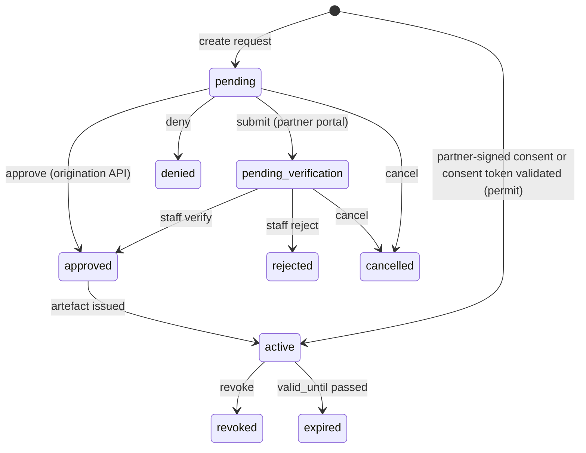

# Consent lifecycle

The **secondary** flow covers consent that the Consent Manager (CM) collects itself, rather than one a partner signed. Revocation and expiry apply to every consent, however it was made.

There are two ways to originate a consent:

* **The partner portal** (assisted, in person): a partner user raises the request, uploads the subject's signed form (and, if required, the subject logs in with national ID), and CM staff verify it. See [Consent collection](consent-collection.md).
* **The origination API**, below: a client creates the request, the subject authenticates with an OIDC provider and approves. It runs on the beneficiary API, which is off by default. Endpoints: [Consent Lifecycle API](../api/consent-lifecycle-api.md).

## Origination

```mermaid
sequenceDiagram
  participant App as Subject app / client
  participant CM as Consent Manager
  participant IdP as OIDC Provider

  App->>CM: POST /consent-requests {subject, partner, scopes or grants, purpose}
  CM-->>App: request (status=pending)
  App->>IdP: subject authenticates (OTP / biometric)
  IdP-->>App: ID token
  App->>CM: POST /consent-requests/{id}/authenticate {id_token}
  CM->>IdP: JWKS; check signature and claims
  CM->>CM: AuthContext (token hash, claims)
  App->>CM: POST /consent-requests/{id}/approve {granted_scopes or grants}
  CM->>CM: effective = granted ∩ policy; artefact (active) + signed receipt
  CM-->>App: the consent
```

1. **Create request** — names the subject, the partner (its audience), the purpose, and the scopes for one registry or a **grant per registry**. Each grant is checked against the partner's policy for that registry in Partner Management, so an impossible request is refused at once. A CM in the Exchange role takes requests **by use case** instead, checked against the partner's policy for that use case.
2. **Authenticate** — the subject's ID token is checked against the identity provider's JWKS (`iss`, `aud`, `exp`); the token's subject must be the request's. Only the token's **hash** and claims are kept, in an `AuthContext` ([Security & trust](security-and-trust.md#id-token-validation-origination)).
3. **Approve** — the subject grants all or part of the requested scopes; for a grants request, per registry, and may decline a registry. Each grant is narrowed to the partner's current policy. The CM stores the artefact (`source = originated`, `active`) and signs its receipt.
4. **Deny** — the request becomes `denied`. No artefact or receipt is created.

Rules:

* An artefact is created only on approval, and its receipt with it.
* The granted scopes never exceed the policy.
* Approval needs an `AuthContext`: the subject must have authenticated.
* An originated consent is used at `/validate` by its `consent_id`, or found by lookup when the partner sends none ([Verification & enforcement](verification-and-enforcement.md#a-consent-the-cm-holds)).

## Revocation

An active consent can be revoked at any time. **Today, staff revoke it on the subject's request:** the subject asks the organisation operating the CM (the receipt's [withdrawal method](data-model.md#consent-receipt-kantara-iso-27560)), and an approver or admin revokes it from the console's consent page, with a reason (`POST /consents/{id}/revocations`, [staff API](../api/README.md#consents-console-consent-page)). Self-service revocation by the subject is planned with the self-service portal ([scenario 3](consent-collection.md#3-self-service-not-built-yet)); the beneficiary API, off by default, already serves it (`/my/consents/{id}/revoke`), as well as revocation by the controller or partner (`/consents/{id}/revoke`).

* The artefact moves to `revoked` and a `RevocationRecord` is written (who asked, the reason and, for staff, who revoked it); earlier timestamps are kept.
* The next `/validate` on it is denied `revoked`. An enforcement point that caches decisions checks `GET /consent/v1/consents/{id}/status`.
* Revocation is per artefact. A partner-signed consent validated by two registries has one artefact per registry, so revoking one leaves the other in force.
* An Exchange issues no new consent token for a revoked consent; tokens already issued lapse within their lifetime ([Exchange consent tokens](exchange-consent-tokens.md#why-a-consent-token)).

## Expiry

A CronJob (every 15 minutes by default) marks active artefacts past `valid_until` as `expired` and stamps `expired_at`. `/validate` also checks validity itself, so an expired consent is denied `expired` even before the job runs.

## State machine



Every decision is recorded in the decision log.
