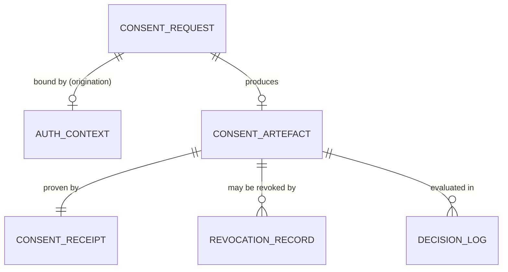

# Data model

The Consent Manager keeps two kinds of structures:

* **Stored entities** — the records it owns (consent requests, artefacts, receipts, logs).
  Partners and policies live in Partner Management: records name the partner by its **audience**
  (e.g. `bank-a`) and the policy applied by `policy_ref` (`data_controller:farmer-registry` or
  `use_case:loan-profile@1`), `policy_version` and `policy_id` (PM's id of that version).
* **Exchanged documents** — JSON-LD documents passed in and out: the consent object a partner
  signs, and the artefact and receipt the CM issues. (The origination flow also takes a standard
  OIDC ID token; the CM keeps only its hash and claims, in the AuthContext.)

Status changes only add: a new status and timestamp are written, earlier timestamps are kept, and
the decision log is never changed.

## Entity overview



### ConsentArtefact (CM-issued, canonical)

The consent as the CM stores it. A **partner-signed** consent yields **one artefact per (`jti`,
`data_controller`)**: validated by two registries, it has two artefacts and two receipts, each
revocable on its own. An **originated** consent yields one artefact per approved request, holding
the approved grants. A department CM stores one per accepted **consent token**.

| Field | Type | Notes |
| --- | --- | --- |
| consent_id | UUID | Primary key |
| subject_id_type / subject_id_value | str | The data subject |
| subject_identifiers | json | The subject's other identifiers recorded with the consent, `[{type, value}]` (e.g. the `FARMER_ID` the partner portal records); a lookup or subject check may match any of them |
| controller_id | str | Data controller (registry). Null for an originated consent with several approved grants |
| partner_id | str | The partner the consent was given to: its audience (e.g. `bank-a`) |
| purpose | json | `{code, text}` |
| data_scopes | list[str] | Consented fields for this controller's grant (pre-policy-intersection) |
| effective_data_scopes | list[str] | `data_scopes ∩ policy.allowed_data_scopes` at issue time |
| grants | json | Originated consents only: `[{data_controller, data_scopes, granted_scopes, effective_data_scopes, policy_version, policy_id, policy_ref}]` |
| object_jti | str | The partner-signed consent's (or consent token's) `jti`; unique together with `controller_id` |
| valid_from / valid_until | datetime | |
| fetch_type | enum | `oneshot`, `periodic` |
| auth_context_id | UUID | FK → AuthContext (origination flow); null otherwise |
| source | enum | `embedded` (partner-signed), `originated` (collected by the CM) or `receipt` (a consent token, department role) |
| assurance | json | Originated consents: how the subject confirmed (method, evidence, verifier, national-ID authentication) |
| consent_request_id | UUID | The request it was made from (originated) |
| policy_version | int | Version of the partner's policy in Partner Management evaluated at issue |
| policy_id | str | PM's id of that policy version |
| policy_ref | str | The policy's key, `kind:key`: `data_controller:farmer-registry` or `use_case:loan-profile@1`. On an originated consent with several grants, set only when all grants share one policy (a consent by use case) |
| use_case | str | Exchange role: the use case (`name@major`) the consent serves — a consent made by use case, or a partner-signed one validated in use-case mode. Null otherwise |
| status | enum | `active`, `revoked`, `expired` |
| created_at / revoked_at / expired_at | datetime | Append-only |

**Lookup indexes.** They serve consent by lookup with one index
range per request, whatever the number of consents:

* `ix_consent_artefacts_lookup`, partial on `status = 'active'` (`partner_id`, `subject_id_type`, `subject_id_value`, `use_case`,
  `valid_until DESC`) — [with a use case](verification-and-enforcement.md#use-case-mode);
* `ix_consent_artefacts_controller_lookup`, partial likewise (`partner_id`, `subject_id_type`, `subject_id_value`,
  `controller_id`, `valid_until DESC`) —
  [at a registry](verification-and-enforcement.md#consent-by-lookup-at-a-registry). An originated
  consent with several grants (no `controller_id`) is matched on its `grants` within the same
  (partner, subject) range;
* `ix_consent_artefacts_subject_identifiers`, GIN (`jsonb_path_ops`) on `subject_identifiers`
  (not partial) — a lookup by one of the subject's other identifiers
  (`subject_identifiers @> [{"type", "value"}]`).

### AuthContext

Created after the CM validates an ID token (origination API) or a national-ID login (partner portal). The raw token is **never** stored, only its hash.

| Field | Type | Notes |
| --- | --- | --- |
| auth_context_id | UUID | Primary key |
| consent_request_id | UUID | FK → ConsentRequest |
| auth_provider | str | e.g. `keycloak` |
| auth_method | str | `otp`, `biometric`, … (from `amr`) |
| auth_timestamp | datetime | |
| issuer | str | `iss` |
| id_token_hash | str | `sha256:…` |
| token_validated | bool | |
| verified_claims | json | `iss, sub, aud, amr, iat, exp, auth_time, kid` |

### ConsentReceipt

Kantara / ISO 27560-aligned, **signed with the CM's own `.p12` key**. Anyone can verify it against
the CM's `GET /.well-known/jwks.json`, without Partner Management. Document: [below](#consent-receipt-kantara-iso-27560).

| Field | Type | Notes |
| --- | --- | --- |
| receipt_id | UUID | Primary key |
| consent_id | UUID | FK → ConsentArtefact |
| artefact_hash | str | `sha256:…` over the canonical artefact |
| algorithm | enum | `EdDSA` (ed25519), `ES256`, or `RS256` — the CM `.p12` key's alg |
| kid | str | CM key id used to sign |
| signature | text | base64url signature over the artefact hash |
| version | str | Receipt schema version |
| issued_at | datetime | |

### Other entities

| Entity | Key fields |
| --- | --- |
| **ConsentRequest** (origination, partner portal) | id, subject, subject_identifiers, controller_id (null when several grants), partner_id (the partner's audience), requested_scopes (union), grants (`[{data_controller, data_scopes, policy_version, policy_id, policy_ref}]` or null), use_case, purpose, validity, method (`assisted`), status (`pending`, `pending_verification`, `approved`, `denied`, `rejected`, `cancelled`, `expired`), verification (who, when, note), timestamps |
| **ConsentEvidence** (partner portal) | id, consent_request_id, kind (signed form), filename, content type, size, sha256, storage key (object store), uploaded by/at |
| **SubjectAuthSession** (partner portal) | A national-ID login in progress: state, nonce, PKCE verifier, status, expiry (5 minutes), the resulting auth context |
| **RevocationRecord** | revocation_id, consent_id, originated_by (`subject`/`controller`/`partner`), reason, created_at |
| **DecisionLog** (immutable) | id, consent_id (null on most denials), partner_id (the partner's audience, when known), object_jti, data_controller (when known), request_ctx_hash, decision, reason_code, detail, policy_version / policy_id / policy_ref (null when no policy was read), receipt_jti / receipt_issuer (decisions on a consent token), created_at |
| **IssuedReceipt** (exchange role) | A consent token issued: jti, consent_id (the artefact it was issued from), data_controller, presenter, partner, expires_at — see [Exchange consent tokens](exchange-receipts.md) |

---

## Exchanged documents (JSON-LD)

### Consent object (partner-signed)

A partner that collects consent in its own system **signs this as a compact JWS** (RFC 7515) and
embeds it in the registry request; the CM accepts it only if the partner's policy sets
`allow_partner_consents`. The claims below are the **JWS payload**; the protected header carries
`alg` and `kid`. The CM verifies the signature with the partner's key from Partner Management.
`jti` and `issued_at` give replay protection.

The data to share is given as **`grants`**, one per registry. The single-registry form
(`data_controller` + `data_scopes` at the top level) is accepted as one grant; a consent may not
mix the two.

```json
// JWS payload (claims). Wire form: base64url(header).base64url(payload).base64url(signature)
{
  "@context": "https://openg2p.org/contexts/consent_object.jsonld",
  "@type": "ConsentObject",
  "jti": "b2f1...-unique-per-object",
  "subject_id": { "type": "national_id", "value": "FARMER_1234" },
  "aud": "bank-a",
  "purpose": { "code": "share_farm_profile", "text": "Share farmer profile with Partner A" },
  "grants": [
    { "data_controller": "farmer-registry",
      "data_scopes": ["farmer-registry.personal_details", "farmer-registry.main_crops", "farmer-registry.land"] },
    { "data_controller": "crop-sown-registry",
      "data_scopes": ["crop-sown-registry.crop_season", "crop-sown-registry.measures"] }
  ],
  "fetch_type": "oneshot",
  "validity": { "valid_from": "2025-05-01T12:00:00Z", "valid_until": "2026-05-01T12:00:00Z" },
  "issued_at": "2025-05-01T11:59:50Z"
}
```

There is no inline `signature` field — the JWS wrapper carries it (header `alg`/`kid` + the signature segment).

### Consent Artefact

The canonical document the receipt's hash covers.

```json
{
  "@context": "https://openg2p.org/contexts/consent_artefact.jsonld",
  "@type": "ConsentArtefact",
  "consent_id": "5b0e…",
  "subject_id": "FARMER_1234",
  "subject_id_type": "national_id",
  "data_controller": "farmer-registry",
  "partner_id": "bank-a",
  "source": "embedded",
  "purpose": { "code": "share_farm_profile", "text": "Share farmer profile with Partner A" },
  "data_scopes": ["farmer-registry.personal_details", "farmer-registry.main_crops", "farmer-registry.land"],
  "effective_data_scopes": ["farmer-registry.personal_details", "farmer-registry.main_crops"],
  "fetch_type": "oneshot",
  "policy_version": 3,
  "validity": { "consent_timestamp": "2025-05-01T12:00:00+00:00", "expiry_timestamp": "2026-05-01T12:00:00+00:00" }
}
```

> This is the Farmer Registry's artefact for the consent above: its grant only.
> `effective_data_scopes` leaves out `farmer-registry.land` because the partner's policy for this
> registry does not allow it. An originated consent with several approved grants carries them
> under `grants` instead.

### Consent Receipt (Kantara / ISO 27560)

Created with the artefact and **signed with the CM's own `.p12` key**: proof of the consent for
the subject, audits and disputes. The controller's name, contact and DPO, retention and
jurisdiction are not filled in yet.

```json
{
  "@context": "https://openg2p.org/contexts/consent_receipt.jsonld",
  "@type": "ConsentReceipt",
  "version": "1.1",
  "issued_at": "2025-05-01T12:02:12+00:00",
  "data_controller": { "id": "farmer-registry" },
  "data_controllers": [ { "id": "farmer-registry" } ],
  "subject_id": "FARMER_1234",
  "purposes": [
    { "code": "share_farm_profile", "text": "Share farmer profile with Partner A",
      "legal_basis": "consent",
      "data_categories": ["farmer-registry.personal_details", "farmer-registry.main_crops"] }
  ],
  "data_categories": ["farmer-registry.personal_details", "farmer-registry.main_crops"],
  "third_parties": ["bank-a"],
  "withdrawal": { "method": "POST /consent/v1/consents/5b0e…/revoke" },
  "consent_artefact": { "@id": "5b0e…", "hash": "sha256:7b0a933e7cd398a…" },
  "signature": {
    "algorithm": "EdDSA", "kid": "cm-2025-01",
    "value": "BASE64URL(cm_private_key.sign(artefact_hash))"
  }
}
```

The receipt is stored with its own `receipt_id`, which `/validate` returns and
[`GET /consent/v1/receipts/{receipt_id}`](../api/verification-api.md) serves.
`data_controllers` lists every controller the receipt covers: the one controller for an embedded
consent (one receipt per registry), or one entry per approved grant — `{id, data_categories}` —
for an originated consent with grants, where `data_controller` is null if there are several.

