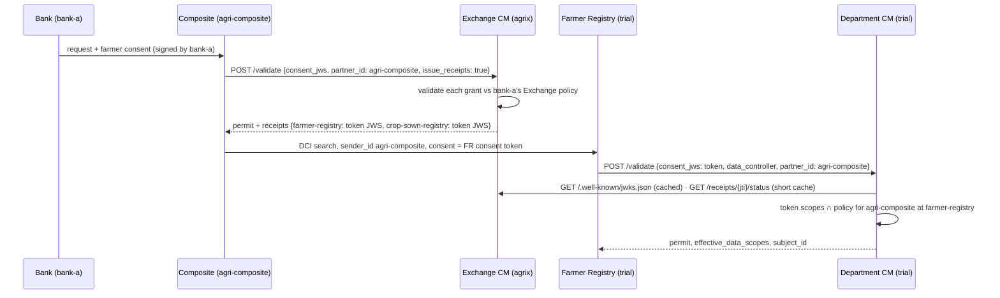

# Exchange consent tokens (Agri Stack Exchange)

In [Agri Stack across departments](../../open-agri-stack/architecture/README.md#across-departments)
a partner (e.g. a bank) onboards and the farmer consents **only at the Exchange** (the data exchange layer, `agrix`), while
each department registry (`trial`, `dept1`) still decides at its own boundary through its own Consent
Manager. The link between the two is a **consent token** (called *receipt* in the API and settings):
a short-lived JWS the Exchange CM signs for one registry and one query, which the department CM
verifies and evaluates against its own policy. It is not the long-lived
[consent receipt](data-model.md#consent-receipt-kantara-iso-27560) document (Kantara / ISO 27560)
the CM keeps as the record of a consent (all four terms side by side: [key terms](README.md#key-terms)).

Everything here is **opt-in and off by default**. With the settings empty — every standalone
install — no new code path runs, `/validate` behaves exactly as before, and the Helm chart renders
the same manifests. API changes are additive only (an optional request field, an optional response
field, a new status endpoint, new reason codes).

## Why a consent token

The partner's consent and its data-share policy are held at the Exchange, but each department must decide for itself what leaves its registry. Without a token there are two ways to connect them, and both fall short:

| Option | Problem |
| --- | --- |
| **Pass the partner's whole consent to every registry** | Each registry must hold the partner as its own partner (key, binding, policy), so the partner onboards at every department. Each registry also sees the whole consent, including grants for other departments' data. |
| **Let each registry ask the Exchange CM per request** | Every department depends on the Exchange's live answer, and keeps nothing signed as proof of why it released the data. |

A consent token avoids both. The Exchange CM checks the partner's policy and the subject's consent once, then signs a short note for **one** registry and **one** query, with only the scopes allowed there. The registry's own CM verifies the signature, checks the token is addressed to it and presented by the named caller (the Composite), checks it has not been revoked, and applies its own standing policy. So:

* each department stays sovereign and sees only what concerns it;
* the partner onboards once, at the Exchange;
* a token is useless to anyone else, expires within minutes, and stops working as soon as the consent is revoked;
* the registry keeps a signed record of why it released the data.

## Two roles, one codebase

| Role | Install | Configured by | What it does |
| --- | --- | --- | --- |
| **Exchange CM** | `agrix` | `receipt_issuer` + `receipt_presenters` | Validates the partner's consent as usual and, when a configured **presenter** (the Composite, `agri-composite`) asks with `issue_receipts: true`, signs one consent token per registry. Serves the tokens' status. |
| **Department CM** | `trial`, `csr` | `trusted_receipt_issuers` | Accepts a consent token from a trusted issuer on `/validate`, checks it, applies its **standing policy for the presenter**, and returns its normal decision to the registry. |

The registry is unchanged: it calls its **own** CM `/validate` with the consent JWS it received (now
a consent token), its `data_controller`, and the DCI `sender_id` as `partner_id` — as it always has.

## Consent token

A compact JWS signed with the CM's **existing receipt-signing key** — the same key, `kid` and
algorithm as its [Kantara receipts](data-model.md#consent-receipt-kantara-iso-27560), published at
`/.well-known/jwks.json` on the partner API.

**Header:** `{"alg": "<EdDSA|ES256|RS256>", "kid": "<CM kid>", "typ": "consent-receipt+jwt"}`

| Claim | Meaning |
| --- | --- |
| `iss` | The Exchange CM's issuer ID (`receipt_issuer`, e.g. `agri-stack-exchange-cm`) |
| `jti` | Token ID (UUID) — the key for its status |
| `consent_id` | The Exchange CM's consent artefact for this registry |
| `aud` | The data controller the token is for (e.g. `farmer-registry`) |
| `presenter` | Who may present it — the caller that asked for it (e.g. `agri-composite`) |
| `partner` | The partner that obtained the consent (the consent's `aud`, e.g. `bank-a`) |
| `sub` | The subject, `{"type": "FAYDA_FAN", "value": "…"}` — same shape as the consent's `subject_id` |
| `purpose` | Purpose code |
| `scopes` | Data scope IDs for this registry: the consent's grant ∩ the Exchange policy for the partner |
| `consent_issued_at` | When the farmer's consent was issued (ISO-8601). Registries use it as "consent time" for data-scope versions |
| `consent_exp` | Consent expiry (epoch seconds) |
| `iat`, `nbf`, `exp` | Token times (epoch seconds); `exp` = min(consent expiry, now + `receipt_ttl_seconds`, default 900) |

> `sub` is an object, as the spec requires, so a generic RFC 7519 JWT validator (which wants a
> string `sub`) rejects it. Verify a consent token at the **JWS** level (signature with the JWKS
> key), then read the claims — as the department CM does.

## Exchange role: issuing

`POST /consent/v1/validate` with `issue_receipts: true`:

1. **Caller check** — the request's `partner_id` must be in `receipt_presenters` and `receipt_issuer`
   must be set; otherwise the decision is `deny` / `receipt_presenter_not_allowed`. The partner API
   has no Keycloak (transport is Istio mTLS), so — as for every partner-API call — the caller is
   identified by the `partner_id` it sends. That value becomes the token's `presenter`, which the
   department CM then matches against the `sender_id` the registry verified on the signed DCI
   request: a consent token is only usable by the presenter it was issued to.
2. **Validation** — each granted controller (or only `data_controller`, if sent) is validated
   exactly as a registry's call would be: signature via Partner Management, the partner's binding and
   policy for that controller, replay, validity. Each writes its artefact and decision log as usual.
3. **Consent tokens** — if every controller permits, one token per controller is signed and recorded
   (`issued_receipts`), and the response carries `receipts: {data_controller: JWS}`. If any
   controller denies, that deny is returned and **no** tokens are issued.

**Status** — `GET /consent/v1/receipts/{jti}/status` → `active | revoked | expired`. A consent token
is `revoked` when its consent artefact is revoked (per registry: revoking the farmer-registry consent
revokes only that token), `expired` after its `exp` or when its consent expires. Auth follows the
partner API (no Keycloak; the jti is an unguessable UUID and the answer is only the status).

## Department role: accepting

When `/validate` receives a JWS whose header `typ` is `consent-receipt+jwt`:

1. **Issuer** — `iss` must be in `trusted_receipt_issuers`; otherwise deny
   `receipt_issuer_not_trusted` (also when no issuers are configured — a consent token is never
   accepted by default).
2. **Signature** — verified against the issuer's JWKS (cached `receipt_jwks_cache_ttl_seconds`,
   refetched — throttled — when the `kid` is unknown, so a key rotation is picked up at once). A bad
   signature, `alg` mismatch or missing claims → `receipt_invalid`.
3. **Audience, presenter, time** — `aud` must equal `data_controller` (`audience_mismatch`);
   `presenter` must equal the caller's `partner_id` (the registry's DCI `sender_id`) and the trusted
   issuer's configured `presenter`, if set (`presenter_mismatch`); `nbf`/`exp` (`expired`, 30 s
   clock leeway on `nbf`).
4. **Status** (`receipt_status_check: always`, the default) — `GET` the token's status at the
   issuer (cached `receipt_status_cache_ttl_seconds`, default 10 s). `revoked`/`expired` deny with
   that reason; unreachable → `receipt_status_unavailable` (fail closed).
5. **Standing policy** — this CM's binding for **audience = presenter** at this controller and its
   active policy (none → `unknown_partner`). Subject type and purpose must be allowed; validity
   (`consent_issued_at` → `consent_exp`) is checked against `max_validity_duration`; **effective
   scopes = token `scopes` ∩ policy `allowed_data_scopes`** (∩ `requested_scopes`, if sent).
6. **Decision** — the normal response (`permit`/`deny`, `effective_data_scopes`, `subject_id` from
   `sub`, `policy_version`, `consent_id`). A permit mints an artefact (`source: receipt`, valid until
   the token expires) and a Kantara consent receipt as usual; presenting the same token again
   returns the stored decision. Every decision on a consent token — permit or deny — logs
   `receipt_jti` and `receipt_issuer` in the decision log.

The policy's `allowed_signing_algs` governs partner signatures and is not applied to consent tokens
(the Exchange CM's key is trusted through `trusted_receipt_issuers`).

## Setting up a department for the Exchange

1. Choose the department role (Helm `global.agriStackExchange.role: department`, which trusts the
   Exchange CM by default; or set `trustedIssuer` yourself, see
   [Deployment](../deployment/README.md#exchange-optional)).
2. Bind the presenter (`agri-composite`) at this CM **for each registry** it may read, with a policy:
   that policy is the department's standing decision on what the Exchange may receive.
3. The registry needs no change beyond accepting the presenter as a DCI sender.
