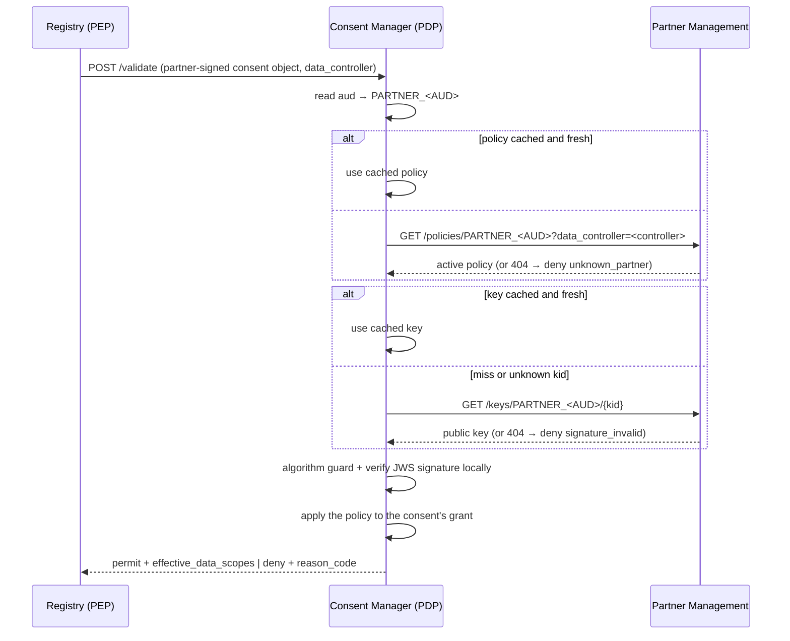

# Partner Management integration (keys and policies)

The Consent Manager (CM) keeps no partner records. **Partner Management (PM)** owns who a partner is,
its signing keys and its **access policies** (what it may ask for). The CM reads keys and policies
from PM when it needs them and owns only the **consent**: consents and consent requests, the
decision at `/validate`, receipts and consent tokens.

## Who owns what

| Concern | Owner | Where it is managed |
| --- | --- | --- |
| Partner identity, organisation, status | PM | PM staff UI and API |
| Partner signing keys | PM | PM (onboarding and key-update requests) |
| Access policies (scopes, use cases, purposes, validity, …) | PM | PM (onboarding and policy requests, approved in PM) |
| Consents, consent requests, assisted-consent verification | CM | CM console and partner portal |
| The decision at `/validate`, receipts, consent tokens | CM | — (computed per request) |

Why policies live in PM:

* **A policy describes the partner agreement**, which belongs with the partner. Onboarding, key and
  policy changes are approved in one place, through PM's request-and-approve flow.
* **Several modules read the same policies.** The CM, the Composite and the registries all use the
  partner's policies from PM, so there is no copy to keep in step.
* **The CM stays a verifier.** It checks consent against a policy; it does not govern the policy.

The CM is **not** a PM partner: it signs receipts and consent tokens with its own `.p12` key and
publishes the public half at `/.well-known/jwks.json` ([Security & trust](security-and-trust.md)).

The policy model — scope policies and use-case policies, their fields, versions and statuses, and how
changes are requested and approved — is documented by PM:
[Access policies](../../platform/platform-services/partner-management/functional-specifications.md#access-policies).
For how an Agri Stack deployment uses them (use-case grants at the Exchange, the Composite's ceiling
in each department) see [Data-sharing policies](../../open-agri-stack/architecture/data-sharing-policies.md).

## Partner ID convention

A partner signs its consents with its **audience** (`aud`, the same value as its DCI `sender_id`,
e.g. `bank-a`). Its PM partner ID follows by convention: upper-case, `-` → `_`, prefix `PARTNER_`.

```
bank-a          → PARTNER_BANK_A
agri-composite  → PARTNER_AGRI_COMPOSITE
```

There is no per-partner override. The CM uses the PM ID for both keys and policies; its own records
(artefacts, consent requests, decision logs, grants) store the **audience** as `partner_id`, with the
`policy_version` that was applied.

## What the CM reads from PM

Both reads go to PM's internal partner API (`CONSENT_MANAGER_PARTNER_MGMT_API_URL`, in-cluster
`http://commons-services-pm-partner-api`), which needs no authentication and is reachable only
inside the cluster. Request and response shapes:
[PM API reference](../../platform/platform-services/partner-management/api-reference.md).

| Read | Call | Used for |
| --- | --- | --- |
| **Key** | `GET {pm}/keys/PARTNER_<AUD>/…` (by the JWS `kid`) | Verifying the signature of a partner's consent object |
| **One policy** | `GET {pm}/policies/PARTNER_<AUD>?data_controller=<controller>` | The partner's **scope policy** for one registry |
| **Use-case policy** | `GET {pm}/policies/PARTNER_<AUD>?data_controller=` (empty) | The partner's **use-case policy** (an Exchange grant, not tied to one registry) |
| **All policies** | `GET {pm}/policies/PARTNER_<AUD>` | The partner portal's "What we can ask for" page (scope policies; at an Exchange, the use-case policy) |

PM returns only **active** policies of an **active** partner. A pending change never affects a
decision; once approved in PM it applies within the cache time below.

### Which policy each check uses

| Situation | Policy read |
| --- | --- |
| A registry validates a consent (`/validate`) | The consenting partner's scope policy for the calling registry (`data_controller`) |
| The Composite validates at the Exchange with `request_context.use_case` ([use-case mode](verification-and-enforcement.md#use-case-mode)) | The consenting partner's use-case policy |
| A department CM accepts a consent token ([Exchange consent tokens](exchange-receipts.md#department-role-accepting)) | The **presenter's** (the Composite's) scope policy for the calling registry |
| A consent request is created or approved (origination, partner portal) | The partner's scope policy for each requested registry; at an Exchange, for a request made by use case, its use-case policy ([consent collection](consent-collection.md#partner-portal)) |

How the CM applies a policy at `/validate` is described in
[Verification & enforcement](verification-and-enforcement.md#how-the-policy-is-applied).

## Caching

Keys and policies change rarely but are read on every `/validate`, so the CM caches both **per pod**,
with the same discipline. The general rules for modules consuming PM are on PM's
[integration page](../../platform/platform-services/partner-management/integration.md).

| Behaviour | Keys | Policies |
| --- | --- | --- |
| **Soft TTL** — reuse without calling PM | `min(TTL, PM max-age)`; PM sends `max-age=300` | per (partner, controller), `min(TTL, PM max-age)`; PM sends `max-age=60` |
| **Hard TTL** — PM unreachable | last answer served up to the hard TTL, then fail closed | same; then deny `policy_unavailable` |
| **Negative cache** — PM `404` | remembered for the negative TTL | remembered for the negative TTL, which is also the wait before retrying after a failed fetch |
| **Unknown `kid`** | rate-limited refresh (catches key rotation) | — |
| **Single flight** | concurrent misses share one call | concurrent misses share one call |

Settings (env prefix `CONSENT_MANAGER_`):

| Setting | Default | |
| --- | --- | --- |
| `PARTNER_MGMT_API_URL` | (chart: `http://commons-services-pm-partner-api`) | PM partner API base URL. Empty = nothing can be fetched and every check fails closed |
| `PARTNER_KEY_CACHE_TTL_SECONDS` | `300` | Key soft TTL |
| `PARTNER_KEY_HARD_TTL_SECONDS` | `21600` | Key hard TTL |
| `PARTNER_KEY_NEGATIVE_TTL_SECONDS` | `30` | Key negative TTL |
| `PARTNER_KEY_REFRESH_COOLDOWN_SECONDS` | `10` | Minimum interval between unknown-`kid` refreshes |
| `PARTNER_KEY_FETCH_TIMEOUT_SECONDS` | `3` | Timeout of one key fetch |
| `PARTNER_POLICY_CACHE_TTL_SECONDS` | `60` | Policy soft TTL: an approved policy change applies within this time |
| `PARTNER_POLICY_HARD_TTL_SECONDS` | `21600` | Policy hard TTL |
| `PARTNER_POLICY_NEGATIVE_TTL_SECONDS` | `30` | Policy negative TTL |
| `PARTNER_POLICY_FETCH_TIMEOUT_SECONDS` | `3` | Timeout of one policy fetch |

The chart sets the policy settings from `global.partnerPolicyCache.*`
([Deployment](../deployment/README.md#partner-management)).

## Failing closed

PM answers `404` with the same body whether the partner is unknown, not active, or has no matching
active policy or key. The CM never treats a missing answer as "skip the check":

| PM answer | Decision |
| --- | --- |
| No active policy for the partner and registry (or no use-case policy) | deny `unknown_partner` |
| No usable key for the JWS `kid` | deny `signature_invalid` |
| PM unreachable and nothing usable cached | deny `policy_unavailable` (retry later) |

## Sequence: validate



The signature check is always local to the CM; PM supplies only the key and the policy.

## Managing partners and policies

Partners, keys and policies are managed in PM's staff UI; the CM console links to it
(**Partners & policies**, chart value `global.partnerManagementUiUrl`). The CM console itself has no
partner pages.
