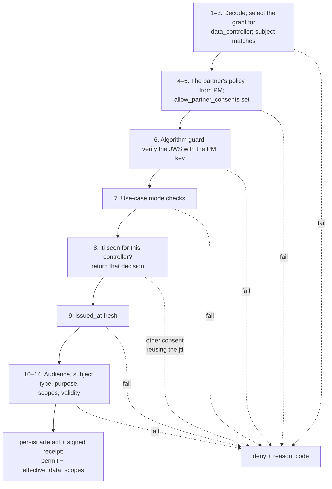

# Verification & enforcement

A partner calls a registry about a person. The registry calls its Consent Manager's `POST /consent/v1/validate`, naming itself as `data_controller`. The CM decides and returns the **effective data scopes**; the registry releases only their fields ([Registry integration](registry-integration.md)). Request and response fields: [Verification API](../api/verification-api.md).

## What a request carries, and how the CM treats it

A registry never decides which kind of consent a caller uses: it passes whatever came with the request, or nothing. There are no partner types; the CM tells the cases apart by the request and by its own settings.

| The request carries | Treated as | Accepted when |
| --- | --- | --- |
| `consent_id` | A consent this CM collected (originated), named by ID | It is the partner's, active, valid now, and has a grant for the caller ([below](#a-consent-the-cm-holds)) |
| No consent | A **lookup** of a consent this CM holds ([at a registry](#consent-by-lookup-at-a-registry); [in use-case mode](#use-case-mode)) | This CM holds an active consent of that partner for that subject and registry (or use case); none → `consent_not_found` |
| A JWS whose header `typ` is `consent-token+jwt` (or the earlier `consent-receipt+jwt`) | A **consent token** from an Exchange ([Exchange consent tokens](exchange-consent-tokens.md#department-role-accepting)) | This CM trusts the token's issuer, and the token's `presenter` is the caller |
| Any other JWS (`consent_jws`) | A **partner-signed consent**: one the partner collected and signed itself | The partner's policy sets `allow_partner_consents`; the [pipeline](#validation-pipeline-partner-signed-consent) passes |

So at a department the Composite presents consent tokens: the farmer's consent is held by the Exchange CM, not the department's, and the Composite's policy there does not allow partner-signed consents. A department's own partners send nothing and rely on the lookup.

**One consent, one grant per registry.** A consent lists a grant per registry (`grants: [{data_controller, data_scopes}]`). Each registry is evaluated **only on its grant**, against the partner's **policy for that registry**. The single-registry form (`data_controller` + `data_scopes`) is accepted as one grant.

## Validation pipeline (partner-signed consent)

The checks run in this order. The first failure is a `deny` with its `reason_code`, and is logged.

| # | Check | Reason code on failure |
| -- | --- | --- |
| 1 | The JWS decodes and its claims match the consent-object schema: exactly one of `grants` or `data_controller` + `data_scopes`, no controller twice | `malformed_object` |
| 2 | Grant selection: a consent with `grants` needs the request's `data_controller` (else `malformed_object`) and a grant for it; a single-registry consent must name the requested `data_controller`, if one is sent | `controller_not_granted` |
| 3 | If `request_context.subject_id` has the consent subject's `type`, its `value` matches (another type is left to the registry) | `subject_mismatch` |
| 4 | Partner Management has an active policy for the partner (`aud` → `PARTNER_<AUD>`): its scope policy for the controller, or in use-case mode its policy for `request_context.use_case`. A `404` fails closed | `unknown_partner` (use-case mode: `use_case_not_granted`); PM unreachable, nothing cached: `policy_unavailable` |
| 5 | The policy sets `allow_partner_consents`: the CM cannot verify that the subject agreed, only the partner's signature | `partner_consent_not_accepted` |
| 6 | The JWS `alg` is in the policy's `allowed_signing_algs` and the CM's allowed set, matches the PM key for the JWS `kid` (algorithm-confusion guard), and the signature verifies | `signature_invalid` |
| 7 | [Use-case mode](#use-case-mode) only: the policy is the use case's; `requested_scopes` is sent; the consent's purpose is `request_context.purpose`, if sent | `use_case_not_granted` / `scope_exceeds_policy` / `purpose_not_allowed` |
| 8 | A `jti` already decided **for this controller** returns that decision (`revoked` or `expired` if the stored consent is), provided it is the same consent (partner, subject, scopes) | `replay` (a different consent reusing the `jti`) |
| 9 | `issued_at` within the freshness window (default ±300 s) | `replay` |
| 10 | `aud` is the partner, and the grant's `data_controller` is the policy's (not in use-case mode) | `audience_mismatch` |
| 11 | The subject's `type` ∈ `allowed_subject_id_types` | `subject_not_allowed` |
| 12 | `purpose.code` ∈ `allowed_purposes` | `purpose_not_allowed` |
| 13 | Effective scopes = the grant's `data_scopes` ∩ the ceiling (∩ `requested_scopes`) is not empty | `scope_exceeds_policy` |
| 14 | `now ∈ [valid_from, valid_until]`, and `valid_until − valid_from ≤ max_validity_duration` | `expired` / `validity_exceeds_policy` |

> **Policy is a ceiling, consent is a request.** The ceiling is the policy's `allowed_data_scopes` for the calling registry; in use-case mode it is `requested_scopes` (the use case's scopes). The effective scopes never exceed it.

The key and the policy come from PM (cached per pod); the signature check itself is always local to the CM ([Partner Management integration](partner-management-integration.md)).

## A consent the CM holds

By `consent_id` (or found by [lookup](#consent-by-lookup-at-a-registry)) there is no signature or freshness check: the CM collected the consent itself. It checks, in order:

| Check | Reason code on failure |
| --- | --- |
| The CM holds a consent with that ID that it collected (`originated`). A lookup also finds partner-signed consents it has already validated | `unknown_consent` |
| Not revoked; not expired; validity started | `revoked` / `expired` / `not_yet_valid` |
| `consent_partner_id` is the partner the consent was given to (a lookup at a registry sets it to the caller) | `partner_mismatch` |
| `request_context.subject_id`, if sent, matches the consent's subject or one of its `subject_identifiers` of that type | `subject_mismatch` |
| The consent has a grant for `data_controller`, if sent | `controller_not_granted` |
| Use-case mode: a consent made for a use case serves only it; the use case's policy, purpose, subject type and validity | `use_case_not_granted`, `purpose_not_allowed`, `subject_not_allowed`, `validity_exceeds_policy` |
| Each grant ∩ the partner's **current** scope policy for that registry (use-case mode: ∩ `requested_scopes`) leaves something. A grant whose registry has no policy is dropped | `scope_exceeds_policy`; PM unreachable: `policy_unavailable` |

## How the policy is applied

A partner has one **scope policy** per registry and, at an Exchange, one **use-case policy** per use case, in Partner Management ([Access policies](../../platform/platform-services/partner-management/functional-specifications.md#access-policies)). The CM reads only the **active** version and records it on every decision, artefact and grant: `policy_ref` (`data_controller:<registry>` or `use_case:<name@major>`), `policy_version`, and `policy_id` (PM's id of that version).

| Policy field | How `/validate` applies it |
| --- | --- |
| `data_controller` | Selects a scope policy: the calling registry's (step 4) |
| `use_case` | Selects a use-case policy (`name@major`) in use-case mode (step 4). Exactly one of `data_controller` / `use_case` is set |
| `allowed_data_scopes` | Ceiling on the effective scopes (step 13). Not in a use-case policy |
| `allowed_purposes` | The consent's `purpose.code` must be listed; empty = any (step 12) |
| `allowed_subject_id_types` | The consent subject's `type` must be listed; empty = any (step 11) |
| `allowed_signing_algs` | The consent JWS `alg` must be listed (step 6). Not applied to consent tokens |
| `allow_partner_consents` | Default false. True: the partner may present a consent it signed itself (step 5). Consents the CM holds and consent tokens do not need it |
| `max_validity_duration` | `valid_until − valid_from` may not exceed it (step 14) |
| `fetch_type` | Default fetch type of a consent the CM collects; recorded on the artefact |
| `max_fetch_frequency`, `data_life` | Not checked by the CM |

Evaluation is **deterministic**: the same consent, policy version and request context give the same decision.

**Data scopes are the registry's.** The CM treats scope IDs (`<controller>.<name>`) as opaque strings. Each registry publishes its catalogue and maps each scope to its fields; an ID it does not know grants nothing. See [Data Scopes](../../products/registry/registry/design/data-scopes.md).

## Use-case mode

At an Exchange, partners are granted **use cases** (e.g. `loan-profile@1`), not registry scopes. The Composite runs the use case and asks the Exchange CM for consent tokens; the CM checks the partner's policy **for that use case**. Each use case has its own policy, so purposes, subject ID types, algorithms and validity can differ per use case.

Use-case mode applies only when **both** hold:

* the caller (`partner_id`) is a configured consent-token presenter (`receipt_presenters`, e.g. `agri-composite`), and
* `request_context.use_case` is sent.

For any other caller `use_case` is ignored. In use-case mode:

1. The CM reads the consenting partner's policy for the use case. None → `use_case_not_granted`.
2. `request_context.requested_scopes` (the use case's scopes) is required, else `scope_exceeds_policy`.
3. If `request_context.purpose` is sent, the consent's `purpose.code` must equal it, else `purpose_not_allowed`.
4. That policy's purposes, subject ID types, signing algorithms and maximum validity apply.
5. For each registry, **effective scopes = the consent's grant ∩ `requested_scopes`**.

A consent made **by use case** (in the Exchange's partner portal or origination API) records its use case and serves only it. A partner-signed consent validated in use-case mode also records the use case.

**Consent by lookup.** The Composite may send no consent. The CM then picks the consent it holds for the partner (`consent_partner_id`), the subject (its main subject or one of its `subject_identifiers`) and the use case: active, valid now, the latest `valid_until` (then the newest). None → `consent_not_found`. It then validates it as [a consent the CM holds](#a-consent-the-cm-holds). An index on (partner, subject, use case) over active consents serves the search.

How the Composite and the departments fit together: [Exchange consent tokens](exchange-consent-tokens.md) and [Data-sharing policies](../../open-agri-stack/architecture/data-sharing-policies.md).

## Consent by lookup at a registry

A registry called directly (no use case) may send no consent: `partner_id`, `data_controller` and `request_context.subject_id`. The CM picks the partner's consent for that subject with a grant for that registry: active, valid now, the latest `valid_until` (then the newest). None → `consent_not_found`. It then validates it as [a consent the CM holds](#a-consent-the-cm-holds). It finds consents collected through the CM and partner-signed consents it has already validated, but not consents given for a use case. An index on (partner, subject, controller) over active consents serves the search.

**Subject matching (both lookups).** `request_context.subject_id` matches the consent's subject or one of its other identifiers (`subject_identifiers`, e.g. a `FARMER_ID` recorded in the partner portal), so a registry may search by either. Types are matched as spelled, with no aliasing: the registry maps its own type names (e.g. DCI `UIN`) to the consent's ([Registry integration](registry-integration.md#no-consent-in-the-search)).

## What the CM persists

Every evaluation, permit or deny, writes an immutable **decision log** entry with the `data_controller` and the policy reference. A permit for a partner-signed consent or a consent token also:

* stores the verified consent for that controller's grant as a **consent artefact**, one per (`jti`, `data_controller`);
* signs a **consent receipt** with the CM's `.p12` key, verifiable against its JWKS;
* returns `consent_id` and `receipt_id`.

A consent the CM holds already has its artefact and receipt; a permit on it is logged and returns them.

Two registries validating one multi-grant consent each get their own decision, artefact and receipt; revoking one leaves the other in force. Revocation applies at once on the next `/validate`; an enforcement point that caches decisions checks [consent status](../api/verification-api.md).
