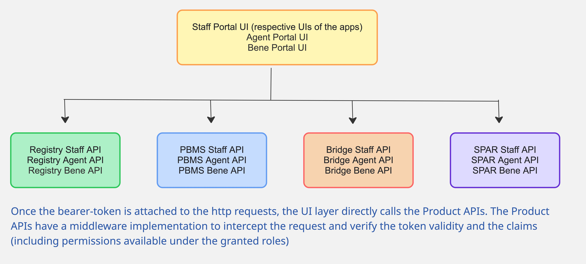

# Agency/Agents RBAC

<figure><figcaption></figcaption></figure>

Agency administrators and agents sign in to realm `agent`. What they may do is decided in three layers: the **role** on the client (`agency_admin` or `agent`), the **API surface** (agency APIs have no Verification or Approval endpoints), and the **data policy**, described below. The design of the agency solution as a whole is in [IAM-Agency-API](../platform/platform-services/identity-and-access-management/agency-high-level-design-document.md).

## Data policies: AGC_ and AGT_

### Model

Policy definitions are the existing data policies, published to the `agent` realm as client roles with two prefixes: `AGC_` for agency policies, created by staff, and `AGT_` for agent policies, created by agency administrators and scoped to their agency by the name `AGT_{AGENCY_MNEMONIC}_...`, so one agency's `AGT_` policies cannot clash with, or be attached to, another agency's agents. They are granted at two levels:

* the **agency** (the outer boundary): AGC_ roles mapped on the agency's Keycloak group. They are mandatory, and are attached by staff or by the Partner API;
* each **agent**: AGT_ roles mapped on the user. They are optional, and are attached by the agency administrator or by the Partner API.

Keycloak puts the union of group roles and user roles in the token, so the intersection is computed by the agency middleware, not by Keycloak.

### Within-agency rule

When an AGT_ policy is attached, the Agency API and the Partner API check that it is within the agency policy, so the Agency Web UI can warn about assignments that would have no effect. The authority is the read-time intersection in the middleware (see Enforcement below), not this check. Example:

| Level   | Policy                     |
| ------- | -------------------------- |
| Agency  | State = Karnataka          |
| Agent 1 | Districts = Mysuru, Mandya |
| Agent 2 | District = Hassan          |

### Enforcement

* Product agency APIs enforce policies for agent actors the way the registry does for staff.
* The effective policy is resolved from the token's AGC_ and AGT_ roles and the `agency` claim. An `iam-core` agency middleware, used by every agency API, reads the AGC_ and AGT_ roles, resolves each set to a merged filter expression with the existing staff data-policy helper, and sets the effective filter to the AND of the two (AGC_ ∩ AGT_).
* **Deny by default.** A token with no AGC_ role gives blank views, which is different from the staff side, where no policy means no restriction. An agent with no AGT_ role gets the agency policy as it stands. An AGT_ role can only narrow, never widen.
* The resolution logic lives in `iam-core`, so every API computes it the same way.

### Policy changes

If the department narrows an agency policy, agent policies outside it are **not deleted**. The effective policy is the intersection at read time, and the Agency Web UI shows which assignments are no longer effective. Nobody needs to clamp agent rows: the intersection does the work, and staff do not write the agent tables.

### Reuse

The staff data-policy code is reused for agency and agent policies. The within-agency validation is built on top of it.
