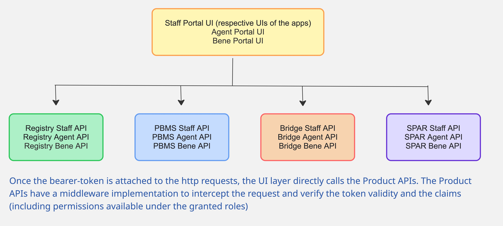

# Staff RBAC

<figure><figcaption></figcaption></figure>

Staff sign in to realm `staff`. The token's roles decide which calls a staff user may make, and the data policies decide which records they may touch.

## Roles and permissions

Each application (a Keycloak client in realm `staff`) has its own roles and permissions, and a mapping of roles to permissions. They are maintained in the Staff Portal and held by the Staff API; roles are synced to Keycloak as client roles through the Admin REST API. Endpoints declare the permission they need, for example `dataPolicy:create`.

## Data policies: DP_

A data policy limits which records a role may see or change, for example by geography or by an attribute value. Each policy is a definition with a mnemonic, a description, a register, a target and a filter expression.

* **Naming.** A data policy created for an application carries the prefix `DP_` on its mnemonic. The prefix is added automatically if the caller omits it.
* **Storage.** The policy definition is saved in the IAM database. Data policies are not a separate table in the Staff Portal today: they appear as `StaffRole` rows whose `role_mnemonic` starts with `DP_` (see `DP_ROLE_PREFIX` in `iam-core`). The Staff Portal presents them as a distinct tab, strips the `DP_` prefix for display and re-applies it on create. If a dedicated model is introduced later, the tab's data source should be swappable without changing its UX.
* **Keycloak.** When a policy is created for an application, the Staff API also creates a client role with the same `DP_` name under that application's client in realm `staff`. If the role already exists in Keycloak, the policy is saved anyway. If Keycloak rejects the call, the database change is rolled back and the request fails. Removing a policy removes the role in the same way.
* **Granting.** A `DP_` role is granted to a user or group like any other client role.

### Enforcement

1. The user's access token carries client roles under `resource_access`.
2. The data-policy middleware in `iam-core` runs after authentication. It acts only on endpoints that carry the data-policy decorator.
3. It collects every `DP_` role from all of the user's clients and strips the prefix to get the policy mnemonics.
4. It calls the IAM endpoint `/data-policies/evaluate_expression` with those mnemonics and puts the resulting filter expressions on the request state for the handler.
5. When several policies apply, `ALLOW` policies are combined with OR and `DISALLOW` policies are negated and combined with AND.

If no `DP_` role is present, no policy is applied and the staff user is not restricted. This differs from the agency side, where no `AGC_` role gives blank views: see [Agency/Agents RBAC](agency-agents-rbac.md).
