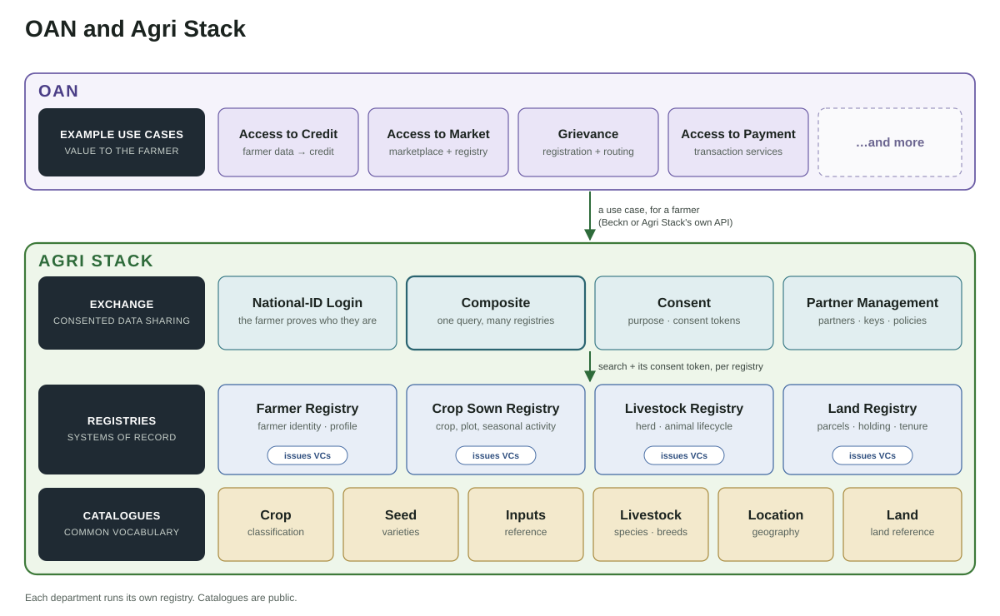

# Agri Stack

Agri Stack is **open-source digital public infrastructure (DPI) for agriculture**. A country deploys it so that the services farmers need (credit, insurance, subsidies, market access, advisory) can draw on trusted farmer data, **with the farmer's consent**.

* **Open source.** Free to deploy, adapt and extend.
* **Digital public infrastructure.** Countries deploy it to provide essential services to farmers, on infrastructure they own and run.
* **Consent built in.** Farmer data is shared with service providers only with the farmer's consent, checked on every request.
* **Departments stay in control.** Each department runs its own registry; Agri Stack queries them together and shares the result, without taking their data away.
* **Open standards.** It follows open standards for data, consent, identity and APIs ([Standards](architecture/standards.md)).
* **A foundation for farmer services networks.** A natural building block for networks such as the Open Agri Network (OAN), and usable on its own without one.
* **Partners onboard once.** A bank or agritech joins once and uses one farmer consent across several registries.

## At a glance

<figure><figcaption>
Concept: Agri Stack makes farmer data available, with consent, to the farmer services offered in a country
</figcaption></figure>

## What Agri Stack does

Agri Stack lets service providers (banks, insurers, government programmes, agritechs) get the farmer data they need for a service, **only with the farmer's consent**. The farmer proves who they are with the national ID and agrees to what is shared, for what purpose and for how long. Each registry releases only what the consent and its own department allow, and every access is recorded.

## The layers

### Farmer services

The services that use Agri Stack's data sit above it. They can be anything a country offers farmers: loans, insurance, subsidies, market linkages, advisory. They reach Agri Stack through its API, or through a farmer services network such as OAN ([below](#agri-stack-and-oan)).

### Exchange

The **Exchange** is where service providers (partners) onboard once and ask for farmer data. It collects and checks the farmer's consent, decides which partner may ask for what, and queries several registries in one request. Data is shared through **use cases**, which partners are assigned when they are onboarded ([Use Cases](architecture/use-cases.md)). A registry can also be used directly, without the Exchange. More: [The Exchange](architecture/exchange.md).

### Registries

The **registries** are the systems of record, each run by its own department. Registries envisaged in Agri Stack today:

* **Farmer Registry:** who the farmers are, their households and holdings.
* **Crop Sown Registry:** what each farmer grows, plot by plot and season by season.
* **Livestock Registry:** animals and their life events.
* **Land Registry:** parcels, holdings and tenure.

More can be added as a country needs them. All registries identify the farmer by the same national ID. Each registry also issues verifiable credentials to farmers. More: [Registries](architecture/registries.md).

### Catalogues

The **catalogues** are the common vocabulary every registry and service uses: crops, seed varieties, inputs, livestock, locations, land. They are defined once for the country and are public. More: [Master Data Service](../platform/platform-services/master-data-service/README.md).

## Agri Stack and OAN

Agri Stack stands on its own: any authorised partner uses it through its API. A country that also runs an agricultural services network such as the Open Agri Network (OAN), built on Beckn, can make Agri Stack one of that network's providers, so partners on the network reach it with the same order mechanism they use for everything else. That is a proposal, described in [Interoperability with OAN (Beckn)](design/oan-interoperability.md).

<figure><figcaption>
Concept: Agri Stack with OAN on top (proposal)
</figcaption></figure>

## Licence and ownership

Agri Stack is available under the **Mozilla Public License 2.0** ([licence](../license.md)). It is owned and maintained by the International Institute of Information Technology, Bangalore ([IIITB](https://www.iiitb.ac.in/)), as part of OpenG2P. The source code of every component: [Components and source code](architecture/README.md#components-and-source-code).

## Where to go next

* **How it works:** [Architecture & Concepts](architecture/README.md): the components, consent, policies, one request end to end.
* **Connect as a service provider:** [Partner Guide](partner-guide.md).
* **Run it:** [Deployment](deployment/README.md).
* **Add or change a use case:** [Composite](composite/README.md) and [Creating a Use Case](composite/creating-a-use-case.md).
* **What is being designed:** [Design](design/README.md), including [Interoperability with OAN](design/oan-interoperability.md).
* **What is still to do:** [TODOs & Open Items](open-items/README.md).
