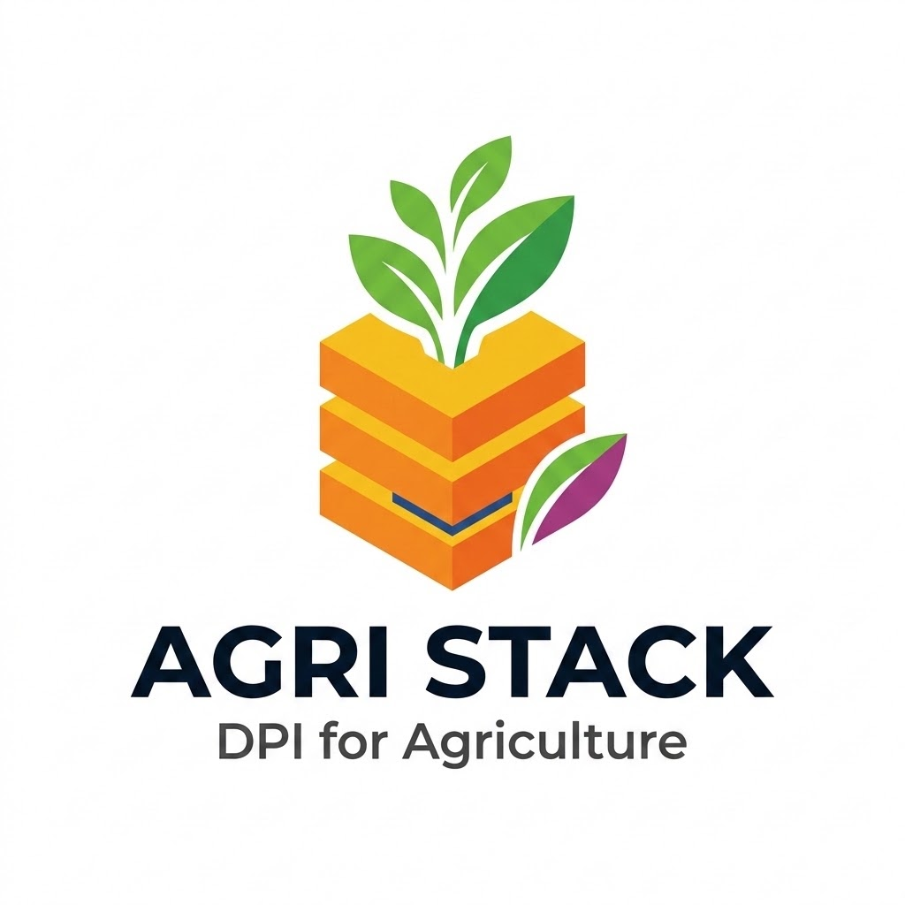

# Agri Stack

<figure><figcaption></figcaption></figure>


**Source code:** [github.com/openg2p/agri-stack](https://github.com/openg2p/agri-stack) (the use-case Composite), [github.com/OpenG2P/crop-sown-registry](https://github.com/OpenG2P/crop-sown-registry), [github.com/OpenG2P/farmer-registry](https://github.com/OpenG2P/farmer-registry) and [github.com/OpenG2P/registry-platform](https://github.com/OpenG2P/registry-platform).


## What it is

Agri Stack is the digital public infrastructure (DPI) for agriculture. It has four parts:

* **Registries:** the functional registries (farmer, crop sown, livestock, DA), each run by its department.
* **Catalogues:** the reference data every registry uses (datasets such as crop types and units, reference entities such as seed varieties, geography).
* **Platform services:** Partner Management, Consent Manager and Audit Manager. Every install has its own.
* **The Exchange** (the data exchange layer): where service providers (banks, MFIs, agritechs: **partners**) onboard once and use one farmer consent across registries: the partner portal, the Exchange's own Consent Manager and Partner Management, eSignet, and the Composite (the Exchange's use-case service).

These pages describe how a partner gets farmer data held across the registries: who routes a request, who decides what may be shared, and who enforces it.

## Registries

Each department runs its own registry on the OpenG2P [registry platform](../products/registry/registry/README.md). Registries are sovereign: each checks the caller, asks its own Consent Manager what may be released, and releases only that. Registries share **data**, never code.

| Registry | Holds | Kind | Status |
| --- | --- | --- | --- |
| **Farmer Registry (FR)** | Farmers, land parcels, households, declared main crops, livestock (until a Livestock Registry exists) | Registers and child tables (entities) | Built ([Farmer Registry](../products/registry/farmer-registry/README.md)) |
| **Crop Sown Registry (CSR)** | What each farmer plans, prepares, sows, observes and harvests, plot by plot and season by season; clusters | An activity register (occurrences) plus a Cluster register | Built ([Crop Sown Registry](../products/registry/crop-sown-registry/README.md)) |
| **Livestock Registry** | Animals and livestock events (born, vaccinated, treated, sold) | An entity register and an activity register | Planned (design only, see [register model design](design/register-model-design.md#livestock-registry-an-entity-and-occurrences-in-one-registry)) |
| **DA Registry** | Development agents | Register | Planned |

All registries are keyed to the same national identifier (Fayda in the reference setup).

## Catalogues, platform services and the Exchange

| Service | Role in Agri Stack |
| --- | --- |
| **Catalogues** (today the [Master Data Service, MDS](../platform/platform-services/master-data-service/README.md)) | All reference data: datasets (the agriculture domain of the country pack in use; ETH ships), reference entities, geography, sample people. The catalogue is being built as [MDS as Catalogue](../platform/platform-services/master-data-service/catalogue/README.md) (see [open items](open-items/README.md#catalogues)) |
| [Partner Management (PM)](../platform/platform-services/partner-management/README.md) | Trust root for every participant (partners, registries, the Composite): identities and public keys. One per install |
| [Consent Manager (CM)](../consent-management/README.md) | The farmer's consent and, today, the data-share policies; `/validate` tells each registry what it may release. One per install; the Exchange's CM collects consents and issues a consent token per registry |
| **Use-case Composite** (in the Exchange) | One generic service that serves approved use cases (e.g. `loan-profile@1`) by querying several registries with one consent and returning one signed response |
| [Approval Workflow Engine (AWE)](../platform/platform-services/approval-workflow-engine/README.md) | Approval of registers' changes; approval of policies is optional and off by default |
| [Audit Manager](../platform/platform-services/audit-manager/README.md) | Audit events from every hop, linked by the request ID. One per install |

## Map of this section

What is built today, and what is still design: [TODOs & Open Items](open-items/README.md#what-is-built).

| Part | Pages |
| --- | --- |
| **[Architecture and concepts](architecture/README.md)** | Components and who talks to whom; [consent model](architecture/consent-model.md); [consent scenarios](architecture/consent-scenarios.md); [policy and consent](architecture/policy-and-consent.md); [request flow](architecture/request-flow.md); [registry model](architecture/registry-model.md); [terms](architecture/terms.md); [standards](architecture/standards.md) |
| **[Design](design/README.md)** | [Register model design](design/register-model-design.md); [use-case Composite](design/use-case-composite.md); [distributed deployment architecture](design/distributed-deployment-architecture.md); [registry data sync](design/registry-data-sync.md); [concept notes review](design/concept-notes-review.md) |
| **[Configuration](configuration/README.md)** | What each install is configured with for Agri Stack: [Farmer Registry](configuration/farmer-registry.md), [Crop Sown Registry](configuration/crop-sown-registry.md), [Exchange](configuration/exchange.md), [Composite](configuration/composite.md) |
| **[Guides](guides/README.md)** | [Partner guide](guides/partner-guide.md); [Composite configuration](guides/composite-configuration.md); [adding a data source](guides/adding-a-data-source.md); [testing after install](guides/testing-after-install.md); [partner test](guides/partner-test.md); [Exchange setup](guides/exchange-setup.md); [Composite console](guides/composite-console.md); [registry-to-registry sync](guides/registry-to-registry-sync.md); [deploying on a cluster](guides/deployment.md); [running the Composite locally](guides/running-the-composite-locally.md) |
| **[TODOs and open items](open-items/README.md)** | Decisions and checks still pending; [service guide notes](open-items/service-guide-notes.md) |
