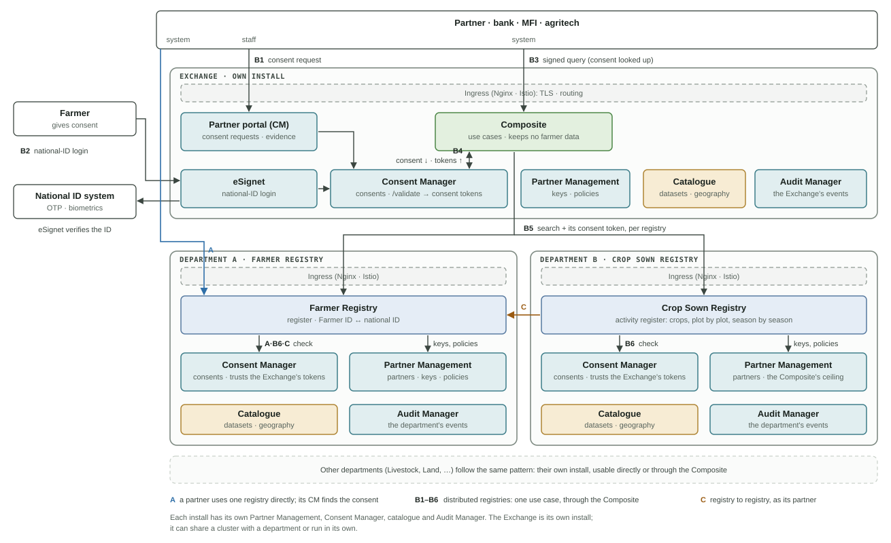

# Architecture & Concepts

## Components and who talks to whom

<figure><figcaption>
Components of Agri Stack, across departments
</figcaption></figure>

| Colour | Part |
| --- | --- |
| Blue | Registries (systems of record) |
| Ochre | Catalogues (reference data; MDS for now) |
| Teal | Platform services (Partner Management, Consent Manager, Audit Manager), and the Exchange's partner portal and eSignet |
| Green | The Composite (the Exchange's use-case service) |

**Departments and installs.** Each department runs its own Kubernetes cluster, behind its own ingress (Nginx, Istio): the public entry point for everything in that cluster. An **install** is one namespace in a cluster with its own commons: Partner Management, Consent Manager, Audit Manager and catalogue. Each registry is its own install. The **Exchange** (the data exchange layer: partner portal, Consent Manager, Partner Management, eSignet, the Composite) is one more install, hosted by one department. Here the Agriculture Department hosts both the Farmer Registry and the Exchange, in two namespaces of its cluster, each with its own Partner Management, Consent Manager and Audit Manager; other arrangements are possible.

**A — a partner uses one registry directly (no Composite).** The partner is onboarded in that registry's Partner Management and bound in its Consent Manager, and calls the registry's partner API (DCI) with a consent for it. The registry checks the signature at its own Partner Management and the consent at its own Consent Manager, and releases only the effective scopes. Every registry shares data this way, Composite or not.

**B — distributed registries, through the Composite** (the OAN layer). The partner onboards once, in the Exchange, and uses one consent for several registries. The Composite runs only approved use cases (each a configuration file, such as `loan-profile`); there is no general query engine across registries.

1. **Consent request.** The partner asks for the farmer's consent at the Exchange's Consent Manager, for example from the partner portal.
2. **Consent.** The farmer gives it through one of several mechanisms ([consent](consent.md#how-a-farmer-gives-consent)), always proving who they are with the national ID (eSignet). Once it is active, the partner can use it.
3. **Query.** The partner's system sends a signed query to the Composite with the consent (its ID, or a consent the partner signed).
4. **Consent tokens.** The Composite asks the Exchange's Consent Manager for one signed consent token per registry, with only the scopes the use case needs.
5. **Search.** The Composite searches each registry with its consent token: the Farmer Registry in the same cluster, the Crop Sown Registry in the Crops Department's.
6. **Check.** Each registry checks its consent token at its **own** Consent Manager, which trusts the Exchange's consent tokens (its public keys) and applies its standing policy for the Composite.

**C — registry to registry (not in use today).** A registry that needs another's data is simply one of its partners: onboarded in its Partner Management, with a policy in its Consent Manager, no Composite involved. The reference design is crop activity from the Crop Sown Registry kept in the Farmer Registry, through the registries' outgestion and ingestion and a small relay (not built): [registry data sync](../design/registry-data-sync.md) and the [setup guide](../guides/registry-to-registry-sync.md). Sharing of this kind usually rests on a mandate rather than each farmer's consent; the Consent Manager's rule for that (a standing permission for a purpose) is an [open item](../open-items/README.md).

* The ingress (dashed grey: OpenG2P deployment infrastructure, not an Agri Stack service) routes requests but never reads data. The Composite runs only approved use cases and keeps nothing after it responds.
* Beckn appears only at the OAN network layer, for discovering service providers and consumers. It isn't used to exchange registry data.


How the departments are installed and set up: [distributed deployment architecture](../design/distributed-deployment-architecture.md) and [deploying on a cluster](../guides/deployment.md#three-namespace-setup-exchange-and-departments).


## Entry point: the OpenG2P deployment, not a separate API gateway

Agri Stack has **no API gateway product**. Partners reach it through the ingress of the [OpenG2P deployment](../../deployment/openg2p-deployment-model.md), as for every OpenG2P service. What an API gateway usually provides is covered as follows:

| API gateway feature | In the OpenG2P deployment |
| --- | --- |
| Single public entry point, TLS, routing | Nginx and the Istio ingress gateway, a VirtualService per service |
| Partner authentication | Each service verifies the partner's signature over the request body against [Partner Management](../../platform/platform-services/partner-management/README.md) |
| Access control | The Composite's allowed partners per use case; Istio `AuthorizationPolicy` to limit registries' partner APIs to the Composite (to do) |
| Rate limits and quotas | In the Composite, which knows the partner on every request: per pod today, shared across pods and daily quotas to do |
| Usage reports | Audit events from every hop, in the Audit Manager |
| mTLS between services, timeouts, retries, circuit breaking | Istio |
| Developer portal | The [partner guide](../guides/partner-guide.md) and the Composite's describe endpoints |


A gateway product is worth adding only if many partner-facing APIs from different teams need a common portal, keys, analytics or billing, or if a national API gateway is mandated. It would then sit in front of the Composite, unchanged.


## In this part

| Page | Covers |
| --- | --- |
| [Consent](consent.md) | One consent per partner and farmer with a grant per registry; how a farmer gives it (in person with a form, built; in person digitally; self-service) |
| [Policy and consent](policy-and-consent.md) | What gets released; policy vs use case vs consent |
| [Request flow](request-flow.md) | One request, end to end |
| [Registry model](registry-model.md) | Register, table and activity-register kinds; projections; where reference data lives |
| [Terms](terms.md) | Validation, change, correction, void, approval of changes, verification, dispute |
| [Standards](standards.md) | The open standards used in each area, our own formats, and standards still to explore |
