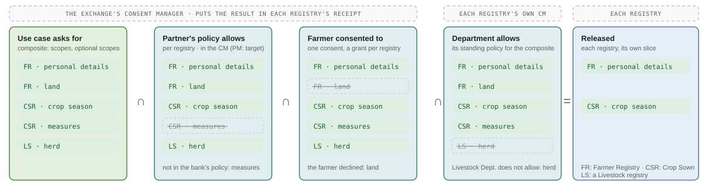

# Data-Sharing Policies

Access policies say what a partner may ask for. In Agri Stack they are all held and approved in **Partner Management (PM)**, next to the partners' keys; the Consent Manager (CM) holds only consents, and reads policies from PM when it validates one. What a policy contains (its fields, versions and statuses, and how it is changed) is defined once, in Partner Management: [access policies](../../platform/platform-services/partner-management/functional-specifications.md#access-policies). This page explains how Agri Stack uses them.

## Two policies

Agri Stack uses both kinds of [access policy](../../platform/platform-services/partner-management/functional-specifications.md#two-kinds-of-policy) that Partner Management offers, one at the Exchange and one in each department:

* **The partner's use-case policy, at the Exchange.** Which use case a partner may call, for example `loan-profile@1`, and with what limits: the purposes, farmer ID types and signing algorithms allowed, and the longest a consent may last. One policy per partner and use case, in the Exchange's Partner Management, approved by the Exchange's partner manager ([example policy](../../platform/platform-services/partner-management/api-reference.md#post-partners-requests-policy)). It lists no data: the use case defines that.
* **The Composite's scope policy, in each department.** Which of the registry's data the department allows the Composite to receive, for which purposes and farmer ID types. One policy per registry, in the department's Partner Management, approved by the department's partner manager ([how a registry applies it](#what-actually-gets-released)).


**Partners and departments never deal with each other.** A partner has no policy in any department, and the Composite has no use-case policy: each department deals only with the Composite, and the Exchange with the partners.


### Use case, policies and consent

Four things together decide what a partner gets:

| | What it decides | Owned by | Kept in |
| --- | --- | --- | --- |
| **Use case** | The data read from each registry (required and optional), the purpose and the response | The Agri Stack platform team | The [Composite](../composite/README.md), as configuration (e.g. [`loan-profile.yaml`](https://github.com/OpenG2P/agri-stack/blob/develop/composite/use-cases/loan-profile.yaml)) |
| **Partner's use-case policy** | Whether the partner may call the use case, and its limits | The Exchange's partner manager | The Exchange's Partner Management |
| **Composite's scope policy** | The most each registry releases to the Composite | Each department's partner manager | The department's Partner Management |
| **Consent** | The farmer's agreement to share the use case's data with this partner | The farmer | The Exchange's Consent Manager ([consent](consent.md)) |

A consent is asked for one use case. In the partner portal, staff choose one of the partner's use cases; the request takes that use case's purpose and data, within its use-case policy's limits (farmer ID types, longest validity), and the consent can be used only for that use case. A consent the partner signs itself is accepted only if the use-case policy allows it.

## What actually gets released

Through the Composite (path B in the [architecture](README.md#data-sharing-paths)):

**released = the use case's scopes (if the partner has a use-case policy for it) ∩ what the farmer consented to ∩ the Composite's scope policy in the department**

* **The Composite** refuses a partner that has no use-case policy for the use case.
* **The Exchange's CM** validates the consent against the partner's policy for that use case (purpose, subject ID type, signing algorithm, validity) and puts, for each registry, the consent's grant ∩ the use case's scopes into that registry's signed **consent token**.
* **Each registry's own CM** checks the consent token and intersects it with the Composite's scope policy for that registry, read from the department's PM. A department therefore always decides what leaves its registry.
* **The registry** releases only what is left, and only its own slice.

**The Composite's scope policy must cover every use case.** Partner Management does not know what a use case contains, so no scope policy is derived from the use-case policies automatically. Each department's scope policy for the Composite is the **superset** of what all published use cases read from its registry: every scope, required and optional, and every purpose. A new use case, or one that reads more, gets nothing extra from a registry until that department widens its scope policy; until then the registry withholds the scopes not covered, and denies the call if none of the requested scopes is covered (a mandatory source then fails the request). Widening is the department's decision: [when use cases change](../administration/releasing-data-to-the-composite.md#when-use-cases-change).

<figure><figcaption>
Worked example of released scopes
</figcaption></figure>


**A partner using one registry directly** (path A, no Composite): effective scopes = the partner's scope policy for that registry, in the registry's own PM ∩ the farmer's consent (held by the registry's CM, or signed by the partner if its policy allows).



In the registries, a scope is a registry **data scope**: a named group of the registry's own fields, with ID `<controller>.<name>` (e.g. `farmer-registry.personal_details`, `crop-sown-registry.crop_season`). Each registry publishes its versioned catalogue at `POST /partner/data_scopes` (signed) and, unless turned off, an unsigned `GET` (which Partner Management reads for its policy form), and filters records to the consented fields before rendering them. See [Data Scopes](../../products/registry/registry/design/data-scopes.md), and the [Farmer Registry](../../products/registry/farmer-registry/data-scopes.md) and [Crop Sown Registry](../../products/registry/crop-sown-registry/data-scopes.md) scopes.


## Who approves what

| Change | Who raises it, and how | Approved in |
| --- | --- | --- |
| A partner joins the Exchange: its keys and a policy per use case it may call | The Exchange's partner manager, at the partner's request: an onboarding request | The Exchange's PM |
| A partner gets another use case | The Exchange's partner manager: **Add policy** on the partner | The Exchange's PM |
| A partner loses a use case | The Exchange's partner manager: **Revoke** that use case's policy | The Exchange's PM |
| A new use case is published | The Agri Stack platform team ([creating a use case](../composite/use-case-configuration.md#creating-a-use-case)) | Not a policy change; partners still need it granted |
| The Composite may read more from a registry (a new scope or purpose) | The department's partner manager: edits the Composite's scope policy ([Releasing Data to the Composite](../administration/releasing-data-to-the-composite.md)) | The department's PM |
| A farmer consents, or revokes | The farmer | The Exchange's CM |

Policy changes are versioned and audited in PM, and take effect when approved; modules see them within their policy cache time (about a minute by default).

## Fail closed

Every hop refuses when it cannot find a policy that allows the request:

| Hop | No policy | PM cannot be read |
| --- | --- | --- |
| Composite | `403 partner_not_allowed`: no policy for the use case | The last answer is used for a while (up to six hours by default), then `503 partner_policy_unavailable` |
| Exchange CM | No policy for the use case: the consent is denied (`use_case_not_granted`), so the call fails with `consent_denied` | As the Composite, then denied with `policy_unavailable` (`consent_denied`) |
| Department CM | No scope policy for the Composite: the source is `denied` | As the Composite, then the source is `denied` |

Partners are matched to PM by convention: `bank-a` → `PARTNER_BANK_A` ([partner ID convention](../../platform/platform-services/partner-management/functional-specifications.md#partner-id-convention)). How the CM evaluates a policy at validate time: [verification & enforcement](../../consent-management/design/verification-and-enforcement.md). How modules read policies from PM and cache them: [PM integration](../../platform/platform-services/partner-management/integration.md).

Checking a use case against these policies when it is published is planned: [Roadmap](../roadmap/README.md).
