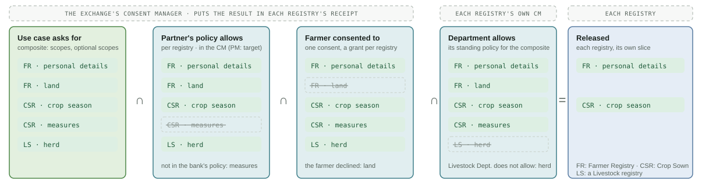

# Policy and Consent

## What actually gets released

Through the composite (path B in the [architecture](README.md#components-and-who-talks-to-whom)):

**effective scopes = what the use case asks for ∩ what the partner's policy allows ∩ what the farmer consented to ∩ what the department allows the composite**

* The **exchange's Consent Manager** computes the first three when the composite asks it to validate the consent, and puts the result for each registry into that registry's signed **consent token**.
* **Each registry's own Consent Manager** checks the consent token and intersects it with the department's **standing policy for the composite**, so a department always decides what leaves its registry.
* **The registry** releases only what is left, and only its own slice.

A misconfigured use case or partner policy can never leak more than the department allows.

<figure><figcaption><p>Worked example of released scopes</p></figcaption></figure>


**A partner using one registry directly** (path A, no composite): effective scopes = the partner's policy at that registry's Consent Manager ∩ the farmer's consent. **A single install** (consent mode passthrough): the partner's consent goes unchanged to each registry, which applies the partner's policy at its own Consent Manager.


## Layers and owners

| | Held in | Owner | Defines | Changes |
| --- | --- | --- | --- | --- |
| **Use case** ([composite](../design/use-case-composite.md)) | the composite's configuration | Agri Stack platform team | Sources, the scopes each source needs (`scopes`) and may use (`optional_scopes`), response, timeouts | Versioned like an API |
| **Partner's data-share policy** | the exchange's Consent Manager, one per partner and registry (Partner Management: target) | The exchange, on behalf of the departments | Allowed scopes per registry, purposes, subject ID types, validity ceiling, fetch type | Rarely; a widening can need approval (AWE, optional, off by default) |
| **Department's policy for the composite** | each registry's own Consent Manager (a binding for `agri-composite`) | The department (data controller) | What its registry may release through the composite, at most | When the department decides; [exchange setup](../guides/exchange-setup.md) creates it from the published use cases |
| **Consent** | the exchange's Consent Manager | The farmer | One consent with a grant per registry, for one partner and purpose | Per farmer; revocable |

Which partners may use a use case is its `allowed_partners` today; a partner association in Partner Management is the target.


**Today** the data-share policies are held in the Consent Manager, one per partner binding and registry (see [Partner policy binding & approval](../../consent-management/design/partner-onboarding-and-policy.md)). Partner Management holds identities and keys: each install verifies signatures against its own. Moving policies to Partner Management, with one policy reusable by many partners, is the target design below and an [open item](../open-items/README.md).


## Example policy (target, in PM)

```yaml
policy: credit-assessment          # version 3, status: active
purpose: credit-assessment
terms: { fetch_type: oneshot, max_validity: P90D, data_life: P1Y, subject_id_types: [FAYDA_FAN, FARMER_ID] }
sections:                           # one per data controller, each approved by that department (optionally through AWE)
  - controller: farmer-registry     scopes: [farmer:profile, farmer:land]        approved_by: Agriculture Dept.
  - controller: crop-sown-registry  scopes: [crop:season]                        approved_by: Crops Dept.
  - controller: livestock-registry  scopes: [livestock:herd]                     approved_by: Livestock Dept.
```

Partner associations (also held in PM):

```
credit-assessment v3  ←  Bank A, Bank B, MFI C
```

* **Each department approves only its own section**, optionally through its own AWE approval workflow. A section that hasn't been approved isn't in force, but the rest of the policy still applies.
* **Policies list scopes, not individual fields.** Each registry defines and versions its own mapping from scope to fields and publishes it in the developer sandbox. For example, `farmer:profile` = name, sex, date of birth, kebele.


In the registries as built, a scope is a registry **data scope**: a named group of the registry's own fields, with ID `<controller>.<name>` (e.g. `farmer-registry.personal_details`, `farmer-registry.land`; `crop-sown-registry.crop_season`, `crop-sown-registry.measures`). Each registry publishes its versioned catalogue at `POST /partner/data_scopes` (signed) and filters records to the consented fields before rendering them, so scopes are independent of DCI. See [Data Scopes](../../products/registry/registry/design/data-scopes.md); the Farmer and Crop Sown Registry catalogues are listed in [Farmer Registry](../implementation/farmer-registry.md#data-scopes) and [Crop Sown Registry](../implementation/crop-sown-registry.md#data-scopes). The `farmer:profile` style above is the design's notation.


## Runtime checks

Through the composite, as built:

1. **Composite:** verifies the partner's signature (the exchange's Partner Management) and that the partner is in the use case's `allowed_partners`.
2. **Composite → exchange Consent Manager `/validate`:** the consent is valid, not revoked, for this partner, purpose and farmer; the partner's policy per registry; only the use case's scopes. It returns one signed consent token per registry with the effective scopes so far.
3. **Registry → its own Consent Manager `/validate`, with the consent token:** the token is signed by a trusted issuer (the exchange's Consent Manager), presented by the composite, still valid and not revoked; the department's standing policy for the composite is applied.
4. **Registry:** releases only the effective scopes.

## Changes needed (target)

* **PM:** add policy, policy-section and association entities, with optional AWE approval per section.
* **CM:** `/validate` reads policies from PM instead of CM's own `PartnerPolicy` tables.
* **Composite service:** check each use case against its PM policy when the use case is published (see [publish checks](../design/use-case-composite.md#checks-when-a-use-case-is-published)).
* **Consent:** see the [consent model](consent-model.md).
