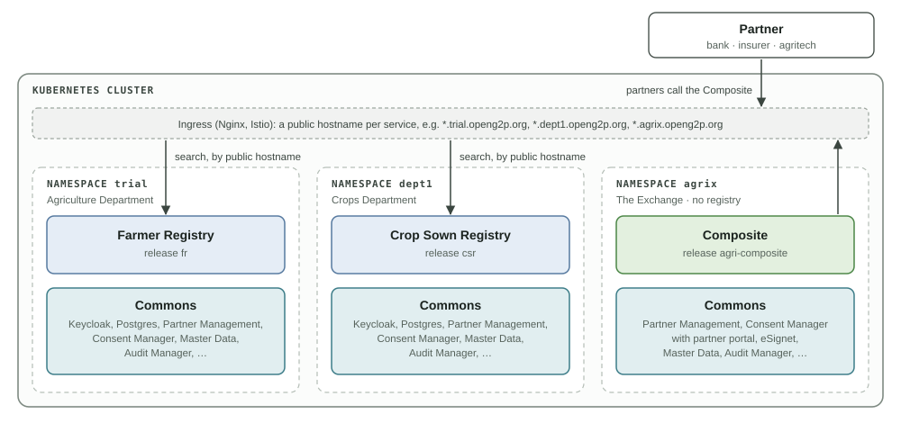
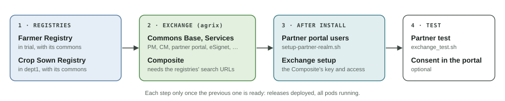

# Deployment

Agri Stack is installed from the OpenG2P Helm charts, through Rancher. These pages are the install steps. How the parts work together: [Architecture](../architecture/README.md). Managing partners and keys once it runs: [Administration](../administration/README.md).

## Topology

The reference install runs three namespaces in one Kubernetes cluster. Each namespace is installed as a separate organisation, with its own commons, and calls the others only through their public hostnames.

<figure><figcaption>
The reference topology
</figcaption></figure>

| Namespace | Install | Charts |
| --- | --- | --- |
| `trial` | The **Farmer Registry** (Agriculture Department) | Commons Base, Commons Services, Farmer Registry |
| `dept1` | The **Crop Sown Registry** (Crops Department) | Commons Base, Commons Services, Crop Sown Registry |
| `agrix` | The **Exchange** | Commons Base, Commons Services, Composite |

Each namespace has its own domain on the `internal` gateway (`*.trial.openg2p.org`, `*.dept1.openg2p.org`, `*.agrix.openg2p.org`), with DNS and TLS. The names are examples: any work. Departments on their own clusters: [Separate Clusters](separate-clusters.md).

## Prerequisites

| What | Where |
| --- | --- |
| A Kubernetes cluster with Rancher, Istio and the `internal` gateway | [Infrastructure setup](../../operations/deployment/infrastructure-setup/README.md) |
| One namespace per install, with its domain, DNS and TLS | [Environment setup](../../operations/deployment/environment-setup-multi-node.md) |
| The OpenG2P chart repository in Rancher (**Apps → Repositories**) | [Commons Helm chart](../../deployment/openg2p-commons-helm-chart.md) |
| For the test: `kubectl` and Python 3 on the operator's machine | [Testing](testing.md) |

## What the install sets up

| What | Done by |
| --- | --- |
| The Composite's signing key (Secret `agri-composite-signing`) and its public keys at `https://agri-composite.<Exchange domain>/.well-known/jwks.json` | The Composite chart |
| The Composite onboarded in the Exchange's and each department's Partner Management, its keys read from that URL, with no policy | Commons Services (Partner Management), from **Exchange Role** |
| Trust between the Consent Managers: the Exchange CM issues consent tokens, each department CM accepts them | Commons Services (Consent Manager), from **Exchange Role** |
| The partner portal's Keycloak realm, client, roles and `partner_id` attribute | Commons Services (Consent Manager), with **Partner Portal?** |

Because each Partner Management reads the Composite's key when needed, the departments and the Exchange can be installed in either order. Left to people, by design: what each department releases to the Composite, and which partners may use which use cases ([Administration](../administration/README.md)).

## Install steps

<figure><figcaption>
Install steps
</figcaption></figure>

| # | Step | Page |
| --- | --- | --- |
| 1 | Install the registries: Farmer Registry in `trial`, Crop Sown Registry in `dept1` | [Farmer Registry](farmer-registry.md), [Crop Sown Registry](crop-sown-registry.md) |
| 2 | Install the Exchange in `agrix`: Commons Base, Commons Services, the Composite | [Exchange](exchange.md) |
| 3 | In each department's Partner Management, add the Composite's scope policy for its registry. Until then the registry releases nothing to the Composite | [Releasing Data to the Composite](../administration/releasing-data-to-the-composite.md) |
| 4 | Run the test | [Testing](testing.md) |

* Steps 1 and 2 can come in either order. Registries usually exist already; upgrading their Commons Services with **Exchange Role** `department` is then step 1.
* Start each install once the one before it in the same namespace is ready: releases `deployed`, all pods running (`helm -n <ns> list`, `kubectl -n <ns> get pods`).
* Every install loads the same country pack (Commons Services default `ETH`; it carries a [licence obligation](../../platform/platform-services/master-data-service/country-packs.md#sources-and-licence)).
* For a test install, step 4 adds the step 3 policies itself, for the use case it tests.
* Before going live: [Production](production.md).

## Settings that must agree across installs

Each install is configured on its own, yet some values are used by more than one install: the Exchange and the departments recognise each other by them. The defaults already agree, so a default install sets none of them. If you change one, change it in every install listed.

| Setting | Default | Must match in |
| --- | --- | --- |
| Composite partner ID | `agri-composite` | The Composite; its Partner Management entry `PARTNER_AGRI_COMPOSITE` in every install; the token presenter at the Exchange CM and the trusted presenter at the department CMs |
| Composite hostname | `agri-composite.<Exchange domain>` | The departments' Partner Management reads the Composite's keys there (**Composite JWKS URL** otherwise) |
| Consent token issuer | `agri-stack-exchange-cm` | The Exchange CM (issuer); the department CMs (trusted issuer) |
| Data controllers | `farmer-registry`, `crop-sown-registry` | Each registry; the Composite's registries; consents; Partner Management scope policies |
| Subject ID types | `FAYDA_FAN`, `FARMER_ID` | Use cases, Partner Management policies (Master Data list `SUBJECT_ID_TYPE`), consents. The registries map the DCI type `UIN` to `FAYDA_FAN` |
| Purposes | `credit-assessment` | Use cases, Partner Management policies (Master Data list `CONSENT_PURPOSE`), consents |
| Exchange domain | `agrix.<parent domain>` | The department CMs read the Exchange CM's public keys there, and their Partner Management the Composite's |
