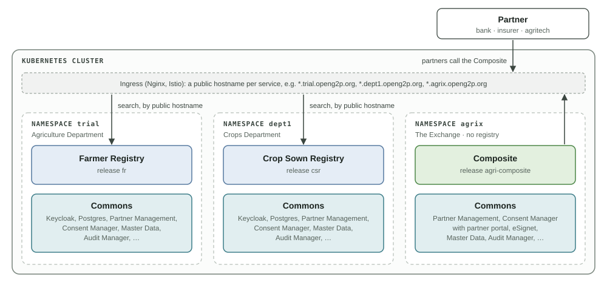
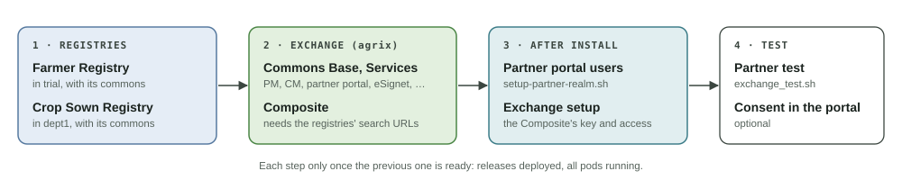

# Deployment

Agri Stack is installed from the OpenG2P Helm charts, through Rancher. These pages are the install guide: which chart goes where, which form fields to change, and the one-time setup after install. How the parts work together: [Architecture & Concepts](../architecture/README.md).

## Topology

The reference install runs three namespaces in one Kubernetes cluster. Each namespace is installed as if it were a separate organisation, with its own commons, and calls the others only through their public hostnames.

<figure><figcaption>
The reference topology
</figcaption></figure>

| Namespace | Install | Charts |
| --- | --- | --- |
| `trial` | The **Farmer Registry** (Agriculture Department) | Commons Base, Commons Services, Farmer Registry |
| `dept1` | The **Crop Sown Registry** (Crops Department) | Commons Base, Commons Services, Crop Sown Registry |
| `agrix` | The **Exchange** | Commons Base, Commons Services, Composite |

Each namespace has its own domain on the `internal` gateway (e.g. `*.trial.openg2p.org`, `*.dept1.openg2p.org`, `*.agrix.openg2p.org`), with DNS and TLS. The namespace names are examples; the commands on these pages use them.

Departments can also run on **separate clusters**: the same charts and choices, with a few extra steps for hostnames and the Exchange setup ([Separate Clusters](separate-clusters.md)).

## Prerequisites

| What | Where |
| --- | --- |
| A Kubernetes cluster with Rancher, Istio and the `internal` gateway | [Infrastructure setup](../../operations/deployment/infrastructure-setup/README.md) |
| One environment (namespace) per install, with its domain, DNS and TLS | [Environment setup](../../operations/deployment/environment-setup-multi-node.md) |
| The OpenG2P chart repository in Rancher (**Apps → Repositories**) | [Commons Helm chart](../../deployment/openg2p-commons-helm-chart.md) |
| `kubectl` and Python 3 on the operator's machine, for the after-install scripts | [agri-stack/scripts](https://github.com/openg2p/agri-stack/tree/develop/scripts) |

## Install order

The registries come first: the Composite, installed with the Exchange, needs their search URLs.

<figure><figcaption>
Install order
</figcaption></figure>

| # | Step | Page |
| --- | --- | --- |
| 1 | Farmer Registry in `trial`, Crop Sown Registry in `dept1` (in either order, or in parallel) | [Farmer Registry](farmer-registry.md), [Crop Sown Registry](crop-sown-registry.md) |
| 2 | The Exchange in `agrix`: its commons, then the Composite | [Exchange](exchange.md) |
| 3 | Partner portal users; the Exchange setup | [After Install](after-install.md) |
| 4 | Test | [Testing](testing.md) |

Start each step once the previous one is ready: releases `deployed`, all pods running (`helm -n <ns> list`, `kubectl -n <ns> get pods`). Before going live: [Production](production.md).

## Catalogue in every namespace

Each namespace's Master Data loads its own catalogue. Load the **same country pack version** everywhere, so codes and geography match across registries. The Commons Services defaults are right for Agri Stack:

| Field (Commons Services) | Value |
| --- | --- |
| Country Pack | `ETH` (the shipped example) |
| Dataset Themes | `agriculture` |
| Load Datasets | On |
| Load Sample People | On for a demo (the registries' sample farmers and the mock identity system's identities); off in production |

The ETH pack carries a licence obligation (CC BY-IGO, attribution required): [Country Packs: sources and licence](../../platform/platform-services/master-data-service/country-packs.md#sources-and-licence).

## Names that must match across installs

The defaults match everywhere, so a default install needs none of these set. Change one only together with every place that uses it.

| Name | Default | Used by |
| --- | --- | --- |
| Composite partner ID | `agri-composite` | The Composite; its Partner Management entry `PARTNER_AGRI_COMPOSITE` in every install; the token presenter at the Exchange CM and the trusted presenter at the department CMs |
| Consent token issuer | `agri-stack-exchange-cm` | The Exchange CM (issuer); the department CMs (trusted issuer) |
| Data controllers | `farmer-registry`, `crop-sown-registry` | Each registry; the Composite's registries; consents; Partner Management scope policies |
| Subject ID types | `FAYDA_FAN`, `FARMER_ID` | Use cases, Partner Management policies (Master Data list `SUBJECT_ID_TYPE`), consents. The registries map the DCI type `UIN` to `FAYDA_FAN` |
| Purposes | `credit-assessment` | Use cases, Partner Management policies (Master Data list `CONSENT_PURPOSE`), consents |
| Exchange domain | `agrix.<parent domain>` | The department CMs read the Exchange CM's public keys there |
