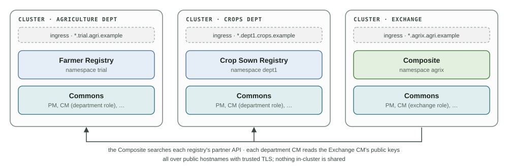

# Separate Clusters

Each namespace in the [reference topology](README.md#topology) is already installed as a separate organisation, so the same charts and choices work when each department, and the Exchange, run on their own clusters.

<figure><figcaption>
Departments on separate clusters
</figcaption></figure>

## What changes

| Step | On separate clusters |
| --- | --- |
| [Registries](farmer-registry.md) | Set **Exchange Domain** (Commons Services, Consent Manager group) to the Exchange's domain when it is not `agrix.<parent of this domain>` |
| [Exchange](exchange.md) | The registries' search URLs are their public hostnames, as on one cluster |
| [Exchange setup](after-install.md#exchange-setup) | The script uses one `kubectl` context, so it reaches only departments in the Exchange's cluster. In every other department, its administrators do step 3 of the setup [by hand](after-install.md#by-hand), with the Composite's public key and `kid` from the Exchange |

Across clusters, these must be reachable with public DNS names and trusted TLS:

| From | To |
| --- | --- |
| The Exchange (Composite) | Each registry's partner API |
| Each department (Consent Manager) | The Exchange CM's public keys: `https://consent-manager-partner.<Exchange domain>/api/consent-manager-partner/.well-known/jwks.json` |

Each department upgrades on its own schedule; after any upgrade, run the [partner test](testing.md#partner-test-public-apis) to check the whole path.

## Adding a department

1. Install its registry as on the [registry pages](farmer-registry.md), with **Exchange Role** `department`.
2. Add the registry to the Composite (`composite.registries` in **Edit YAML**) and to the use cases that read it ([adding a data source](../composite/adding-a-data-source.md)).
3. Run the [Exchange setup](after-install.md#exchange-setup) again with the new `--registry <controller>=<namespace>`, or do step 3 [by hand](after-install.md#by-hand) on another cluster.
