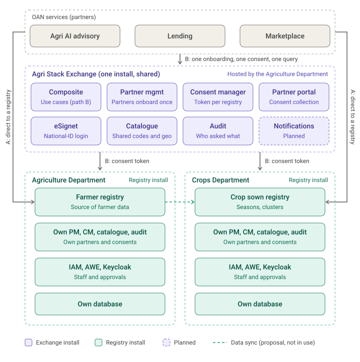
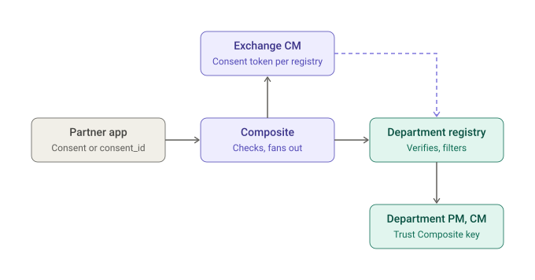

# Distributed Deployment Architecture


**Status: phase 1 built; phases 2–3 to build.** This page records the agreed direction for deploying Agri Stack across departments. Phase 1 (one onboarding and one consent at the Exchange, consent tokens checked by each department) is built and installed by hand. The [TODO list](#todo) at the end says what is still to build.


## The setting

Agri Stack is the **data layer** that Open AgriNet (OAN) uses to serve farmers and others: AI-based advisory, loans, a marketplace and more. The registries behind it belong to **different departments**: the Farmer Registry (FR) to one, the Crop Sown Registry (CSR) to another, and later others (livestock, …).

Two needs pull in different directions:

* **Each department runs its own registry for its own work:** its staff, its approvals, its own partners and use cases. It cannot depend on another department being up, or on another department's partner and consent setup.
* **OAN partners need one place** to get a farmer's data from all registries, with **one onboarding** and **one consent** from the farmer.

## Two tiers

Each department runs its own Kubernetes cluster behind its own ingress (Nginx, Istio), the public entry point for that cluster.

1. **Department tier: one install per registry, complete.** Each registry is its own install (commons and the registry) with its **own** Partner Management (PM: identity and keys), Consent Manager (CM), catalogue (MDS), IAM, approvals (AWE), audit, Keycloak and database. It runs its own partners and use cases without depending on anyone, and shares data on its own: a partner can call a registry directly (path A in the [architecture](../architecture/README.md#components-and-who-talks-to-whom)).
2. **Agri Stack Exchange tier: one install, shared, facing OAN.** A separate install of the cross-cutting pieces, hosted by one department. Here the Agriculture Department, which holds the Farmer Registry, hosts it; other arrangements are possible. It serves path B (one onboarding, one consent, one query across registries):
   * the **[Composite](use-case-composite.md)**, which runs the use cases across registries;
   * **PM**, where OAN partners onboard **once**;
   * **CM** in the exchange role, where the farmer gives consent **once**, for all registries, and which issues one consent token per registry;
   * the CM's **partner portal**, where partner staff raise consent requests, and **eSignet**, for the farmer's national-ID login ([consent scenarios](../architecture/consent-scenarios.md));
   * the **catalogue**, shared codes and geography;
   * **audit** of who asked what through the Exchange;
   * planned: **notifications** to farmers (consent requests) and **usage metering** (per-partner quotas; billing later, for a marketplace).

A third path, registry to registry, is not in use ([registry data sync](registry-data-sync.md)).

**To each department, the Exchange is one partner.** The department's PM holds the Composite's public key; the department's CM holds one standing policy for it.

### What is shared and what is per department

| Component | Where | Why |
| --- | --- | --- |
| Composite | Exchange | One query across registries for OAN partners (path B); partners can still call a registry directly (path A) |
| Partner Management, Consent Manager | **Both** | Each registry install's for its own partners; the Exchange's for OAN partners and farmer consent. Data-share policies are in the CM today; PM is the target |
| Catalogue | **Shared, authoritative at Agri Stack level** | Crop codes, seasons and geography (P-codes) must be identical across registries, or the Composite cannot join their data. Target: departments read it through its API (cached, version-pinned); department-only datasets can live in it under their own publisher. **For now (phase 1):** each department runs its own MDS from the same `openg2p-data` pack; the central catalogue and mirroring come in phase 2. |
| Audit | **Both** | Each department audits access to its data, including calls from the Exchange, recorded "on behalf of" the partner. The Exchange audits who asked what. A **request ID passed through every hop** ties them together for forensics. |
| Verifiable credentials | Issuer per department, verification shared | The Farmer Registry issues farmer credentials under its own issuer identity; verification is public and can be shared. |
| Farmer identity | National ID (Fayda FAN in the reference setup) and the FR farmer ID | The join key across registries; departments resolve farmers through FR (lookups or [data sync](registry-data-sync.md)). |
| IAM, AWE, Keycloak, Kafka, Redis, object store | Per department | Internal to each |
| Data sync (WebSub) | Per publisher | Proposal, not built: FR would publish, CSR and others subscribe. See [registry data sync](registry-data-sync.md). |
| Databases | Per department; the Exchange's own for its services | Registry data never leaves its department except through its APIs |

## Consent and policies

### Who collects the consent

The partner (e.g. a bank) **asks** for consent; the **Exchange CM issues** it. One consent object covers all registries the use case reads: a grant per registry (e.g. FR: identity, land; CSR: crop seasons), the purpose, the validity and the farmer's ID.

* **CM-originated (recommended for the Exchange):** the consent is collected and kept by the Exchange CM, so the partner cannot fabricate it. **Built:** in person at the bank (scenario 1): partner staff raise the request in the partner portal, the farmer logs in with the national ID through eSignet and signs a form, and CM staff verify it, checking the Farmer ID in the Farmer Registry. The partner then queries with the consent's ID (`message.consent_id`) and can download the consent record. **Planned:** in person digitally (no form, no staff step) and self-service (scenarios 2 and 3), with notifications to the farmer. See [consent scenarios](../architecture/consent-scenarios.md) and [consent collection](../../consent-management/design/consent-collection.md).
* **Partner-embedded:** the bank collects consent in its own app and signs it. Weaker; acceptable only with proof the farmer authenticated.

### Two kinds of policy, one inside the other

| | Exchange CM | Department CM (FR, CSR, …) |
| --- | --- | --- |
| Question it answers | What may **this partner** ask farmers for? | What may **the Exchange** ever get from me? |
| Binding | One per OAN partner, per registry it reads | **One standing policy** for the Exchange (the Composite as partner) |
| Contents | Purposes; [data scopes](../../products/registry/registry/design/data-scopes.md) per registry; subject ID types; validity; fetch type | Scopes and purposes the department agrees to share **through the Exchange**, and the rule that every request must carry a valid Exchange consent token |
| Who decides | The Exchange operator | The department (its own approval workflow) |

**Rule: a partner's scopes for a registry must be a subset of that department's Exchange policy.** The Exchange CM checks this when a partner policy is created or widened, reading each department's published scope catalogue and Exchange policy, and refuses to grant a partner more than a department allows.

### What a department registry does with the consent

The registry does **not** create or look up a per-farmer consent of its own, and its flow does not change: it still calls its **own** department CM's `/validate` with the consent JWS it received and its `data_controller`, as a standalone registry does. What changes is what it receives and what its CM does with it. For each request from the Exchange:

1. **Verify the caller (registry):** the Composite's signature, with the key in the department's own PM.
2. **Ask its own CM (registry):** the request carries an **Exchange consent token** (from the Exchange CM, for this registry; called a *receipt* in the API and settings) where a partner's consent would be. The registry passes it to its own CM's `/validate` unchanged, with the sender (the Composite) and its `data_controller`.
3. **Verify the consent token (department CM):** the Exchange CM is a configured **trusted token issuer**; the token's signature is checked against the Exchange CM's published keys, and it must be for this registry (`aud` = this controller), presented by the Composite, still valid and not revoked (status check against the Exchange CM).
4. **Apply the standing Exchange policy (department CM):** the department's policy for the Exchange (binding audience = the Composite's partner ID) must allow the purpose and the subject ID type; effective scopes = token scopes ∩ that policy's scopes. The consent token already carries only the scopes the use case needs: the Composite sends them to the Exchange CM as `requested_scopes`. The CM answers with its normal decision, including the farmer from the consent token, and logs the token ID and issuer.
5. **Filter and record (registry, unchanged):** the registry checks the searched farmer against the decision's subject, filters the record to the effective scopes, and audits as today. The only registry change: the consent time used to pick each data scope's version is the consent token's `consent_issued_at` (the farmer's consent time) when present, before `iat` and `issued_at`.

**Revocation:** the farmer's consent is revoked at the Exchange CM. Consent tokens are short-lived (900 seconds by default, never past the consent's expiry), and the department CM checks a token's status at the Exchange CM (`GET /consent/v1/receipts/{jti}/status`) before permitting.

Trusting consent tokens is a Consent Manager setting in the department (role **department**, chart value `global.agriStackExchange.role`); the registry platform needs no new trust settings. Details: [Exchange consent tokens](../../consent-management/design/exchange-receipts.md).

## Networking across departments

Each department's cluster has its own ingress. Partner-facing APIs (each registry's partner API, the Exchange CM's partner API and partner portal, the Composite) are reached over **public hostnames** on it; staff UIs and admin APIs may stay on an internal gateway reachable only over WireGuard. Calls between departments use these public hostnames today, protected by signed requests. For production, add one of:

* **Site-to-site WireGuard between departments:** each cluster becomes a peer. Simple and private; fine for a few departments, but every new department means network plumbing.
* **A separate inter-department gateway (recommended):** expose **only the service APIs** others need, protected by **mutual TLS** (a client certificate per department) on top of the signed requests, optionally with IP allowlists. Staff UIs and admin APIs stay on WireGuard. APIs to expose:
  * from the Exchange: the Composite's partner API, CM's token-signing keys and token status check, the catalogue's read API;
  * from each department: its registry partner API (the Composite calls it), and its PM key lookup if the Exchange verifies department signatures.

Cross-department **service-to-service trust** uses signed requests with keys registered in PM (as the partner APIs already do), not shared Keycloak tokens. Each department is a partner of the services it calls, and no secrets are exchanged.

## Operating it

* **Availability:** departments depend on the Exchange's catalogue, and the Exchange depends on each department's partner API. PM keys and catalogue reads are already cached; consent tokens are verified offline. Decide behaviour when a site is down: consent fails closed, catalogues serve their cached version. Add timeouts and alerts.
* **Upgrades and compatibility:** the Exchange and departments upgrade on their own schedules. Shared APIs (Composite, CM consent tokens, catalogue, registry partner API) need versioning and a compatibility promise.
* **Tracing:** a request ID passed across tiers, recorded in every audit log.
* **DNS and certificates:** public DNS names and trusted TLS for the exposed APIs; client certificates for mutual TLS.
* **Onboarding a department to the Exchange:** register its keys in the Exchange PM; register the Composite's key in the department PM; create the department's standing Exchange policy in its CM; publish its scope catalogue; issue its client certificate; set the Exchange URLs in its charts.

## Standalone installs are not affected

The Exchange settings in commons are **opt-in and off by default**. A department that installs commons and a registry without the Exchange gets the standalone behaviour:

* the registry keeps calling its **own** CM `/validate` for consent, its own PM for keys and its own catalogue;
* new CM settings (token issuer, presenters, trusted Exchange CM) and remote shared-service URLs are **empty by default**, and while they are empty no new code path runs;
* the Composite chart defaults to **Exchange mode** (`consent.mode: exchange`, Exchange CM at `http://commons-services-cm-partner-api`), since the Exchange is where it is meant to run.

## Proving it: three namespaces

The model is tested on one cluster with three namespaces, each installed as if it were a separate organisation: `trial` (Farmer Registry), `dept1` (Crop Sown Registry) and `agrix` (the Exchange: commons with the Exchange choices and the Composite in Exchange mode). Each has its own domain, and all calls between namespaces use **external hostnames**, never in-cluster service names. What to install in each, step by step: [three-namespace setup](../guides/deployment.md#three-namespace-setup-exchange-and-departments).

### What works without exchange-specific code

* **Reaching the registries:** each registry already publishes its partner API on its gateway (`https://partner-fr.trial.openg2p.org`, `https://partner-csr.dept1.openg2p.org`). The Composite's registry URLs are values (`composite.registries.<name>.url`); set them to these.
* **The Composite as a partner of each department:** register the Composite's public key in the `trial` PM and the `dept1` PM, and give it a policy in each department's CM. Each registry then verifies the Composite's signature as for any partner.
* **Partner onboarding at the Exchange:** the bank onboards in the `agrix` PM and CM only; the Composite verifies the bank there (same namespace).
* **Catalogue, phase 1 (decided):** each department runs its **own MDS**, loaded from the **same `openg2p-data` country pack version**, so codes and geography are identical. A central catalogue, and departments mirroring it, is phase 2. Each MDS can also publish an opt-in, read-only [public catalogue](../../platform/platform-services/master-data-service/catalogue/public-catalogue.md) (DCAT, SKOS, downloads) of the datasets it marks public.

**Consent (phase 1, built):** without the Exchange, a registry validates the partner's consent with its **own** CM, so the bank would have to be bound in every department's CM as well. With phase 1, the bank onboards and the farmer consents only at the Exchange; the Exchange CM issues a consent token per registry, and each department CM trusts it. After the install, `scripts/setup_exchange.py` registers the Composite's key in each department PM, binds the Composite in each department CM and checks consent-token trust; `scripts/partner_test.py` and `scripts/exchange_test.sh` test the whole path ([testing after install](../guides/testing-after-install.md)).

### Changes, in phases

**Phase 1: one onboarding, one consent (built)**

| Where | Change | Default |
| --- | --- | --- |
| Consent Manager (exchange role, `agrix`) | On `/validate` with `issue_receipts: true` from a configured **token presenter** (the Composite), return one **signed consent token** per registry grant (subject, partner, presenter, purpose, scopes for that registry, consent time, validity, token ID), signed with the key CM already publishes at `/.well-known/jwks.json`; a token status endpoint for revocation | Off: no token issuer or presenters configured; `/validate` unchanged |
| Consent Manager (department role, `trial`, `dept1`) | **Trusted token issuers** (the Exchange CM: issuer ID, key URL, presenter). `/validate` accepts a consent token from a trusted issuer: verifies it, checks it is for this registry, applies the department's standing policy for the Exchange and intersects scopes; the token ID and issuer are logged with the decision | Empty: a consent token is denied; partner consents as today |
| Composite | An **Exchange mode**: validate the partner's consent (or `consent_id`) with the Exchange CM (`issue_receipts: true`, `requested_scopes` = the use case's scopes), then send each registry its own consent token instead of the raw consent | Chart: Exchange mode (the default) |
| Registry platform (partner API) | No flow change: still calls its own CM `/validate` with the sender and `data_controller`. Consent time for data-scope versions prefers the consent token's `consent_issued_at` claim | Additive: the claim is absent from partner consents |
| CM chart | An "Exchange" question group for the token issuer, presenters and trusted issuers | Hidden unless enabled |
| Install | By hand in Rancher: the unchanged commons charts and the Composite in order, with the Exchange choices (slim commons-services, CM exchange role, partner portal, eSignet, Composite Exchange mode); then `scripts/setup_exchange.py`. See [deploying on a cluster](../guides/deployment.md#what-to-install-in-agrix) | Commons unchanged; department installs keep its defaults |
| Consent collection | Scenario 1, in person: partner portal, national-ID login (eSignet), signed form, CM staff verification with a Farmer ID check in the Farmer Registry, consent record download | Off unless the partner portal is enabled |
| Operations | DNS and TLS for `dept1` and `agrix`; onboarding steps (see above) | — |

**Phase 2: shared catalogue and policy subset check**

* Departments may point at the `agrix` catalogue (a remote catalogue URL; default stays local), with read access by signed request.
* **Central catalogue and mirroring:** the `agrix` catalogue becomes the authoritative copy; department MDSs mirror its published versions (pull by release or change feed) instead of loading the pack themselves. Not before phase 2: for now each department loads the same pack.
* The Exchange CM refuses a partner policy that grants more than a department's published Exchange policy allows.

**Phase 3: production hardening**

* Inter-department gateway with mutual TLS (or WireGuard peering).
* Consent in person digitally and self-service (scenarios 2 and 3), with notifications to farmers.
* Request ID propagation across tiers; API versioning; usage metering.

## TODO

Platform items are opt-in and default off; see [the phases](#changes-in-phases). Done in phase 1: consent tokens (exchange and department CM roles), the Composite's Exchange mode, the hand install and `scripts/setup_exchange.py`, and in-person consent collection.

* **Consent trust, next:** per-partner choice of which CM to trust.
* **Policy subset check:** the Exchange CM refuses a partner policy that grants more than a department's Exchange policy allows (needs departments to publish their Exchange policy and scope catalogue).
* **More consent scenarios** in the Exchange CM: in person digitally (no form, no staff step), and self-service, with notifications to farmers ([consent scenarios](../architecture/consent-scenarios.md)).
* **Exchange-tier install:** by hand in Rancher today. Later: a scripted install with pinned chart versions.
* **Remote shared services in registry charts:** a "shared services" question group with external URLs (catalogue, Exchange CM), back in the Rancher form; setup jobs that call service APIs instead of writing into another service's database (e.g. Certify credential configs).
* **Catalogue across departments:** read access for department registries (signed requests or an exchange-issued client), publishers per department.
* **Inter-department gateway** with mutual TLS; document the WireGuard-peering alternative.
* **Request ID propagation** across the Composite, registries and CMs, recorded in audit.
* **API versioning** for the shared APIs.
* **Usage metering** per partner at the Exchange (later: billing).
