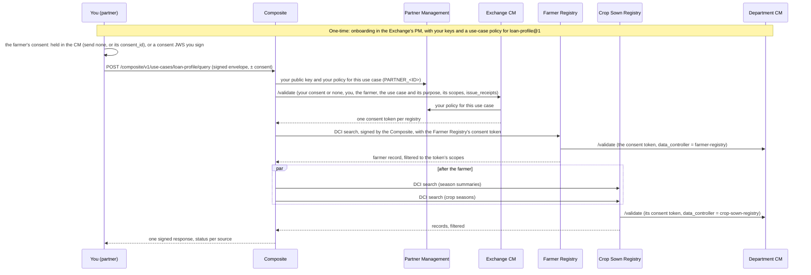

# Partner Guide

You are a **partner**: a bank, MFI or agritech that needs farmer data held across several registries, for an approved use case such as `loan-profile`. You send **one signed request** with the farmer's identifier to the Composite, under **one consent** of the farmer, and get back **one signed response** with a status per registry.


This guide covers what is specific to Agri Stack. The consent object, its signing and the Consent Manager's reason codes are documented once, in the Consent Manager's [Partner Integration Guide](../consent-management/partner-integration-guide.md); onboarding and policies are in [Partner Management](../platform/platform-services/partner-management/README.md). This guide links to both rather than repeating them.



Endpoint reference (request and response schemas, error codes): [Composite API](composite/api.md).


## How it fits together

The diagram shows the sample use case `loan-profile`, which reads the Farmer Registry and then the Crop Sown Registry; another use case reads its own registries in its own order.



You never call the registries or `/validate` yourself. The Composite checks that you have a policy for the use case, then takes your consent (or asks it to find the one it holds) to the **Exchange Consent Manager** (the CM of the Agri Stack Exchange), which checks it against the same policy and issues **one signed consent token per registry**, limited to `grant ∩ the use case's scopes`. Each registry gets only its own consent token and validates it at **its own department CM**, which trusts the Exchange CM's consent tokens and applies its department's ceiling for the Composite. The Composite only routes, maps and signs; it stores nothing. See [consent](architecture/consent.md) and [data-sharing policies](architecture/data-sharing-policies.md).

## What you need, and who sets it up

| What | Who does it today | Step |
| --- | --- | --- |
| A signing key pair and a `kid` | You | [1](#step-1-generate-your-signing-key) |
| Your partner record, public key and a **use-case policy per use case** you may call, in the Exchange's Partner Management | The Exchange's **partner manager** (PM administrator; no self-service yet) | [2](#step-2-get-onboarded-in-partner-management) |
| The Composite's URL and its public key | The Agri Stack operator | [3](#step-3-discover-the-use-case) |

## Step 1 — Generate your signing key

You sign every **request envelope** with your key and, if your policy lets you sign your own consents, each **consent** too. Supported algorithms: **EdDSA** (Ed25519), **ES256** (EC P-256) and **RS256** (RSA). Keep the private key in a keystore (a `.p12` is recommended); share only the public key. Choose a stable `kid` (e.g. `bank-a-2026-01`) and put it in every JWS header.

Key generation is shown in the Consent Manager's [Partner Integration Guide, step 1](../consent-management/partner-integration-guide.md#step-1-generate-and-hold-your-signing-key). The [partner test kit](#test-kit) generates an EC P-256 key (ES256) for testing.

## Step 2 — Get onboarded in Partner Management

Partner Management (PM) is the trust root: it holds your public key and your **access policies**, and the Composite and the Exchange's Consent Manager read both from it. In the first version of PM the portal is **admin-run**: the Exchange's partner manager files your onboarding request, with your keys and your use-case policies, and approves it. There is no partner self-service. You are onboarded only in the Exchange, never in a department.

**What you give the partner manager:**

| Item | Example | Notes |
| --- | --- | --- |
| **Partner ID** | `bank-a` | Your DCI `sender_id`, used in every request, and the consent's `aud`. Lower-case with hyphens is the convention. |
| Name and organisation | Bank A | |
| **Public key(s)** | PEM, X.509 certificate, or JWK; or a `jwks_url` to import from once | With `kid` and `algorithm` (EdDSA, ES256 or RS256) |
| **Use cases** | `loan-profile@1` | Each use case you will call, as `name@major` ([step 3](#step-3-discover-the-use-case)) |
| Purposes | `credit-assessment` | Per use case: its `purpose` |
| Subject ID types | `FAYDA_FAN`, `FARMER_ID` | Per use case: its `input.subject.id_types` |
| Signing algorithms | `ES256` | Your key's algorithm |
| Longest consent validity | `P90D` | As agreed with the Exchange |
| Partner-signed consents | Off | On (**May present its own signed consents**) only if you will sign consents yourself ([step 4](#step-4-collect-the-farmers-consent)) and the Exchange trusts your own consent collection |

You get **one use-case policy per use case**, with that use case's purposes, subject ID types, algorithms and validity: the partner manager creates each as in [Creating and Changing Policies](../platform/platform-services/partner-management/creating-and-changing-policies.md) (its fields: [access policies](../platform/platform-services/partner-management/functional-specifications.md#access-policies)). A use-case policy carries no data scopes: the use case brings its own, and each department's ceiling for the Composite still applies ([data-sharing policies](architecture/data-sharing-policies.md)).


**Consents collected in the partner portal** ([step 4](#step-4-collect-the-farmers-consent)) need nothing more: your staff pick one of your granted use cases, and the consent takes its purpose and its scopes per registry. It can be used only for that use case.


**The PM ID.** PM stores you as `PARTNER_<SENDER_ID>`, upper-cased with `-` replaced by `_`: partner `bank-a` is `PARTNER_BANK_A`. Every module looks your key and policies up under that ID. The Composite is itself a PM partner: `agri-composite` is `PARTNER_AGRI_COMPOSITE`.

After approval your keys are served at `GET {pm}/keys/PARTNER_BANK_A` (and `/keys/PARTNER_BANK_A/jwks.json`). Ask the partner manager to confirm; PM returns `404` for an unknown or disabled partner, which everyone treats as a rejection. Key rotation is a **key-update request**. Another use case is **Add policy** on your partner (a policy request); changing or revoking one use case's policy leaves the others alone. All are filed and approved in PM. See the PM [API reference](../platform/platform-services/partner-management/api-reference.md) and [functional specifications](../platform/platform-services/partner-management/functional-specifications.md).

## Step 3 — Discover the use case

The operator gives you the Composite's URL, e.g. `https://agri-composite.<namespace>.openg2p.org`, and its public key for verifying responses. The describe endpoints need no signature:

```bash
curl -s https://agri-composite.<ns>.openg2p.org/composite/v1/use-cases              # all published use cases
curl -s https://agri-composite.<ns>.openg2p.org/composite/v1/use-cases/<use_case>   # one use case
```

The description tells you what to ask for and send: `use_case` (the `name@major` of your use-case policy), `purpose` (for the policy and the consent), `input.subject.id_types` and `input.parameters` (for the request), `sources` and `consent_grants_needed` (the registries to grant in the consent), `consent_scopes` (per registry, the data scopes the consent must grant, `required`, and may grant, `optional`), and `output_fields`.

Example: `loan-profile`.

```json
{
  "use_case": "loan-profile@1",
  "name": "loan-profile",
  "version": "1.0.0",
  "status": "published",
  "title": "Farmer loan profile",
  "description": "Identity, location, land and declared crops from the Farmer Registry, and crop seasons …",
  "policy": "credit-assessment",
  "purpose": "credit-assessment",
  "consent": {"required": true},
  "input": {
    "subject": {"id_types": ["FAYDA_FAN", "FARMER_ID"]},
    "parameters": {
      "crop_year": {"type": "integer", "description": "Crop year, e.g. 2019 (…)", "required": false, "min": 1990.0, "max": 2100.0},
      "season": {"type": "string", "description": "Season code", "required": false,
                 "enum": ["SEASON_MEHER", "SEASON_BELG", "SEASON_IRRIGATION"]}
    },
    "batch": {"max_subjects": 1}
  },
  "sources": [
    {"id": "farmer", "controller": "farmer-registry", "requirement": "mandatory", "depends_on": [],
     "scopes": ["farmer-registry.farmer_identifiers", "farmer-registry.personal_details",
                "farmer-registry.land", "farmer-registry.main_crops"],
     "optional_scopes": ["farmer-registry.household_location", "farmer-registry.land_location"]},
    {"id": "season_summaries", "controller": "crop-sown-registry", "requirement": "optional", "depends_on": ["farmer"],
     "scopes": ["crop-sown-registry.farmer_reference", "crop-sown-registry.crop_season", "crop-sown-registry.measures"],
     "optional_scopes": ["crop-sown-registry.location"]},
    {"id": "crop_seasons", "controller": "crop-sown-registry", "requirement": "optional", "depends_on": ["farmer"],
     "scopes": ["crop-sown-registry.farmer_reference", "crop-sown-registry.crop_season", "crop-sown-registry.measures"],
     "optional_scopes": ["crop-sown-registry.location"]}
  ],
  "consent_grants_needed": ["crop-sown-registry", "farmer-registry"],
  "consent_scopes": {
    "crop-sown-registry": {"required": ["crop-sown-registry.crop_season", "crop-sown-registry.farmer_reference",
                                        "crop-sown-registry.measures"],
                           "optional": ["crop-sown-registry.location"]},
    "farmer-registry": {"required": ["farmer-registry.farmer_identifiers", "farmer-registry.land",
                                     "farmer-registry.main_crops", "farmer-registry.personal_details"],
                        "optional": ["farmer-registry.household_location", "farmer-registry.land_location"]}
  },
  "output_fields": ["crops.season_summaries", "crops.seasons", "crops.total_area_sown_ha", "farmer.birth_date",
                    "farmer.identifiers", "farmer.location", "farmer.main_crops", "farmer.name", "farmer.sex",
                    "land.parcel_count", "land.parcels", "land.total_size"],
  "source_status": true,
  "partial_response": "allowed",
  "rate_per_partner": "60/min"
}
```

`consent_grants_needed` lists the registries your consent needs a grant for, and `consent_scopes` the data scopes of each grant: grant every `required` scope (and the `optional` ones you want). A grant for a **mandatory** source, with its required scopes, is needed or the request fails (`consent_scope_missing`); without them for an **optional** source, that source is reported `denied` and not called. Scopes beyond the use case's are never asked for.

A data scope is a **named group of the registry's own fields**, `<controller>.<name>`, not a key of the record you get back: the registry filters each record to the scopes' fields before rendering it. Each registry publishes its catalogue (a label, a description and the fields of each scope) on its partner API (`/partner/data_scopes`); you are not a partner of the registries, so ask the operator, who sees every registry's catalogue in the Composite console. See [Data Scopes](../products/registry/registry/design/data-scopes.md).

## Step 4 — Collect the farmer's consent

Data is released only against the farmer's consent for the specific purpose and scopes.

It is either held by the Consent Manager or signed by you, and a query presents it in one of three ways:

| You send | When |
| --- | --- |
| **Nothing** | The consent is held by the Exchange CM (e.g. collected in the partner portal). The CM looks up your active consent for this farmer and use case (the latest-expiring one if several). **Recommended** for these consents: no ID to store or pass around. |
| `message.consent_id` | The consent is held by the Exchange CM and you want a specific one. |
| `message.consent_jws` | A consent you obtained and signed yourself ([step 5](#step-5-build-and-sign-the-consent)), only if your policy for the use case allows partner-signed consents. |

The first two need the Composite's Exchange consent mode. The response names the consent used (`message.consent_id`).

**A consent held in the Consent Manager.** Your staff record the farmer's consent in the CM's **partner portal**, for example in person at a branch: the farmer logs in with their national ID (Fayda in the reference setup, through eSignet) when that is switched on, the portal records the farmer's identifiers the department requires (e.g. the Farmer ID) and the evidence (stored by the CM), and CM staff verify it (checking the Farmer ID in the registry) before it becomes active. You then query without a consent, or with its ID ([step 6](#step-6-sign-the-request-envelope)). The CM holds the consent; you can download its consent record, signed by the CM. See [consent](architecture/consent.md) and [consent collection](../consent-management/design/consent-collection.md).

**A consent you sign (`consent_jws`).** You obtain the consent from the farmer through your own channel and assert it in a consent object signed with your key (the "partner-embedded" flow, [step 5](#step-5-build-and-sign-the-consent)). The Exchange accepts it only if your policy for the use case allows partner-signed consents (off by default; otherwise `consent_denied`, reason `partner_consent_not_accepted`): the Consent Manager can verify your signature, not that the farmer agreed. What that means for you:

* **Obtain real, informed consent** for the use case's purpose (e.g. `credit-assessment` for `loan-profile`) and for each registry's data, before you sign. Tell the farmer which registries hold the data being shared (e.g. the Farmer Registry and the Crop Sown Registry for `loan-profile`) and what each scope covers (its label and description in the registry's catalogue), as the CM consent screen would.
* **Stay within the use case.** Grant per registry the use case's `consent_scopes` ([step 3](#step-3-discover-the-use-case)), within what the farmer agreed to, for the use case's purpose.
* **Keep evidence** of how the consent was obtained, for audit and disputes: who consented, when, through which channel and how they were authenticated, for which purpose and which registries' data. The capture method and evidence accepted are part of your agreement with the Exchange when you are onboarded; follow what it requires.
* **The signed consent and the Consent Manager's receipts are the audit trail.** CM issues a receipt per registry for your consent ([Partner Integration Guide, step 9](../consent-management/partner-integration-guide.md)). Misrepresenting consent is a compliance breach.

## Step 5 — Build and sign the consent

Skip this step for a consent held in the Consent Manager. The consent is a **compact JWS** signed with your key, with **one grant per registry**. The claims are defined in the [Partner Integration Guide, step 5](../consent-management/partner-integration-guide.md#step-5-construct-the-consent-claims); for Agri Stack:

| Claim | Value | Rule |
| --- | --- | --- |
| `jti` | a new UUID | **New for every consent.** Re-sending the same signed consent to the same registry returns its earlier decision; a different consent reusing a `jti` is denied `replay`. |
| `aud` | your partner ID | |
| `subject_id` | `{"type": …, "value": …}`, a type from the use case's `input.subject.id_types` | Must equal `message.subject` in your request: **same type and value** |
| `purpose` | `{"code": <the use case's purpose>}` | Must equal the use case's purpose, and be allowed by your policy for it |
| `grants` | `[{"data_controller": <registry>, "data_scopes": [<scope IDs>]}]`, one per registry in `consent_grants_needed` | Each registry once; scope IDs from the use case's `consent_scopes` for that registry, within what the farmer agreed to |
| `fetch_type` | `oneshot` | |
| `validity` | `{"valid_from": …, "valid_until": …}` | Within your policy's `max_validity_duration` for the use case; the Composite rejects a consent outside its window |
| `issued_at` | now (UTC) | Within **±300 seconds** of the Consent Manager's clock (its freshness window), so sign a **fresh consent for each request** and keep clocks in sync |

Example: `loan-profile`, for partner `bank-a`.

```json
{
  "jti": "5f0c2a8e-3d1b-4a51-9a0e-2b8f2e7c9d10",
  "aud": "bank-a",
  "subject_id": {"type": "FAYDA_FAN", "value": "946053125409"},
  "purpose": {"code": "credit-assessment"},
  "grants": [
    {"data_controller": "farmer-registry",
     "data_scopes": ["farmer-registry.farmer_identifiers", "farmer-registry.personal_details",
                     "farmer-registry.household_location", "farmer-registry.land",
                     "farmer-registry.land_location", "farmer-registry.main_crops"]},
    {"data_controller": "crop-sown-registry",
     "data_scopes": ["crop-sown-registry.farmer_reference", "crop-sown-registry.crop_season",
                     "crop-sown-registry.measures", "crop-sown-registry.location"]}
  ],
  "fetch_type": "oneshot",
  "validity": {"valid_from": "2026-10-01T10:00:00+00:00", "valid_until": "2026-10-31T10:00:00+00:00"},
  "issued_at": "2026-10-01T10:00:00+00:00"
}
```

Sign it with your key and `kid` (any RFC 7515 library):

```python
import json
from jwt import PyJWS  # PyJWT

def canonical(obj) -> bytes:
    return json.dumps(obj, sort_keys=True, separators=(",", ":"), ensure_ascii=False).encode()

consent_jws = PyJWS().encode(canonical(claims), private_key, algorithm="ES256", headers={"kid": "bank-a-2026-01"})
# "eyJhbGciOiJFUzI1NiIs…" + "." + payload + "." + signature
```

The Composite presents this consent to the Exchange CM, and each registry gets its own consent token.

## Step 6 — Sign the request envelope

The request is a DCI-style envelope: `header`, `message`, and a **detached JWS** over `{header, message}`.

| Field | Value |
| --- | --- |
| `header.version` | `1.0.0` |
| `header.message_id` | a new UUID |
| `header.message_ts` | now, ISO 8601 UTC, e.g. `2026-10-01T10:00:00.000Z`. Must be within **300 seconds** of the Composite's clock. |
| `header.action` | `query` |
| `header.sender_id` | your partner ID |
| `header.receiver_id` | the Composite's ID, `agri-composite` (if present, it must match) |
| `message.subject` | `{"type": "FAYDA_FAN" \| "FARMER_ID", "value": "…"}` |
| `message.parameters` | the use case's `input.parameters`, e.g. `{"crop_year": 2019, "season": "SEASON_MEHER"}` for `loan-profile`; omit or `{}` for none |
| `message.consent_jws` | the consent from step 5 |
| `message.consent_id` | *instead of `consent_jws`:* the ID of a consent held by the Exchange Consent Manager. It checks it (active, in its validity, obtained by you, about this farmer) and what it grants. |

Send at most one of `consent_jws` and `consent_id`. With **neither**, the Exchange Consent Manager looks up your consent for this farmer and use case ([step 4](#step-4-collect-the-farmers-consent)); if it holds none, the query is refused (`403 consent_denied`, reason `consent_not_found`).

**The signature** is a JWS whose payload is the canonical JSON of `{"header": …, "message": …}` (keys sorted, no whitespace, UTF-8), with the payload part removed: `<protected header>..<signature>`.

Example (`loan-profile`, partner `bank-a`):

```python
import uuid
from datetime import datetime, timezone

def sign_detached(payload: dict, key, kid: str) -> str:
    h, _p, s = PyJWS().encode(canonical(payload), key, algorithm="ES256", headers={"kid": kid}).split(".")
    return f"{h}..{s}"

header = {"version": "1.0.0", "message_id": str(uuid.uuid4()),
          "message_ts": datetime.now(timezone.utc).isoformat(timespec="milliseconds").replace("+00:00", "Z"),
          "action": "query", "sender_id": "bank-a", "receiver_id": "agri-composite"}
message = {"subject": {"type": "FAYDA_FAN", "value": "946053125409"},
           "parameters": {"crop_year": 2019, "season": "SEASON_MEHER"},
           "consent_jws": consent_jws}
envelope = {"signature": sign_detached({"header": header, "message": message}, private_key, "bank-a-2026-01"),
            "header": header, "message": message}
```

## Step 7 — Call the use case

```
POST https://agri-composite.<ns>.openg2p.org/composite/v1/use-cases/<use_case>/query
Content-Type: application/json

<envelope>
```

* `<use_case>` gets the highest published major version; `<use_case>@1` pins major 1 (or send the header `X-Use-Case-Major: 1`). For example `loan-profile` or `loan-profile@1`.
* How many subjects one request may carry is the use case's `input.batch.max_subjects` (one for `loan-profile`).

## Step 8 — Read the response

The response is an envelope signed by the Composite. Example (`loan-profile`):

```json
{
  "signature": "<protected header>..<signature>",
  "header": {"version": "1.0.0", "message_id": "…", "message_ts": "…", "action": "on-query",
             "status": "succ", "sender_id": "agri-composite", "receiver_id": "bank-a",
             "meta": {"in_reply_to": "<your header.message_id>"}},
  "message": {"use_case": "loan-profile@1", "version": "1.0.0", "request_id": "…",
              "subject": {"type": "FAYDA_FAN", "value": "946053125409"},
              "consent_id": "c0a8012e-…",
              "sources": {"farmer": {"status": "ok"}, "season_summaries": {"status": "ok"},
                          "crop_seasons": {"status": "ok"}},
              "data": {"…": "…"}}
}
```

* `header.status` is `succ` or `rjct`; on `rjct`, `header.status_reason_code` and `status_reason_message` say why, and `message` carries `error: {code, message}` instead of `data`.
* `message.request_id` is the Composite's ID for this request; quote it when reporting a problem (audit events are linked by it).
* `message.consent_id` is the consent the Exchange Consent Manager used, also when it looked it up (Exchange mode).
* `message.sources` has a status per source, and a `detail` when there is something to say:

| Source status | Meaning |
| --- | --- |
| `ok` | The registry returned records |
| `no_record` | The registry answered, with no matching record |
| `denied` | The registry refused (consent, policy or subject check), or your consent has no grant for it (an optional source is then not called) |
| `unavailable` | The registry could not be reached, timed out, or answered 408/429/5xx; or the overall timeout was reached |
| `error` | Any other failure (a rejected search, a malformed answer) |

A source whose dependency is not `ok` is not called; it takes the dependency's status, with `detail: "not called: …"`. With `partial_response: allowed` (e.g. `loan-profile`), only a failing **mandatory** source fails the request; optional sources that fail just show their status, and their output fields are `null` (a source that answered with no record gives `[]` or `0`).

**HTTP status and error codes:**

| HTTP | `error.code` | Meaning |
| --- | --- | --- |
| 200 | — | Success (some optional sources may still be `denied` / `unavailable` / `error`) |
| 400 | `invalid_envelope`, `wrong_receiver`, `stale_request`, `invalid_use_case`, `invalid_input` | Bad envelope, wrong `receiver_id`, `message_ts` more than 300 s from now, bad `@major`, bad subject or parameters |
| 401 | `signature_invalid` | The envelope signature does not verify against your PM key (or you are unknown in PM) |
| 403 | `partner_not_allowed` | You have no policy for this use case (`name@major`) in Partner Management: ask the Exchange's partner manager ([step 2](#step-2-get-onboarded-in-partner-management)) |
| 403 | `consent_required`, `consent_malformed`, `consent_signature_invalid`, `consent_subject_mismatch`, `consent_not_yet_valid`, `consent_expired`, `consent_grant_missing`, `consent_scope_missing` | A consent problem found by the Composite before any registry is called (`consent_required`: no consent sent in passthrough mode; `consent_scope_missing`: a mandatory source's required scopes are not granted) |
| 403 | `consent_denied` | The Exchange Consent Manager denied the consent; its reason code is in the message (e.g. `consent_not_found`: you sent none and it holds none for this farmer and use case; `partner_consent_not_accepted`: you signed the consent but your policy does not allow it; `use_case_not_granted`, `purpose_not_allowed`, `policy_unavailable`) |
| 403 | `consent_receipt_missing` | The Exchange Consent Manager issued no consent token for a mandatory source's registry |
| 502 | `consent_exchange_error` | The Exchange Consent Manager rejected the call or gave an unreadable answer |
| 503 | `consent_exchange_unavailable` | The Exchange Consent Manager could not be reached, timed out, or is not configured |
| 503 | `partner_policy_unavailable` | Partner Management cannot be read to check your use-case grant and no recent answer is cached; try again later |
| 403 | `source_denied` | A mandatory source was denied (e.g. by the Consent Manager at the registry) |
| 404 | `unknown_use_case` | No published use case of that name / major |
| 429 | `rate_limited` | Rate limit reached |
| 502 / 503 / 504 | `source_error` / `source_unavailable` | A mandatory source failed: error / unavailable / timed out |
| 500 | `signing_unavailable` | The Composite cannot sign (its key is missing); the body is unsigned |

When a registry denies your consent, the reason in `sources.<id>.detail` comes from the Consent Manager's `reason_code`; see the table in the [Partner Integration Guide, step 8](../consent-management/partner-integration-guide.md).

## Step 9 — Verify the Composite's signature

Verify every response before you use it. The `signature` is a detached JWS over the canonical JSON of the response's `{header, message}`, signed with the Composite's key (`PARTNER_AGRI_COMPOSITE` in PM; the JWS header carries its `kid`):

```python
import base64

def verify_response(body: dict, composite_public_key) -> None:
    h, _, s = body["signature"].split(".")
    payload = base64.urlsafe_b64encode(canonical({"header": body["header"], "message": body["message"]})).decode().rstrip("=")
    PyJWS().decode(f"{h}.{payload}.{s}", composite_public_key, algorithms=["ES256", "RS256", "EdDSA"])  # raises if invalid
```

Get the Composite's public key from the operator, or from PM's key API (`GET {pm}/keys/PARTNER_AGRI_COMPOSITE`) where it is reachable to you; the key-fetch API is served on the cluster-internal gateway.

## Rate limits

Each use case sets a rate per partner (its `rate_per_partner`; `loan-profile` allows **60 requests per minute**), and `429 rate_limited` is returned beyond it. The limit is applied per Composite pod and worker, so it is a floor rather than an exact ceiling; limits across all pods and daily quotas are [not built yet](open-items/README.md).

## Worked example: `loan-profile`

**Request:** the sample farmer of a demo install (FAN `946053125409`, farmer ID `FR-0007`), Meher 2019.

```json
{
  "signature": "eyJhbGciOiJFUzI1NiIsImtpZCI6ImJhbmstYS0yMDI2LTAxIn0..MEUCIQ…",
  "header": {"version": "1.0.0", "message_id": "0b6f6c1e-…", "message_ts": "2026-10-01T10:00:00.000Z",
             "action": "query", "sender_id": "bank-a", "receiver_id": "agri-composite"},
  "message": {"subject": {"type": "FAYDA_FAN", "value": "946053125409"},
              "parameters": {"crop_year": 2019, "season": "SEASON_MEHER"},
              "consent_jws": "eyJhbGciOiJFUzI1NiIsImtpZCI6ImJhbmstYS0yMDI2LTAxIn0.eyJhdWQiOiJiYW5rLWEi….…"}
}
```

**What the Composite does:**

1. Verifies your signature (`PARTNER_BANK_A`), checks that you have a policy for `loan-profile@1`, the parameters and the rate limit.
2. Checks the consent: your signature, subject `FAYDA_FAN 946053125409` = the request's, valid now, a grant for `farmer-registry` (mandatory) and `crop-sown-registry`. Then gets a consent token for each registry from the Exchange CM, which applies your policy for `loan-profile@1`.
3. Calls the **Farmer Registry**: `reg_type: Farmer`, search `foundational_id $eq 946053125409`.
4. Reads `FARMER_ID` from the farmer record, then calls the **Crop Sown Registry** twice in parallel: season summaries (`FARMER_SEASON_SUMMARY`, crop year 2019, Meher) and crop seasons (crop year 2019, Meher).
5. Maps and derives the output, signs and returns it.

**Response** (`message`; record contents abbreviated — each keeps its registry's DCI record shape):

```json
{
  "use_case": "loan-profile@1",
  "version": "1.0.0",
  "request_id": "7d2e…",
  "subject": {"type": "FAYDA_FAN", "value": "946053125409"},
  "sources": {"farmer": {"status": "ok"}, "season_summaries": {"status": "ok"}, "crop_seasons": {"status": "ok"}},
  "data": {
    "farmer": {
      "name": "…", "sex": "…", "birth_date": "…",
      "identifiers": [{"@type": "Identifier", "identifier_type": "UIN", "identifier_value": "946053125409"},
                      {"@type": "Identifier", "identifier_type": "FARMER_ID", "identifier_value": "FR-0007"}],
      "location": {"…": "…"},
      "main_crops": ["CROP_TEFF", "CROP_BREAD_WHEAT"]
    },
    "land": {"parcels": [{"…": "…"}, {"…": "…"}], "parcel_count": 2, "total_size": 1.4},
    "crops": {
      "seasons": [{"crop_season": {"…": "…"}, "measures": {"area_sown_ha": 0.9, "…": "…"}, "location": {"…": "…"}, "farmer_reference": {"…": "…"}}],
      "season_summaries": [{"…": "…"}],
      "total_area_sown_ha": 1.3
    }
  }
}
```

* `land.total_size` is the sum of each parcel's `land_size`, in the parcels' unit (`farm_details[].measurement`).
* `crops.total_area_sown_ha` sums `measures.area_sown_ha` over the crop seasons returned; with `crop_year` and `season` it is that season's.
* Without `crop_year` and `season`, all of the farmer's seasons come back, newest first.

If the farmer had not consented to the Crop Sown Registry (no grant), `season_summaries` and `crop_seasons` would be `denied` with `detail: "the consent has no grant for crop-sown-registry"`, `crops.*` would be `null`, and the request would still succeed. If the Farmer Registry denied the consent, the request would fail `403 source_denied`.

## Test kit

[`scripts/partner_kit.py`](https://github.com/openg2p/agri-stack/blob/develop/scripts/partner_kit.py) does all of the above for testing (`pip install cryptography pyjwt`):

```bash
python scripts/partner_kit.py keys          # partner key + composite .p12 in scripts/kit-out (git-ignored), and what to onboard
python scripts/partner_kit.py consent --subject FAYDA_FAN:946053125409
python scripts/partner_kit.py describe --url https://agri-composite.<ns>.openg2p.org
python scripts/partner_kit.py call --url https://agri-composite.<ns>.openg2p.org \
    --subject FAYDA_FAN:<FAN of a registered farmer> --param crop_year=2019 --param season=SEASON_MEHER
```

* `keys` (defaults: partner `bank-a`, Composite `agri-composite`) prints the PM onboarding requests for `PARTNER_BANK_A` (with its use-case policy for `loan-profile@1`, allowing partner-signed consents because `call` signs its own) and `PARTNER_AGRI_COMPOSITE`, the `kubectl create secret generic agri-composite-signing …` command, and the Composite's scope policy requests for each department's PM.
* `call` builds a consent with both grants (`--controllers` narrows it), signs the envelope, verifies the Composite's signature on the answer and prints it.

To go through these steps as a test partner against an environment, use the [partner test](deployment/testing.md#partner-test-public-apis).

## Checklist

* [ ] Your key is registered and **active** in the Exchange's PM under `PARTNER_<YOUR_ID>`; the JWS `kid` and `alg` match it.
* [ ] An **active** use-case policy there for each use case you call (`name@major`), allowing its purpose and subject ID types, and your signing algorithm.
* [ ] For consents collected in the partner portal: the consent was made for the use case you call, for the farmer you name in `message.subject`.
* [ ] For a consent you sign: your policy for the use case allows it; its `subject_id` equals `message.subject` (type and value); `aud` is your partner ID; the purpose is the use case's; one grant per registry, with the use case's `consent_scopes`; a new `jti` and a fresh `issued_at` each time.
* [ ] `message_ts` fresh; clocks in sync.
* [ ] You verify the Composite's signature and check `sources` before using `data`.
* [ ] You keep evidence of how each consent was obtained.
