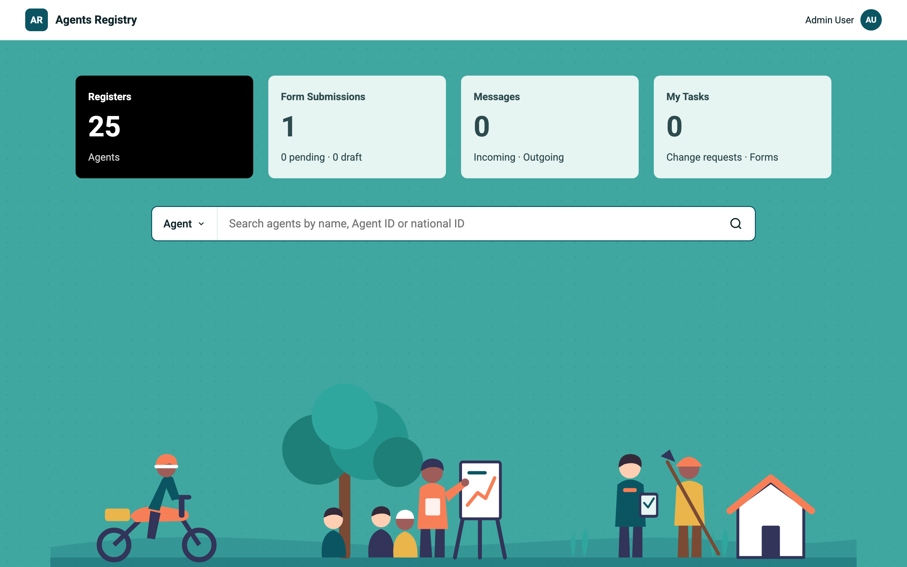

# Agents Registry


**Source:** [github.com/OpenG2P/agents-registry](https://github.com/OpenG2P/agents-registry)


<figure><figcaption>
The staff portal home page, with the Agents Registry theme
</figcaption></figure>

Farmers are served by agents: extension agents, development agents, animal health workers. A ministry needs to know who they are, where each one is posted, what they are qualified in and which trainings they have completed, and to keep that record right through postings, promotions, leave and retirement.

The **OpenG2P Agents Registry** keeps that record. It is a **reference registry**: generic fields and lists that a system integrator customises for a country ([Customisation](customisation.md)).

It is built on the [OpenG2P Registry Platform](../../../products/registry/registry/README.md), like the [Farmer Registry](../../../products/registry/farmer-registry/README.md) and the [Crop Sown Registry](../../../products/registry/crop-sown-registry/README.md): an **entity register** for the agents and an **[activity register](../../../products/registry/registry/features/activity-register.md)** for their trainings, in one registry.

## At a glance

* **Agents** with a generated **Agent ID**, their employment, their **current assignment** (an area and a service point) and their **service status**.
* **Specializations** and **qualifications** for each agent.
* **Every change approved:** registrations and changes are change requests approved in AWE; the version history is the audit trail of every posting, promotion and status change.
* **Trainings** completed and **certifications** awarded, recorded against the agent, with a summary per agent.
* **Generic:** every coded field is a Master Data list, and the assigned area is a unit of the country's own geography, at any level.
* **Not shared with partners:** it is the agents' own record, kept by the staff who manage them.

## Who uses it

| User | Uses it to |
| --- | --- |
| **Staff managing agents** (district, regional offices) | Register agents, record postings, promotions, leave and retirement, keep qualifications current |
| **Approvers** | Approve registrations and changes in AWE |
| **Training staff** | Record trainings and certifications, one at a time or for a whole course |
| **A learning platform** | Send completed trainings through the signed partner API |
| **Planners** | Read reports: agents by area, position and status; trainings by topic |

## Registers

Two registers: one entity register and one activity register.

| Register | Kind | Holds |
| --- | --- | --- |
| **Agent** | Entity register | One record per agent: identity, person, contact, employment, current assignment, service status, and two lists of rows, specializations and qualifications |
| **AgentTraining** | Activity register | Trainings completed and certifications awarded, by agent |

**Specializations and qualifications are not registers.** They are list sections of the agent record: rows under the agent, added and edited on the agent's record, the way the Farmer Registry keeps lands and livestock under a farmer. Each list is kept in a table of its own (`AgentSpecialization`, `AgentQualification`), which the platform defines as a child of Agent with the purpose `TABLE`; that is why the two names appear among the register definitions.

### The agent record

The Agent register inherits the platform's person fields and location fields. Its location is the agent's **assigned area**, not their home.

| Group | Fields |
| --- | --- |
| **Identity** | Agent ID (generated, read-only), national ID, employee number (the employer's HR number) |
| **Person** | First, middle and last name, gender (`GENDER`), date of birth, languages spoken |
| **Contact** | Mobile number, alternate phone, email |
| **Employment** | Position (`AGENT_POSITION`), employer type (`AGENT_EMPLOYER_TYPE`), employer, employment type (`AGENT_EMPLOYMENT_TYPE`), date of hire |
| **Current assignment** | Assigned area (a geography unit, any level), service point, service point type (`AGENT_SERVICE_POINT_TYPE`), assigned since, assignment reason (`AGENT_ASSIGNMENT_REASON`), latitude and longitude |
| **Service status** | Status (`AGENT_SERVICE_STATUS`), status date, reason |
| **Documents** | Appointment letter, national ID document |

| List section | Fields per row |
| --- | --- |
| **Specializations** | Specialization (`AGENT_SPECIALIZATION`), primary (yes/no), since |
| **Qualifications** | Level (`AGENT_QUALIFICATION_LEVEL`), field of study (`AGENT_FIELD_OF_STUDY`), institution, year completed |

In the staff portal the record has four tabs: **Profile**, **Employment and assignment**, **Specializations and qualifications**, and **Documents**. A new agent is registered through the **agent intake form**, which has the same sections.

The current assignment is held on the record, not as a list of postings: each posting replaces it, and the record's [version history](../../../products/registry/registry/features/version-history.md) keeps every earlier one with its dates.

### Agent ID

* Generated by the ID generator when the registration is approved, from the pool `agent`: **eight digits, no prefix** (e.g. `48207193`).
* Shown read-only; staff never type it.
* A country can change the length or add a prefix ([Customisation](customisation.md#agent-id)).

### National ID and duplicates

* The national ID is a plain field, **not verified** against a national ID system by default.
* The platform's [deduplication](../../../products/registry/registry/features/deduplication.md) flags likely duplicates on the national ID, name and date of birth.
* A country with an online ID service can switch on the platform's registrant authentication (for example through eSignet) for the register.

### Checks

Every country's records pass these:

* the date of birth is in the past, the date of hire after it and not in the future;
* the agent is not assigned before being hired, and no status dates from before the hire;
* a status other than **active** needs a status date;
* email and phone numbers are well formed;
* each specialization appears once, and at most one is primary;
* a qualification's year is a past year.

## Lifecycle and approvals

Every change to an agent is a **change request**, approved in [AWE](../../../products/registry/registry/features/change-management-and-approval-workflow.md); a new agent comes in through the intake form, approved the same way. The shipped policies, two stages with demo approvers, are sample data, loaded only with **Load Sample Data**; a country sets up its own in AWE, for example the district office, then the regional office ([Customisation](customisation.md#approvals)).

| Lifecycle event | What the change request changes |
| --- | --- |
| Onboarding | A new agent record (intake form); the Agent ID is generated on approval |
| Transfer, reassignment | Assigned area, service point, assigned since, reason |
| Promotion, role change | Position, and the assignment when it changes too |
| New specialization | Rows of the Specializations section |
| Leave, suspension | Status, status date and reason |
| Reactivation | Status back to active |
| Retirement, separation, death | Status, status date and reason |

The history is the audit trail: each approved change is a version, with who asked, who approved and when. Lifecycle events are not recorded a second time as activities.

## Trainings

**AgentTraining** is an activity register: each training an agent completes, and each certification awarded, is an append-only activity against the agent. The agent is the activity's **subject**, a record of the Agent register (by Agent ID), so the trainings show on the agent's profile.

| Activity | Fields | Occurred at |
| --- | --- | --- |
| **Training completed** | Topic (`AGENT_TRAINING_TOPIC`), course title, course code, provider, start and end date, course days (worked out), hours, delivery mode (`AGENT_TRAINING_DELIVERY_MODE`), result (`AGENT_TRAINING_RESULT`), score, where it took place | The day the course ended |
| **Certification awarded** | Certification, topic, issuing body, certificate number, valid until | The day it was issued |

* **One context per agent.** Its current state is the agent's training summary: trainings, hours, the last training and its topic, certifications, and the latest one with its validity.
* **Checks:**
  * an unknown agent, delivery mode or result is rejected;
  * a topic another system sends that is not in the list is accepted with a warning;
  * a course that ends before it starts is rejected;
  * more than 12 hours a day, or a failed course with no score, is a warning.
* **Corrections** are a supersede or a void with a reason, as in every activity register. Verification is off; a country can require a supervisor's verification per activity type.

### How trainings come in

| Channel | How |
| --- | --- |
| **Staff portal** | The **Trainings** activity register (`AgentTraining`) → **Record**, one entry or a batch. A batch carries the course, provider, dates and hours from row to row, so a whole course is entered once |
| **A learning platform** | Signed calls to the partner API (`/partner/activity/append_activities`, `/partner/activity/correct_activities`). Each message is idempotent; a partner corrects only what it sent |

## Reports

Reporting views for Superset or Insights. Geography levels are read by position in the area's hierarchy (level 1 is the country), each with its code, name and level name, so the views work for any country.

| View | One row per |
| --- | --- |
| `agents_rpt_agent` | Agent: status, position, employment, each level of the assigned area, primary specialization, qualifications, trainings, hours, latest certification |
| `agents_rpt_agents_by_area` | Area, position and status: agents, women, trained and certified agents |
| `agents_rpt_training` | Current training or certification, with the agent's area |

Not built yet: dashboards, and areas with no active agent (the list of areas is in Master Data, not in the registry).

## Verifiable credentials

The registry can issue an agent a **verifiable credential**, their ID card, at the counter, as the Farmer Registry does for farmers ([VC Issuance](../../../platform/platform-services/vc-issuance/README.md), Phase 1: a printed card with a signed QR). It is **off by default**.

* **Who:** an active agent, in service (a retired, suspended or separated agent gets no card).
* **How:** the agent authenticates with the national ID system (eSignet), then staff in the Agent Portal issue the credential.
* **Claims:** Agent ID, full name, date of birth, gender, position, service point and assigned area, from the view `agent_vc_view`. The QR carries name, date of birth, gender and the Agent ID; employment terms, qualifications and trainings are never on the card.
* **Packaging:** the Agent Portal API image `openg2p-agents-registry-agent-portal-api`, the credential definition `OpenG2PAgentCredential` and the card design `agent-card.svg` in the chart. Turning it on: [Deploying on Rancher](deployment/rancher.md#verifiable-credentials).

## What it shares

Nothing with partners. No bank, insurer or OAN service reads agents through the [Exchange](../../architecture/exchange.md), so the registry has no partner search output and no data scopes, and **consent enforcement is off**. The partner API is deployed only to take data in: a learning platform's trainings, and an existing agent system's records through `ingest_data`. Partner signatures are still checked.

## How it relates to other registries

* **Farmers.** Which farmers an agent serves is **not stored**: the agent's assigned area and a farmer's location in the [Farmer Registry](../../../products/registry/farmer-registry/README.md) give the link when a service needs it. The registries stay independent, and no list of farmers per agent goes out of date.
* **Crop Sown Registry.** Its activities carry the agent's ID as an identifier held by another system, checked by format only.

## How it is packaged

A thin **extension** of the Registry Platform, like the other registries ([Packaging](../../../products/registry/registry/deployment-and-extension/packaging-and-reference-registry.md#domain-registry-charts)). The `agents-registry` repository adds:

* the `agents-extension` package: models, domain services (checks, record names, the training context and summary, sample trainings), seed metadata and the training register's configuration;
* `scripts/agents_definitions.py`: the registers, sections, tabs, intake form, search, duplicate check, approval bindings, activity types and indicators in one file, from which `scripts/build_seed_sql.py` generates the seed SQL (CI checks the two match);
* five images, each a `FROM` of the matching platform image plus the extension: `staff-api`, `partner-api`, `celery`, `db-seed` and `agent-portal-api` (VC issuance). The staff portal and Agent Portal UIs are the platform's images;
* the `openg2p-agents-registry` chart, a values overlay over the platform's `openg2p-registry` chart, plus the credential card design.

## Pages

* [Customisation](customisation.md): what a country changes, and where
* [Deployment](deployment/README.md) and [Deploying on Rancher](deployment/rancher.md)
* [Versions](versions.md)
