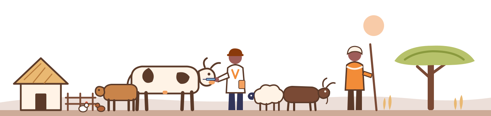

# Livestock Registry


**Source:** [github.com/OpenG2P/live-stock-registry](https://github.com/OpenG2P/live-stock-registry)


<figure><figcaption>
The staff portal's home-page illustration, in the Livestock Registry theme
</figcaption></figure>

The livestock department needs to know which animals there are, whose they are, where they are kept, and what has happened to them: when they were born, vaccinated, treated, sold, and when they died. Vaccination campaigns, disease control, livestock insurance and loans all start from that record.

The **OpenG2P Livestock Registry** keeps it. It is a reference registry: generic fields and lists that a system integrator customises for a country ([Customisation](customisation.md)).

It is built on the [OpenG2P Registry Platform](../../../products/registry/registry/README.md), like the other Agri Stack registries, and combines the platform's two register kinds: **entity registers** for the animals and the vets, and an **[activity register](../../../products/registry/registry/features/activity-register.md)** for what happens to the animals. How each kind works (append-only activities, contexts, current state, corrections, participants) is in the activity register [feature](../../../products/registry/registry/features/activity-register.md) and [design](../../../products/registry/registry/design/activity-register.md) pages; this page says what the Livestock Registry puts in them.

## At a glance

* **Animals** with a generated **Animal ID**, their description, their mother and how the owner got them.
* **The owner** of each animal: the Farmer Registry's **Farmer ID**, with the owner's **national ID** alongside. The owner held here is authoritative.
* **Veterinarians** and animal health workers, with a generated **Vet ID**.
* **Every change approved:** registrations and changes to an animal or a vet, a change of owner among them, are change requests approved in AWE.
* **Events:** births, vaccinations, treatments, sales and deaths, recorded against the animal, with each animal's **current state**.
* **Shared with consent:** a partner (a bank, an insurer, a programme) reads a farmer's animals over DCI, only with the farmer's consent and only the consented data.
* **Generic:** every coded field is a Master Data list, and locations are units of the country's own geography.

## Who uses it

| User | Uses it to |
| --- | --- |
| **Livestock office staff** | Register animals and vets, record changes of owner |
| **Approvers** | Approve registrations and changes in AWE |
| **Vets and animal health workers** | Record vaccinations and treatments, one at a time or a whole campaign; their own system can send them through the signed partner API |
| **Supervisors** | Verify vaccinations and treatments |
| **Partners** (banks, insurers, programmes) | Read a farmer's animals, their current state and their events, with the farmer's consent |
| **Planners** | Read reports: animals by area and species, vaccination coverage, events |

## Registers

Three registers: two entity registers and one activity register.

| Register | Kind | Holds |
| --- | --- | --- |
| **Animal** | Entity register | One record per animal: identity, description, origin, owner, where it is kept |
| **Veterinarian** | Entity register | One record per vet or animal health worker: person, cadre, licence, practice, area served |
| **LivestockEvent** | Activity register | Births, vaccinations, treatments, sales and deaths. The context is the animal |

### The animal record

| Group | Fields |
| --- | --- |
| **Identity and description** | Animal ID (generated, read-only), ear tag number, species (`LIVESTOCK_TYPE`), breed type (`LIVESTOCK_BREED`), breed, sex (`LIVESTOCK_SEX`), date of birth (and whether it is estimated), colour and markings |
| **Origin** | Mother (an Animal ID), how it was acquired (`LIVESTOCK_ACQUISITION`), acquired on |
| **Owner and location** | Owner's Farmer ID, owner's national ID, where it is kept (a geography unit, any level) |
| **Documents** | A photo of the animal, proof of ownership |

In the staff portal the record has three tabs: **Animal**, **Owner and location**, and **Documents**. A new animal is registered through the **animal intake form**.

### The vet record

| Group | Fields |
| --- | --- |
| **Personal details** | Vet ID (generated, read-only), national ID, first, middle and last name, gender, date of birth |
| **Contact** | Mobile number, email |
| **Practice** | Cadre (`LIVESTOCK_VET_CADRE`), licence number, employer type (`LIVESTOCK_VET_EMPLOYER`), employer, clinic or animal health post, area served |

### Animal ID and Vet ID

* Generated by the ID generator when the registration is approved: **Animal ID** ten digits (pool `animal`), **Vet ID** eight digits (pool `veterinarian`), no prefix.
* Shown read-only; staff never type them.
* An ear tag is a separate field: the number on the animal, which may come from another identification system.
* A country can change the lengths or add a prefix ([Customisation](customisation.md#animal-id-and-vet-id)).

### Checks

Every country's records pass these:

* a date of birth is not in the future, and an animal is not acquired before it was born;
* an animal is not its own mother;
* identifiers (ear tag, mother, the owner's Farmer ID and national ID) hold only letters, digits and hyphens;
* a vet's date of birth is in the past, and their email and phone are well formed.

The platform's [deduplication](../../../products/registry/registry/features/deduplication.md) flags a likely duplicate animal on the ear tag, and a likely duplicate vet on the national ID, licence, name and date of birth.

## The owner

The owner is the **Farmer Registry's Farmer ID**, with the owner's **national ID** alongside, as in the [Crop Sown Registry](../README.md#farmer-id-across-registries).

* The Farmer Registry runs in another department: the Farmer ID is checked by format only, never looked up. The farmer is registered in the Farmer Registry first.
* The owner held here is authoritative. A sale changes it through the Animal register's change request, approved in AWE; the record's [version history](../../../products/registry/registry/features/version-history.md) keeps every earlier owner.
* The national ID is what a farmer's consent names: it links the animals to the consent ([What it shares](#what-it-shares)).

## Lifecycle and approvals

Every change to an animal or a vet is a **change request**, approved in [AWE](../../../products/registry/registry/features/change-management-and-approval-workflow.md); a new animal or vet comes in through its intake form, approved the same way. The shipped policies, two stages with demo approvers, are sample data, loaded only with **Load Sample Data**; a country sets up its own in AWE ([Customisation](customisation.md#approvals)).

## Events

**LivestockEvent** is an activity register: each event is an append-only activity whose **context and subject is the animal**, a record of the Animal register (by Animal ID), so the events show on the animal's profile.

| Event | Participants | Fields | Occurred at |
| --- | --- | --- | --- |
| **Born** | Animal (primary), farmer, mother | Mother (an Animal ID), birth weight, litter size | The date of birth |
| **Vaccinated** | Animal (primary), farmer, vet | Vaccine (`LIVESTOCK_VACCINE`), batch, dose number, dose (ml), next dose due, campaign | The day of the vaccination |
| **Treated** | Animal (primary), farmer, vet | Disease or condition (`LIVESTOCK_DISEASE`), treatment (`LIVESTOCK_TREATMENT`), medicine, dose, milk and meat withdrawal until | The day of the treatment |
| **Sold** | Animal (primary), seller (the farmer), buyer | Buyer (`LIVESTOCK_BUYER_TYPE`), buyer's Farmer ID (if a farmer), buyer's name, price, market | The date of sale |
| **Died or slaughtered** | Animal (primary), farmer | Cause (`LIVESTOCK_DEATH_CAUSE`), disease (if known) | The day it died |

Every event also carries the **owner when it happened** (Farmer ID and national ID), where it happened, and the platform's provenance: when and by whom it was recorded, the channel and the partner it came through. Born and Died occur once per animal; the others may repeat.

### Entities first

An event never creates or changes an animal record:

* **Birth:** the newborn is registered in the Animal register first; the Born event records the birth against it.
* **Sale:** the change of owner goes through the Animal register's change request; the Sold event records the sale. One sale leads to both records; they stay separate.
* **Vaccination, treatment and death** change nothing on the animal.

### Checks before storing

An event is stored only if its references hold, and these are strict (rejected):

* the animal is registered in the Animal register, and so is a mother named at birth;
* the vaccine, treatment, disease, buyer type and cause are values of their Master Data lists;
* the vet is a Veterinarian record of this registry (`vet_id`), or an ID held by another system (`vet_external_id`, checked by format only);
* a vaccination names its vet, once; a treatment may have none (a farmer deworms);
* an animal is not its own mother, and a buyer is not the seller;
* the Farmer IDs are well formed (format only).

Warnings, which do not block: a vaccination with no batch, a treatment with no condition, a sale with no price, a sale to a farmer with no Farmer ID, and an event recorded after the animal's death (it may have happened before).

### Current state

The events are the history. Each animal's **current state** is worked out from them, in the context's projection:

* **Status:** active, **sold** (its latest event is a sale) or **died**. Vaccinated, treated, vaccinated, sold gives sold; a later vaccination by the new owner makes it active again; a death is final.
* Its birth and mother; vaccinations, the last vaccine and date, and when the next dose is due; treatments, the last one and any milk and meat withdrawal; sales, the last one and to whom; its death and cause.

### Verification and corrections

* **Vaccinations and treatments are verified** by a supervisor (the platform's verification); births, sales and deaths are not. An event can be stored before it is verified, and verification never changes it.
* Verification by a **trusted source** (a vet's authenticated system) is part of the platform's [Verification and Correction proposal](../../../products/registry/registry/design/verification-and-correction.md), not built yet.
* An event is never edited: it is **superseded** (a wrong vaccine, batch, dose or date) or **voided** (it did not happen), with a reason; the original stays for audit. A partner corrects only the events it sent. A wrong identity, sex or owner is a change request on the Animal register.

| Situation | Correction |
| --- | --- |
| A wrong vaccine, batch, dose or date | A Vaccinated event that supersedes the old one, verified again |
| The vaccination did not happen | Void the event |
| The animal's identity, sex or ID is wrong | Change request on the Animal register |
| A sale was wrongly recorded | Supersede or void the Sold event, and correct the owner through the Animal register's change request |
| Wrong birth details | Supersede the Born event. The animal stays |
| A death was wrongly recorded | Void the death |

### Approval

The registry has no approval step for events. Approval is needed only when something is issued from an event: a certificate (birth, vaccination, movement or sale), a payment (a vaccination campaign, a treatment) or an official figure. That approval belongs to the programme that issues it ([PBMS](../../../pbms/README.md)), not to the registry. A sale that is an official transfer of ownership is approved through the Animal register's owner change request.

### How events come in

| Channel | How |
| --- | --- |
| **Staff portal** | The **Livestock events** register (`LivestockEvent`) → **Record**, one entry or a batch. A batch carries the vaccine, batch, dose, campaign and vet from row to row, so a whole campaign is entered once |
| **A vet's or an animal identification system** | Signed calls to the partner API (`/partner/activity/append_activities`, `/partner/activity/correct_activities`). Each message is idempotent; a partner corrects only what it sent |

## What it shares

Like the Farmer and Crop Sown Registries, the Livestock Registry shares over **DCI search with consent**. Its consent data controller is `livestock-registry`. Partner signatures are checked, and every search is limited to the consent's subject and data scopes.

* **A farmer's animals**, from the Animal register (record type `spdci-extensions-agri:Animal`), by the owner: the national ID (`UIN`) or the Farmer ID (`FARMER_ID`) in an ID search, or an expression on the owner and the animal's fields. Under a farmer's consent, every animal returned must be that farmer's: an animal is the consent subject's when its owner is, not by its own Animal ID.
* **Each animal's current state**, from LivestockEvent (record type `spdci-extensions-agri:Animal`, by the Animal ID): status, last vaccination, next dose due.
* **Its events**, from LivestockEvent, with their verification status, as evidence. A consent reaches an event through the owner recorded on it.

The Veterinarian register is not shared.

### Data scopes

Scope IDs are `livestock-registry.<name>`. Only these are offered: the registers' section scopes are excluded, so a vet's personal details and the animals' documents are never shared.

| Scope | Label | Fields |
| --- | --- | --- |
| `animals` | Animals | Animal ID, ear tag, species, breed, sex, date of birth, colour, mother, how and when acquired, record status. Not the owner, nor the location |
| `owner_reference` | Owner | The owner's Farmer ID and national ID, on the animal, its events and its current state |
| `animal_location` | Where the animal is kept | The area where the animal is kept, and where each event happened |
| `animal_status` | Current status | Each animal's current state: status, birth, vaccinations, next dose due, treatments, withdrawal, sales, death |
| `events` | Events | Each event: which animal, what and when, the vaccine, treatment, disease or cause, the vet, its verification |
| `event_details` | Event details | Everything recorded with each event: batch, dose, medicine, withdrawal, a sale's price and buyer |

The catalogue is `meta_data/data-scopes/10_livestock.json`. How scopes work: [Data Scopes](../../../products/registry/registry/design/data-scopes.md).

The Livestock Registry is not yet a source of an Exchange use case. Adding it is configuration only: [Adding a Registry](../adding-a-registry.md), which uses it as its example.

## Reports

Reporting views for Superset or Insights. Geography levels are read by position in the area's hierarchy (level 1 is the country), each with its code, name and level name, so the views work for any country. An animal counts as alive unless a death is recorded.

| View | One row per |
| --- | --- |
| `lsr_rpt_animal` | Animal: description, owner, each level of the area, its current state (status, alive, last vaccination, vaccinated in the last 12 months, next dose due and overdue, treatments, sale, death) |
| `lsr_rpt_animals_by_area` | Area, species and sex: living animals, females, vaccinated in the last 12 months, overdue, owners, sold, died |
| `lsr_rpt_event` | Current event, with the animal, its area and the vet who gave a vaccination or treatment |
| `lsr_rpt_vaccination_coverage` | Area, species and vaccine: living animals, those vaccinated in the last 12 months, doses and coverage |

The events register also carries indicators: animals with events, by status, vaccinated, by last vaccine, vaccinations, treatments, deaths by cause.

### Dashboards

Three sample Superset dashboards on these views, imported into the namespace's Superset at install (on by default; skipped when there is no Superset). Each has the filters **Region** and **Species**.

| Dashboard | Shows |
| --- | --- |
| **Livestock Overview** | Living animals, owners, the share vaccinated in the last 12 months, animals overdue; animals by species, status, region and sex; the herd by region |
| **Vaccination and Animal Health** | Vaccinations and treatments in the last 12 months, the share of vaccinations verified; vaccinations by vaccine, month and vet cadre; coverage by region, species and vaccine; treatments by disease |
| **Sales and Deaths** | Sales and deaths in the last 12 months; deaths by cause and month; sales by buyer; sales and average price by species |

They are titled `<release> · <title>` (e.g. `lsr · Livestock Overview`), on a connection named after the release, so several installs can share one Superset ([Several installs in one Superset](../../../platform/platform-services/reporting-and-analytics/dashboards.md#several-installs-in-one-superset)). Changing them: [Customisation](customisation.md#dashboards).

## How it relates to other registries

* **Farmer Registry.** The owner is the Farmer Registry's Farmer ID, never looked up. The Farmer Registry still has its own Livestock section, per herd (type, breed, head count, livestock system), not per animal ([domain models](../../../products/registry/farmer-registry/README.md#domain-models)). Where the Livestock Registry is installed, that section should be reduced to a declared summary or removed, so each fact has one authoritative registry; that is not done yet.
* **Basic farmer details** (location, household size), to search and filter animals by them, would be a mirror of the Farmer Registry's data ([Registry Data Sync](../../roadmap/registry-data-sync.md#the-other-direction-mirrors-of-farmer-data)); not built.
* **Agents Registry.** Animal health workers who are extension agents may also be in the [Agents Registry](../agents-registry/README.md); the Veterinarian register here is independent of it.

## How it is packaged

A thin **extension** of the Registry Platform, like the other registries ([Packaging](../../../products/registry/registry/deployment-and-extension/packaging-and-reference-registry.md#domain-registry-charts)). The `live-stock-registry` repository adds:

* the `livestock-extension` package: models, domain services (checks, record names, the event context, checks and current state, sample events), seed metadata, the events register's configuration, the data scope catalogue and the DCI templates;
* `scripts/livestock_definitions.py`: the registers, sections, tabs, intake forms, search, duplicate checks, approval bindings, event types and indicators in one file, from which `scripts/build_seed_sql.py` generates the seed SQL (CI checks the two match);
* five images: `staff-api`, `partner-api`, `celery` and `db-seed`, each a `FROM` of the matching platform image plus the extension, and `staff-ui`, the platform's staff portal UI built with this registry's overrides ([UI Extendability](../../../products/registry/registry/design/ui-engineering-design/ui-extendability.md));
* the `openg2p-livestock-registry` chart, a values overlay over the platform's `openg2p-registry` chart, and the Superset dashboard bundle (`files/lsr-dashboards.zip`, built by `scripts/build_dashboards.py`), which the platform chart's dashboards Job imports.

## Pages

* [Customisation](customisation.md): what a country changes, and where
* [Deployment](deployment/README.md) and [Deploying on Rancher](deployment/rancher.md)
* [Versions](versions.md)
