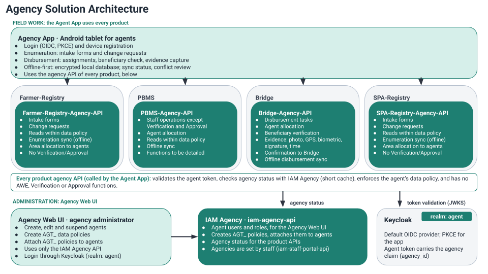

# Agent API Design

<figure><figcaption></figcaption></figure>

## 1. Purpose

Programs delivered through the OpenG2P platform rely on field-level partners to enrol beneficiaries and hand over benefits. Examples are NGOs, banks' business correspondents, cooperatives, and local-government outreach teams. This document defines the **Agency Solution**, which lets a department:

* onboard and govern such **agencies**,
* let each agency manage its own **agents**,
* let agents perform registry (enumeration) and disbursement work, online or offline, from an Android tablet,
* keep every action within the **data scope** the department intended.

This version covers ideas, requirements and design direction only.

## 2. Terminology

| Term                 | Meaning                                                                                                                                                                                                                                                                                               |
| -------------------- | ----------------------------------------------------------------------------------------------------------------------------------------------------------------------------------------------------------------------------------------------------------------------------------------------------- |
| Department staff     | Government/program staff who operate the registry and workflows (verification, approval). Existing staff users, in the `staff` realm.                                                                                                                                                                 |
| Agency               | An external organisation authorised by the department to work in a defined geography/scope.                                                                                                                                                                                                           |
| Agent                | A person belonging to exactly one agency who works in the field.                                                                                                                                                                                                                                      |
| Agency administrator | The primary user of an agency, created by staff or by the partner system that created the agency. Manages the other agents of that agency.                                                                                                                                                            |
| Partner system       | An external system onboarded in Partner-Management that creates agencies and agents through `iam-partner-api`. It is an integration, not an IAM audience.                                                                                                                                             |
| AGC\_ / AGT\_        | Role prefixes for data policies: `AGC_` for agency policies (mandatory for an agency) and `AGT_` for agent policies (optional). Staff create the `AGC_` definitions; agency administrators create the `AGT_` definitions, which belong to their own agency and are named `AGT_{AGENCY_MNEMONIC}_...`. |
| Audience             | A class of IAM users with its own identity provider and API: `STAFF`, `AGENCY`, `BENEFICIARY`.                                                                                                                                                                                                        |
| Data policy          | A rule restricting which records a user may see or act on (for example, by geography).                                                                                                                                                                                                                |
| Evidence             | Artefacts captured at disbursement to prove delivery.                                                                                                                                                                                                                                                 |

## 3. Scope

### In scope

1. Agency lifecycle management: create (by staff or by partner systems), enable, disable.
2. Agent lifecycle management under an agency.
3. Agent authentication and authorisation (OIDC, Keycloak by default).
4. Data policies for agencies and agents, with agent policies within the agency policy.
5. Registry functionality for agents: everything staff can do, except Verification and Approval operations. Agencies get no AWE (workflow engine) functionality.
6. Agent allocation to work (enumeration areas, disbursement tasks), done in each product's agency API.
7. Disbursement execution by agents with evidence capture.
8. Agency Web UI and an Android tablet app, with full offline support for enumeration and disbursement.
9. Device management for the tablets: devices belong to the agency and are empanelled by the agency administrator (sections 9.7 to 9.14).

### Out of scope

* Payment rails and reconciliation logic (stays in G2P Bridge).
* Agency commission/payout calculation.
* iOS clients for agents.
* Beneficiary login. It shares the IAM design (section 6.1) but is a separate audience with its own API.

## 4. Requirements

### 4.1 Agency management

* **R1.** Department staff, and partner systems through `iam-partner-api`, create agencies. Each agency is created with at least one AGC\_ policy and, at creation, the **primary user**, who becomes the agency administrator. Only staff and partner systems can create agencies; the agency API cannot.
* **R2.** Staff can **enable or disable** an agency. Disabling stops fresh logins and fresh ingestion of data. Work already in flight is progressed (section 6.8).
* **R3.** Staff-facing agency operations are endpoints of the staff IAM API (`iam-staff-portal-api`), used from the Staff Web UI.
* **R3a.** Partner systems are onboarded in Partner-Management. `iam-partner-api` verifies each request's signature against the partner's public key and lets the partner manage only the agencies and agents it created (section 6.9).

### 4.2 Agent management

* **R4.** The agency administrator adds, edits, suspends and removes agents within their own agency only, through the Agency Web UI. Partner systems can also create agents for agencies they created.
* **R5.** An agent belongs to exactly one agency.
* **R6.** Agents are authenticated via OIDC. They live in a separate Keycloak realm from staff, named `agent`. Other OIDC providers must remain pluggable.
* **R7.** The access token carries a **claim identifying the agent's agency** (the `agency` claim, carrying the `agency_id`). Services trust the claim and never accept it from the request body.

### 4.3 Registry functionality

* **R8.** Agents can do everything staff can on the registry, **except Verification and Approval operations**. Agencies get no AWE (workflow engine) functionality. This is enforced structurally: the agency APIs do not expose those operations.
* **R9.** Agents **initiate** intake form submissions and change requests, which then enter the staff workflow with the agency and agent recorded as origin.
* **R10.** Agents are subject to data policies, as staff already are.

### 4.4 Data policies

* **R11.** Data policies apply at **agency** level (`AGC_`, mandatory) and at **agent** level (`AGT_`, optional). Staff create the `AGC_` policy definitions. Agency administrators create the `AGT_` policy definitions for their own agency, named `AGT_{AGENCY_MNEMONIC}_...`. Staff can manage only the policies they create (`AGC_`) and cannot edit `AGT_` policies. Staff and partner systems attach `AGC_` policies to agencies; the agency administrator and partner systems attach `AGT_` policies to agents.
* **R12.** An agent's policies can only narrow the agency's policies. Example: the agency is scoped to State X, and its agents to districts within State X.
* **R13.** Effective access is the intersection of the agency policy and the agent policy, computed at read time. An agent whose token has no AGC\_ role sees nothing (deny by default).

### 4.5 Allocation

* **R14.** G2P Bridge allocates **agencies** to disbursement work by geography.
* **R15.** Agent allocation within an agency respects each agent's data policies (see section 7).

### 4.6 Disbursement by agents

* **R16.** Agents effect disbursements for beneficiaries assigned to them.
* **R17.** For each disbursement the app captures evidence: beneficiary photograph, geo-coordinates, biometric verification, beneficiary confirmation (signature and/or thumb print), and date-time stamp.

### 4.7 Offline and device

* **R18.** An Android application on a tablet.
* **R19.** Enumeration and disbursement both work **offline** and sync when connectivity returns, each against its own product agency API.
* **R19a.** A tablet belongs to the **agency**, not to an agent. Any agent of that agency can sign in on it. An agent uses one device at a time.
* **R19b.** The **agency administrator** empanels and retires the agency's devices, and manages each device's PIN.

### 4.8 UI

* **R20.** An Agency Web UI for the agency administrator: manage agents and see a consolidated view of agents' activity.
* **R21.** Consolidation across products happens in the **UI layer**. The UI calls each product's agency API and merges the results.

## 5. Solution overview

```
 UI layer      Staff Web UI     Agency Web UI + Agency App      Beneficiary Web UI     Partner systems
                    |                  |            |                   |                    |
 API layer   iam-staff-portal-api   iam-agency-api  |        iam-bene-portal-api     iam-partner-api
             (agencies, apps,       (agents,        |                                (agencies, agents;
              roles, providers,      agent          +--> registry-agency-api          signed requests,
              policy catalogue)      policies)      +--> bridge-agency-api            checked in
                    \                 |                           /                  Partner-Management)
 Library              iam-core (adapters, token validation, policies, models)
                    |                                           |
 Identity     Keycloak (realm: staff, realm: agent)          eSignet
                    |
 Data         PgBouncer --> one IAM PostgreSQL database
```

### Components

1. **`iam-staff-portal-api`** (existing). Owns applications, roles and the `AGC_` data policy definitions (the only place they are created), and a browse screen for the login providers configuration. Also creates and maintains agencies and their AGC\_ assignments, shared with the Partner API. Gains the agency endpoints used by staff.
2. **`iam-agency-api`** (new; currently the placeholder `iam-agent-portal-api`, which today only does login). Agents and agency administrators sign in through it. Agency administrators create the `AGT_` policy definitions, and create and manage agents and their AGT\_ assignments, through it (the Partner API can also create agents). Scoped to the caller's agency. It cannot create agencies.
3. **`iam-partner-api`** (new). Lets partner systems create agencies (with AGC\_ policies) and agents (with optional AGT\_ policies), authenticated by the partner's signature (section 6.9).
4. **`registry-agency-api`** (new). Agency-facing registry API for the Agency Web UI and the Android app: intake, change requests, reads within data policy, enumeration sync.
5. **`bridge-agency-api`** (new). Agency-facing bridge API: disbursement tasks, evidence capture, confirmation, disbursement sync. Other products (for example PBMS) follow the same pattern with their own agency API. Each agency-facing product API owns agent allocation for its domain.
6. **`iam-core`** (existing library). Shared models, OIDC adapters, token validation, data policy engine and Keycloak admin client.
7. **Keycloak**, realms `staff` and `agent`.
8. **Agency Web UI** (new). Agency administrator portal, forked from the staff UI pattern.
9. **Agency App** (new). Android tablet app for agents.
10. **Evidence store.** Object storage for photos, signatures and biometric artefacts, referenced from the disbursement record.

## 6. Identity and access

### 6.1 Audiences

IAM serves three audiences, each with its own API and identity provider. A fourth API, `iam-partner-api` (section 6.9), is an integration surface for partner systems and is not an audience:

| Audience      | API                    | Identity provider       | IAM writes                                                                                                                    |
| ------------- | ---------------------- | ----------------------- | ----------------------------------------------------------------------------------------------------------------------------- |
| `STAFF`       | `iam-staff-portal-api` | Keycloak, realm `staff` | Applications, roles, permissions, the `AGC_` policy definitions; agencies and AGC\_ assignments (shared with the Partner API) |
| `AGENCY`      | `iam-agency-api`       | Keycloak, realm `agent` | `AGT_` policy definitions, agents and AGT\_ assignments (shared with the Partner API), devices, device enrolment codes        |
| `BENEFICIARY` | `iam-bene-portal-api`  | eSignet                 | Login/logout event log only                                                                                                   |

For beneficiaries, eSignet issues and manages the tokens and fronts the ID provider (a Farmer Registry, another Keycloak instance, or a Foundational ID Registry, as deployment dictates). IAM keeps no list of beneficiaries.

### 6.2 Applications by audience

The existing applications model (today `StaffPortalApplication` in the staff API, with `staff_`-prefixed role and permission tables) moves into `iam-core`, loses the `staff_` prefix, and gains a `user_type` enum column: `STAFF`, `AGENCY`, `BENEFICIARY`. The same column is added to login providers.

Migrations create new tables only. There is no ALTER TABLE for now, and no live installation needs migrating, so the models are defined in their target shape (with `user_type`, without the `staff_` prefix) and created fresh. Altering existing tables is deferred.

* Uniqueness becomes `(user_type, application_mnemonic)`, because a Keycloak client id is unique only within a realm.
* The Keycloak helper resolves the realm from the application's `user_type`, and skips `BENEFICIARY` (eSignet is not administered by IAM).
* Staff applications: Bridge, Farmer-Registry, Worker-Registry, SPA-Registry, PBMS, Superset, Partner-Management, Consent-Management, IAM-Staff.
* Agency applications: Agency Portal, Agency App. Registry and Bridge agency APIs register as clients in the agency realm too.
* Beneficiary application: Bene Portal. It has no roles or permissions.
* An agency administrator can also do field work if they are granted access to the Agency App application.

### 6.3 Keycloak clients in the agency realm

| Client                    | Type         | Used by                                                     |
| ------------------------- | ------------ | ----------------------------------------------------------- |
| `agent-portal` (existing) | Confidential | Browser flow, with the IAM agency API as the login back end |
| Agency Web UI client      | Confidential | Agency administrator portal                                 |
| `agent-mobile` (new)      | Public, PKCE | Android app, logging in directly to Keycloak                |

The mobile app does not go through the IAM agency API for login. Product agency APIs validate its bearer tokens against the agency realm's keys.

### 6.4 Token claims

| Claim               | Purpose                                                                                                            |
| ------------------- | ------------------------------------------------------------------------------------------------------------------ |
| `sub`               | Agent identifier                                                                                                   |
| `agency`            | The agent's agency: the `agency_id`, from the agency group membership (a Group Membership mapper)                  |
| roles on the client | `agency_admin` or `agent`, plus the data policy roles: `AGC_*` (from the agency group) and `AGT_*` (from the user) |

The device is not identified in the Keycloak token. Keycloak knows nothing about devices. The device presents its own Device JWT alongside the access token (section 9.7).

Each agency is a Keycloak group in realm `agent`, named by its `agency_id`, and each agent or agency administrator is in exactly one agency group. The token carries the agency as the `agency` claim. Services read this claim and never accept an agency from the request (decision 30).

### 6.5 Authorisation layers

1. **Role:** what the actor may call.
2. **API surface:** agents cannot call Verification, Approval or other AWE operations because those endpoints do not exist in the agency APIs.
3. **Data policy:** which records the actor may touch ([Agency/Agents RBAC](/broken/pages/ODbcRLVk3ZohVqAJhyQs)).
4. **Agency state:** for a disabled agency, fresh logins and fresh data ingestion are rejected regardless of token validity (section 6.8).

### 6.6 Table ownership

IAM keeps one PostgreSQL database behind PgBouncer. Each API has its own database user, with write grants (insert, update, delete) only on the tables listed for it below. Read grants follow the table below too; an API has no access to a table that does not list it.

**Migrations are the sole responsibility of `iam-staff-portal-api`.** `iam-agency-api`, `iam-bene-portal-api` and `iam-partner-api` run no migrations. The staff API creates every table (new tables only for now, with no ALTER TABLE), including the tables the other APIs write (agents, policy assignments, beneficiary login events). The agency, bene and partner database users have no CREATE, ALTER or DROP.

| Table                                                                                                                        | Written by                                                             | Read by                                                                                               |
| ---------------------------------------------------------------------------------------------------------------------------- | ---------------------------------------------------------------------- | ----------------------------------------------------------------------------------------------------- |
| Login providers (configuration)                                                                                              | No API. Loaded by the seeding script in the staff API's migration step | Staff API (login, and a screen for staff to browse all records); Agency API and Bene API (login only) |
| AGC\_ policy definitions                                                                                                     | Staff API only                                                         | Agency API, Partner API, product APIs                                                                 |
| AGT\_ policy definitions (scoped to one agency, named `AGT_{AGENCY_MNEMONIC}_...`)                                           | Agency API only                                                        | Staff API (read only), Partner API, product APIs                                                      |
| Applications, roles, permissions, role-permissions                                                                           | Staff API                                                              | Agency API, Bene API                                                                                  |
| Agencies (status, primary user, geography, `partner_id` and creator)                                                         | Staff API, Partner API                                                 | Agency API                                                                                            |
| Agency data policy assignments (AGC\_)                                                                                       | Staff API, Partner API                                                 | Agency API                                                                                            |
| Agents (local record keyed by Keycloak `sub` and `agency_id`)                                                                | Agency API, Partner API                                                | Staff API (reporting)                                                                                 |
| Agent data policy assignments (AGT\_)                                                                                        | Agency API, Partner API                                                | Staff API, product agency APIs                                                                        |
| Devices (status, trust tier, public key thumbprint, last seen, encrypted device PIN and any pending PIN) and enrolment codes | Agency API                                                             | Staff API (reporting); product agency APIs ask the Agency API for device status, with a short cache   |
| Beneficiary login/logout events                                                                                              | Bene API                                                               | Staff API (audit)                                                                                     |

Where more than one API writes a table (agencies, agents and the two policy assignment tables), the shared rules live in `iam-core` so the writers cannot drift: an agency needs at least one AGC\_ policy, an agent belongs to exactly one agency group, and role names follow the AGC\_ and AGT\_ prefixes. Each record carries its creator (staff, agency or `partner_id`) and a version, so one writer cannot silently overwrite another. The Partner API's database user has write grants only on those four tables. Other rules:

* When staff create an agency, they create the Keycloak user for the primary user and store its `sub` on the agency row. The agent record for that person is created by the Agency API on first login, so staff do not write agent tables. When a partner creates an agency, the partner supplies the first administrator in the same call, and the Partner API creates the user and the agent record.
* Disabling an agency does not touch agent rows. The effective state is agency enabled and agent enabled.
* `login_providers` is a configuration table. No API writes it: it is inserted by a seeding script that runs as part of the staff API's migration step, together with all other seed data (including the agent realm's login provider row). Each API that handles login (staff, agency and bene) reads it to know how to interact with its OIDC provider. Only the staff API has a screen and endpoints that list the records, for staff users to browse; the agency, bene and partner APIs have no such screen or endpoint. The Partner API does not log anyone in and does not read it. Today `iam-agent-portal-api` runs `create_migrate()` for login providers and its own data loader at startup; both are removed from the agency API.
* **Release order:** the staff API migrates first, then the agency, bene and partner APIs start against the new schema.
* **Proposed:** each API checks the schema version at startup and refuses to start if it does not match what it expects.

### 6.7 Keycloak administration

Today the Keycloak helper forwards the logged-in user's token to the admin API, which cannot work across realms. The helper in `iam-core` takes the realm as a parameter and uses service accounts instead.

* The Staff API holds one service account per realm. It creates agency groups, the AGC\_ role definitions and, for staff-created agencies, the primary user, and it disables or enables agency users.
* The Agency API holds a service account for the agent realm, limited to user management, AGT\_ role definitions and AGT\_ mappings for its own agency.
* The Partner API holds a service account for the agent realm. It creates agency groups, users and AGC\_ and AGT\_ role mappings for the agencies and agents it creates.

### 6.8 Disabling an agency

**Behaviour when an agency is disabled:**

* Fresh logins are disabled.
* Fresh ingestion of data is prevented. This includes anything still queued on a tablet that has not yet reached the server.
* Work already in flight is progressed. Data that was already submitted is processed through the regular workflow.
* Work left on the agency's tablets is treated as lost. Department staff disable an agency only after the necessary work is completed.

Enforcement uses several layers so that it takes effect quickly:

1. **Keycloak:** disable the agency's users (or the organisation, if the Keycloak version supports it) and revoke their sessions. This blocks new logins and refreshes.
2. **Agency API middleware:** check agency status from the `agency` claim on every request, with a short cache, and delete the agent's refresh-token entries.
3. **Product agency APIs:** `registry-agency-api` and `bridge-agency-api` have their own databases, so they ask the Agency API for agency status, with a short cache. They do not read the IAM database.
4. **Offline devices:** see section 9.5.

### 6.9 Partner API

`iam-partner-api` lets partner systems create agencies and agents. It is an integration surface, not an identity audience: partners are not Keycloak users, so there is no partner realm and no `user_type` for them.

* **Authentication.** Each request is signed by the partner and carries its `partner_id`. The Partner API checks that the partner exists and is active in Partner-Management, fetches its public key, and verifies the signature. The key and status are cached briefly. Requests carry a timestamp and a nonce (or idempotency key); old requests and repeated nonces are rejected. Partner-Management can hold two keys during a rotation.
* **What a partner can do.** Read the policy definitions. Create agencies and attach AGC\_ policies. Create agents and attach AGT\_ policies. A partner cannot create or change policy definitions of either kind, and can manage only the agencies and agents it created (`partner_id`).
* **How it writes.** Directly: the Partner API writes the agencies, agents and policy assignment tables, and creates the group, user and role mappings in the `agent` realm through its own admin service account.
* **No approval step.** A partner-created agency is active immediately. AGC\_ policies are mandatory, so the create call is rejected without at least one.
* **Who creates agencies.** Only staff (through the staff API) and partner systems (through the Partner API). The agency API cannot create agencies. Agents and agency administrators sign in through the agency API, and agency administrators create agents through it.
* **Staff authority.** Staff can edit or disable any agency, agent or assignment, including partner-created ones; the change is attributed to staff.

## 7. Agent allocation

**Decision:** agent allocation is owned by the agency-specific product services (Registry, PBMS, Bridge and so on), each for its own domain.

* `bridge-agency-api` allocates disbursement tasks, after G2P Bridge has allocated them to an agency by geography.
* `registry-agency-api` allocates enumeration areas.
* Each product API takes the agent's effective data policy from the token (AGC\_ ∩ AGT\_, through the `iam-core` agency middleware) and reads the agent list from the Agency API.

Reasons:

* Bridge stays a payments component and does not need to know about agents.
* Allocation sits next to the tasks it assigns, and the Android app already syncs from these APIs.
* The agency administrator can adjust allocations in the Agency Web UI.

**Proposed disbursement flow:**

1. Bridge produces disbursement batches and allocates each work item to an agency by geography.
2. Bridge hands the items to `bridge-agency-api`.
3. `bridge-agency-api` allocates each item to an agent whose effective policy covers the beneficiary's location, automatically or by the agency administrator.
4. The agent's app syncs its assignments.
5. After delivery, the app syncs the result and evidence. `bridge-agency-api` validates it and confirms to Bridge, with the agent id carried for audit.

**Open sub-questions:** whether the two APIs share one allocation concept or each has its own; reallocation when an agent is suspended.

## 8. Data policies

Data policies apply at two levels: `AGC_` roles on the agency (mandatory, created by staff) and `AGT_` roles on the agent (optional, created by agency administrators). The effective policy is their intersection, computed at read time by the `iam-core` agency middleware, with deny by default. The model, the within-agency rule, enforcement, policy changes and reuse are documented in [Agency/Agents RBAC](/broken/pages/ODbcRLVk3ZohVqAJhyQs).

## 9. Agent Android application

### 9.1 Functions

* Device enrolment with a QR code from the agency administrator, then agent login (OIDC, public client with PKCE) and unlock with the device PIN.
* Enumeration: intake forms, change requests, records within policy.
* Disbursement: assignments, beneficiary verification, evidence capture, confirmation.
* Sync status, conflicts and errors.

### 9.2 Offline-first design

* All work runs against a **local encrypted database**. The UI never waits on the network.
* The app has **two sync engines**, one per product API: `registry-agency-api` for enumeration and `bridge-agency-api` for disbursement. A shared local database and sync framework is recommended.
* Each operation carries a **client-generated unique id**, so retries are idempotent.
* Large evidence artefacts upload separately, with resume support, and are linked by reference.

### 9.3 Data downloaded to the device

Only what the agent's policy and assignments require: form definitions, master data, assigned beneficiaries and tasks, and the minimum beneficiary fields needed for verification.

### 9.4 Evidence capture at disbursement

| Evidence                 | Notes                                                   |
| ------------------------ | ------------------------------------------------------- |
| Beneficiary photograph   | Camera capture only                                     |
| Geo-coordinates          | GPS at the time; record accuracy and flag mock location |
| Biometric verification   | Open question: on-device or server match                |
| Beneficiary confirmation | Signature and/or thumb print                            |
| Date-time stamp          | Device time plus server receive time                    |

The bundle is hashed and linked to the assignment, so later alteration is detectable.

### 9.5 Offline security and policy enforcement

* Data at rest is encrypted (section 9.10). Retiring a device wipes it after a final sync (section 9.8).
* The app unlocks with the device PIN set by the administrator (section 9.11). Biometrics are not used to identify the agent on a shared tablet (section 9.12).
* **Offline window.** The agent can work offline for a period after the last token refresh, then the app locks until it reconnects. Locking never deletes unsynced data. The period is a platform-level setting (environment or configuration parameter), not set per agency. Keycloak can only block the next refresh, so a disabled agent can keep working offline until then. The window should be short enough to accept that.
* On reconnect, the app checks agency and agent status before syncing. If the agency is disabled, data still queued on the tablet is not ingested (section 6.8). Data already submitted to the server continues through the regular workflow.
* If a data policy changed while the agent was offline, work done under the policy valid when the task was assigned is accepted and flagged for staff review.

### 9.6 Conflicts

* Enumeration: duplicate detection is a registry concern after sync.
* Change requests: if the underlying record changed since download, the request is flagged for staff review, not auto-merged.
* Disbursement: a task can be completed only once. A second submission after reassignment or completion is rejected and surfaced to staff.

### 9.7 Device model

A device belongs to the **agency**. Device identity and agent identity are separate.

* **Device JWT.** The server (`iam-agency-api`) issues it at enrolment. It carries `device_id`, `agency_id`, the thumbprint of the device's public key, the trust tier, `kid`, `jti` and an expiry. It has no agent in it. It is signed by the server and validated on the device with a pinned server public key.
* **Agent identity.** The agent signs in through Keycloak (realm `agent`, public client with PKCE) and gets an access token.
* **Every API call proves both.** The device signs each request or sync batch with its private key, with a timestamp and nonce so that replays fail. The agent's access token goes with it. The server checks that the device is active, the agent is active, and both belong to the same agency.
* **One device at a time per agent.** An agent has at most one active device session. A login on a second device is refused until the first session ends, either by the agent signing out or by the administrator releasing it.
* **Audit.** Every action is recorded against agent, device and agency.

### 9.8 Device enrolment and lifecycle

The agency administrator empanels devices from the Agency Web UI.

1. The administrator adds a device with a label and sets its **device PIN** (six digits), or asks the server to generate one. The Agency API creates a short-lived, single-use enrolment code, shown as a QR code.
2. On the tablet, the app scans the code. The server sends a challenge. The app generates its key pair in the Android Keystore (a software key if the device has no hardware-backed Keystore), signs the challenge with the private key to prove it holds it, and returns the public key and the Keystore attestation chain, if any.
3. The server checks the code, verifies the signature and the attestation, and assigns the trust tier (section 9.9). If the attestation shows a hardware-backed key with a valid chain, the device is high trust. If there is no chain, an untrusted root or only a software security level, the server warns the administrator and registers the device only if the administrator explicitly overrides the warning. The server records the device as active with its tier and returns the Device JWT. The PIN reaches the device in the same exchange, encrypted for that device.
4. From then on, any agent of that agency can sign in on that tablet.

Enrolment needs connectivity. No agent has to log in to enrol a device.

**Administrator actions:** list devices (status, trust tier, last seen, last sync), view the device PIN, rotate it, release an agent's session on a device, authorise an upload of pending work, and **retire** a device.

**Retire.** This is the only way to end a device's life, and it also covers lost devices.

* The server stops accepting normal logins and calls from the device immediately.
* At the device's next contact, it is allowed one final upload of any remaining work, then it wipes itself.
* A device that never reconnects is simply blocked. Its exposure is bounded by the offline window and by the data protection in section 9.10.

### 9.9 Trust tiers

The server assigns a trust tier at enrolment from the attestation result. The device never claims a tier: the server derives it from the attestation and, for low trust, from the administrator's decision, and writes it into the device record and the Device JWT.

|                                   | High trust                                                                    | Low trust                                                                                        |
| --------------------------------- | ----------------------------------------------------------------------------- | ------------------------------------------------------------------------------------------------ |
| Key                               | Hardware-backed key, valid attestation, verified boot, acceptable patch level | Software key, no attestation                                                                     |
| Enrolment                         | Normal                                                                        | Only if the installation enables the tier, and only with an explicit choice by the administrator |
| Work allowed                      | Enumeration and disbursement                                                  | **Enumeration only**                                                                             |
| Device JWT validity               | Long                                                                          | Shorter                                                                                          |
| Offline window                    | Platform default                                                              | Shorter                                                                                          |
| Unlock                            | Device PIN, six digits                                                        | Device PIN, six digits, with the other limits in this table                                      |
| Biometric templates on the device | Subject to open question 5                                                    | Never                                                                                            |
| Server side                       | Normal                                                                        | Records are flagged as captured on a low-trust device                                            |

**Low-trust enrolment.** The app still generates a key pair and keeps the private key itself, wrapped by the workspace key (section 9.10). The server has only a bare public key and the proof-of-possession signature, with no chain to a trusted root. It warns the administrator, who can override and continue. The override needs a reason and is audited (who, when, why), and is allowed only if the installation enables the low-trust tier. The device entity is marked low trust. A low-trust device cannot be upgraded in place: retire it and re-enrol it so a new key is generated.

The Bridge agency API and any other disbursement API refuse requests from low-trust devices, and the app does not offer disbursement on them. Play Integrity is not used: it depends on Google Play services, a network connection and how the app is installed, so trust comes from Keystore key attestation.

On a low-trust device the only protection of the workspace key is the PIN. A six-digit PIN can be guessed offline if someone copies the encrypted workspace off the tablet. That is why low-trust devices are limited to enumeration, with a shorter offline window and less data cached. A longer passphrase for this tier is an option (open item 29).

### 9.10 Local data protection

* **One workspace key per device.** The device's encrypted workspace has a single key. Separation between agents is logical: each agent's records are tagged with the agent, and the app only shows the signed-in agent's work. On a hardware-backed device the keys cannot be exported.
* **Shared reference store.** Forms and master data sit in a device-level encrypted store that holds no beneficiary data.
* **Key hierarchy.** The device PIN is run through a key derivation function (with a salt) to give a PIN key. The PIN key wraps a random workspace key, which in turn encrypts the database and evidence files. On a low-trust device, where the private key is a software key, the workspace key also wraps that private key; on a high-trust device the private key stays in the hardware Keystore and is never exported. A stolen tablet is useless without the PIN.
* **PIN rotation touches one small blob.** Changing the PIN means deriving the new PIN key and re-wrapping the workspace key (32 bytes), written atomically so a failure midway leaves the old wrap valid. The data and the private key are not re-encrypted, and the server-released recovery wrap (section 9.12) is re-issued after each rotation. The old wrapped blob is overwritten, and with no Android backup there are no stale copies. Re-encrypting under a new workspace key is reserved for a suspected compromise.
* **Database.** An encrypted database that persists continuously (for example SQLCipher), not one decrypted into memory and written back on exit. A crash or dead battery must not lose collected work. Evidence files are stored encrypted in app-private storage.
* **Integrity.** Use authenticated encryption, so tampering is detected. The server's sync sequence can be used to detect rollback to an older copy. On detected tampering, the workspace is quarantined and reported to the server.
* **Brute force.** Wrong PIN attempts are throttled with increasing delays. After repeated failures the device locks until the administrator releases it (section 9.12, administrator recovery). It does not wipe, because no work should be lost.
* **No backup and no gallery.** Android backup is disabled, and photos never go to the gallery. A missing Keystore key after a reinstall means re-enrolment, not a broken state.
* **Completed work.** Data for completed and synced tasks is removed from the device under a retention rule.

### 9.11 Device PIN and its management

* **The PIN is a device lock, not an agent identity.** One six-digit PIN per device, shared by the agents of the agency who use it.
* **The server stores the PIN**, encrypted at rest. Only the agency administrator of that agency can view it in the Agency Web UI, and every view is audited. The administrator tells the agents the PIN.
* **Rotation is initiated by the server**, and the device pulls it:
  1. The server generates a new random PIN for a device, on a schedule, when the administrator asks, or after an event such as an agent leaving the agency. It is stored as a pending PIN.
  2. At the device's next sync, the device pulls it, encrypted for that device.
  3. The device applies it while the app is unlocked: it unwraps the workspace key with the current PIN and re-wraps it with the new one. Then it confirms to the server.
  4. The server marks the new PIN active. The Agency Web UI shows the active PIN and whether a new one is pending for that device.
* Until the device applies a pending PIN, the old PIN keeps working. The app tells the agent when the PIN has changed. The administrator should only pass on a new PIN once the Web UI shows it active.
* The rotation period and the event triggers are platform configuration. The period must be longer than the offline window. If a device has not applied a rotation within a grace period, it locks until it syncs.
* Frequent forced rotation makes agents' lives harder and adds little protection by itself. I recommend a long period plus event-driven rotation.

### 9.12 Unlock, agents and offline use

* An agent's **first use of a device is online.** They sign in through Keycloak, and the app downloads their work.
* **Offline, the app carries on as the agent who last signed in online.** Switching to a different agent needs an online sign-in. This keeps every record tied to a verified sign-in.
* **Biometrics are not an agent identity.** Android biometrics are device-wide, so any fingerprint enrolled on the tablet would unlock it. They can be a convenience after the PIN, never a substitute.
* **The access token does not gate the app.** It is for API calls. Local access depends on a valid Device JWT, the device PIN and the offline window.
* **Offline window exceeded.** The app locks until the tablet is back online. Unsynced data is kept.
* **Clock.** Expiry checks do not trust the device clock alone. The app remembers the last server time and uses elapsed-time counters, and it refuses a clock that moves backwards.

#### Administrator access and recovery

No work should be lost. The agency administrator can get at everything on the agency's devices:

* **Remote authorisation:** from the Agency Web UI the administrator authorises an upload of all pending work on a device, or releases an agent's session. The device uploads at its next contact. Uploads are processed under the original agent's identity and recorded as administrator-authorised.
* **On-device admin mode:** the administrator signs in on the tablet and can view, upload or retire.
* **Locked or forgotten PIN:** the workspace key has a second wrap that the server releases only against an administrator authorisation. The administrator can then unlock the device and set a new PIN.

**When an agency is disabled,** work left on its devices is treated as lost. Department staff disable an agency only after the necessary work is completed. A warning in the staff UI before disabling an agency with devices that have not synced recently would help.

### 9.13 Additional hardening

* Verify Keystore attestation on the server at enrolment, including the app's signing certificate.
* Pin the server public key and the TLS certificate. Use a key identifier and plan key rotation.
* Obfuscate the app, detect rooted or hooked devices as a risk signal, and block screenshots on beneficiary data screens.
* Keep personal data out of logs.
* Set a minimum supported app version and support forced updates.
* Use the system browser for sign-in (AppAuth), never an embedded web view.

### 9.14 Start-up flow in summary

1. Launch. Is the device enrolled, with a valid Device JWT? If not, the only route is enrolment with a QR code, online.
2. If the Device JWT is close to expiry and the tablet is online, renew it.
3. Unlock the device with the device PIN. If a PIN rotation is pending and the tablet is online, pull and apply it.
4. Identify the agent. Online: Keycloak sign-in. Offline: the app carries on as the agent who last signed in online, within the offline window.
5. Check the agent's session. An agent with an active session on another device is refused.
6. Check the workspace integrity and continue.

## 10. Registry integration

* `registry-agency-api` exposes the agent-facing registry operations, which are everything staff can do except Verification and Approval. It exposes no AWE functionality.
* Agent-initiated intake forms and change requests enter the same workflow as staff-originated ones, with agency and agent recorded.
* Audit entries record agency, agent and device.
* **To confirm:** whether agent-initiated records need their own initial workflow state, or the existing states suffice.

## 11. Disbursement integration (G2P Bridge)

* Bridge allocates to agencies by geography and hands work items to `bridge-agency-api`.
* On completion, `bridge-agency-api` sends Bridge a confirmation with evidence references and a summary. Bridge treats the evidence as supporting data for the disbursement record.
* The evidence model also suits other benefit types, such as in-kind or vouchers.

## 12. Agency Web UI and consolidation

The Agency Web UI has two parts:

* **User management:** agents, roles and agent policies, from the Agency API.
* **Activity dashboard:** enumeration and disbursement activity per agent, from `registry-agency-api` and `bridge-agency-api`.

The UI merges the responses. No aggregation service is planned. The Beneficiary Web UI follows the same pattern across Bridge, Registry and other applications. For v1 the dashboard can be limited to user management if the activity views are not ready.

## 13. Decisions and open items

| #  | Question                                                                                                           | Decision / status                                                                                                                                                                                                                                                                                                                                                                                                          |
| -- | ------------------------------------------------------------------------------------------------------------------ | -------------------------------------------------------------------------------------------------------------------------------------------------------------------------------------------------------------------------------------------------------------------------------------------------------------------------------------------------------------------------------------------------------------------------- |
| 1  | Keycloak realm name for agencies                                                                                   | **Decided:** `agent`.                                                                                                                                                                                                                                                                                                                                                                                                      |
| 2  | Column name on applications and login providers                                                                    | **Decided:** `user_type` (`STAFF`, `AGENCY`, `BENEFICIARY`).                                                                                                                                                                                                                                                                                                                                                               |
| 3  | How the `user_type` change and table renames are migrated                                                          | **Decided:** migrations create new tables only. No ALTER TABLE for now; altering existing tables is deferred.                                                                                                                                                                                                                                                                                                              |
| 4  | Agent allocation owner                                                                                             | **Decided:** the agency-specific product services (Registry, PBMS, Bridge and so on), each for its own domain.                                                                                                                                                                                                                                                                                                             |
| 5  | Biometric match: on-device or server. Offline disbursement implies on-device, which means templates on the tablet. | **Open.** Leaning to on-device against minimised templates, with a privacy review.                                                                                                                                                                                                                                                                                                                                         |
| 6  | Offline session window length and expiry behaviour                                                                 | **Decided:** configurable for the platform, not per agency, through an environment or configuration parameter. Default value still to be set.                                                                                                                                                                                                                                                                              |
| 7  | Migrating existing agents in the `agent` realm                                                                     | **Decided:** no migration concern. There is no live installation.                                                                                                                                                                                                                                                                                                                                                          |
| 8  | Which registry operations an agent can do                                                                          | **Decided:** everything staff can do, except Verification and Approval operations. Agencies get no AWE functionality.                                                                                                                                                                                                                                                                                                      |
| 9  | Reuse of the staff data-policy engine                                                                              | **Decided:** yes, reuse the code.                                                                                                                                                                                                                                                                                                                                                                                          |
| 10 | Can an agency administrator also do field work?                                                                    | **Decided:** yes, if they have access to the Agency App application. **Open:** more than one administrator per agency, and recovery if the only administrator leaves.                                                                                                                                                                                                                                                      |
| 11 | Can an agent belong to more than one agency?                                                                       | **Decided:** no.                                                                                                                                                                                                                                                                                                                                                                                                           |
| 12 | Device management: shared tablets, MDM                                                                             | **Decided:** required. Designed in sections 9.7 to 9.14: devices belong to the agency and are shared by its agents. MDM is not part of this design.                                                                                                                                                                                                                                                                        |
| 13 | Handling work when an agency is disabled mid-sync                                                                  | **Decided:** fresh logins are disabled and fresh ingestion of data is prevented. Work in flight progresses, and data already submitted is processed through the regular workflow (section 6.8).                                                                                                                                                                                                                            |
| 14 | Evidence retention and legal admissibility                                                                         | **Decided:** an installation configuration. It is not configured per program.                                                                                                                                                                                                                                                                                                                                              |
| 15 | Language and low-literacy UX for the tablet                                                                        | **Decided:** needed. The design exercise still has to be done.                                                                                                                                                                                                                                                                                                                                                             |
| 16 | Where beneficiary login happens                                                                                    | **Decided:** through `iam-bene-portal-api`, as in the IAM Architecture slides (one shared IAM database).                                                                                                                                                                                                                                                                                                                   |
| 17 | Agency claim in the agent token: agency or Keycloak group, and whether Keycloak Organizations helps                | **Decided** (see item 30): a group per agency, with an `agency` claim carrying the `agency_id`.                                                                                                                                                                                                                                                                                                                            |
| 18 | Is a device tied to an agent or to the agency?                                                                     | **Decided:** to the agency. Any agent of the agency can sign in on any of its devices.                                                                                                                                                                                                                                                                                                                                     |
| 19 | Who empanels devices, and how?                                                                                     | **Decided:** the agency administrator, with a QR code enrolment.                                                                                                                                                                                                                                                                                                                                                           |
| 20 | Can one agent use more than one device at a time?                                                                  | **Decided:** no. One agent uses one device at a time.                                                                                                                                                                                                                                                                                                                                                                      |
| 21 | Ending a device's life                                                                                             | **Decided:** a single "retire" action: block the device, allow a final upload, then wipe.                                                                                                                                                                                                                                                                                                                                  |
| 22 | Low-trust devices (no hardware key)                                                                                | **Decided:** a lower trust model exists. Low-trust devices are restricted to enumeration.                                                                                                                                                                                                                                                                                                                                  |
| 23 | Unsynced work of a suspended agent or a retired device                                                             | **Decided:** the administrator can authorise an upload. No work should be lost.                                                                                                                                                                                                                                                                                                                                            |
| 24 | How the administrator-authorised upload reads the workspace                                                        | **Decided:** there are no per-agent PINs. One device PIN, set by the administrator, protects one workspace key per device, so the administrator can upload everything. A server-released second key wrap covers a locked or forgotten PIN.                                                                                                                                                                                 |
| 25 | Releasing an agent's session on a device that cannot sign out                                                      | **Decided:** the administrator can access everything on the agency's devices, including releasing a session.                                                                                                                                                                                                                                                                                                               |
| 26 | Queued data on a tablet when an agency is disabled                                                                 | **Decided:** the work is treated as lost. Department staff disable an agency only after the necessary work is completed.                                                                                                                                                                                                                                                                                                   |
| 27 | Device PIN                                                                                                         | **Decided:** six digits, set by the administrator, stored encrypted on the server and viewable by that agency's administrator, who tells the agents.                                                                                                                                                                                                                                                                       |
| 28 | PIN rotation                                                                                                       | **Decided:** the server initiates rotation and the device pulls and applies it (section 9.11). **Open:** the rotation period and event triggers, as platform configuration.                                                                                                                                                                                                                                                |
| 29 | Six-digit PIN on low-trust devices can be guessed offline                                                          | **Open.** Currently mitigated by restricting these devices to enumeration, a shorter offline window and less cached data. A longer passphrase for this tier is an option.                                                                                                                                                                                                                                                  |
| 30 | Agencies in Keycloak and the agency claim                                                                          | **Decided:** one group per agency in realm `agent`, named by `agency_id`; each agent is in exactly one group; the token carries an `agency` claim (group membership mapper). Resolves item 17.                                                                                                                                                                                                                             |
| 31 | Policy prefixes and intersection                                                                                   | **Decided:** `AGC_` for agency policies (mandatory) and `AGT_` for agent policies (optional). The agency middleware in `iam-core` computes AGC\_ ∩ AGT\_ by expression; no AGC\_ role gives blank views.                                                                                                                                                                                                                   |
| 32 | Partner API                                                                                                        | **Decided:** partners are onboarded in Partner-Management; the Partner API validates the partner there and verifies the partner's signature with its public key. No partner realm.                                                                                                                                                                                                                                         |
| 33 | What partners may write                                                                                            | **Decided:** staff create `AGC_` policy definitions and agency administrators create `AGT_` policy definitions, scoped to their agency by the prefix `AGT_{AGENCY_MNEMONIC}_`. Staff manage only what they create and cannot edit `AGT_` policies. Partners read the definitions, create agencies and attach AGC\_ policies, and create agents and attach AGT\_ policies. Partner-created agencies are active immediately. |
| 34 | Write ownership                                                                                                    | **Decided:** direct writes (option B). The Partner API writes agencies, agents and policy assignments itself; the shared rules live in `iam-core`. Staff can edit or disable agency and agent records, but cannot edit `AGT_` policy definitions.                                                                                                                                                                          |
| 35 | Who creates what                                                                                                   | **Decided:** agents and agency administrators sign in through `iam-agency-api`. Agency administrators create agents through it. Agencies can be created only by staff (through `iam-staff-portal-api`) and by partner systems (through `iam-partner-api`); the agency API cannot create agencies.                                                                                                                          |
| 36 | Limits on a partner's reach                                                                                        | **Open.** Whether a partner's agencies and policies are limited by what Partner-Management says the partner may access (for example allowed registers or regions), and whether that is checked at write time.                                                                                                                                                                                                              |

## 14. Non-functional considerations

* **Privacy and consent:** data on devices is minimised and encrypted. Consent capture for biometrics and photographs is a program decision, and the app must record it.
* **Scale:** many agents sync in bursts at end of day. Sync endpoints must be idempotent and resumable.
* **Auditability:** every agent action is attributable to agent, agency and device.
* **Availability:** the app is offline-first and tolerates API outages. IAM is a single database, so product APIs must not depend on it directly.
* **Low bandwidth:** compact payloads, delta sync, deferred media upload.
* **Partner API security:** signed requests with a timestamp and nonce (replay protection), cached partner keys and status, idempotent create calls, and an audit entry for every partner write.
* **Installation-level settings:** the offline window and the evidence retention period are platform configuration, not per agency or per program.

## 15. Suggested phasing

| Phase | Content                                                                                                                                                                                              |
| ----- | ---------------------------------------------------------------------------------------------------------------------------------------------------------------------------------------------------- |
| 1     | IAM groundwork: models defined with `user_type` and created as new tables, table ownership and grants, all migrations and seeding in the staff API only, Keycloak admin client with service accounts |
| 2     | Agencies in the staff API and Staff Web UI; `iam-agency-api` with agent management; Agency Web UI (user management); agency claim and status checks                                                  |
| 3     | Agency and agent data policies (AGC\_ and AGT\_, with the middleware); `iam-partner-api` with partner-created agencies and agents; `registry-agency-api` with online enumeration                     |
| 4     | Android app: login, enumeration online, then offline and sync                                                                                                                                        |
| 5     | Agency APIs for the other products, starting with `bridge-agency-api`: agent allocation, disbursement with evidence, offline disbursement                                                            |
| 6     | Hardening: device retirement and recovery flows, offline policy-change handling, activity dashboard, reporting                                                                                       |

Device enrolment (sections 9.7 to 9.9) is needed by phase 4, because the app cannot sign in without an enrolled device. The tablet UX still needs a design exercise before phases 4 to 6.

## 16. Repositories

* `iam`: `iam-core`, `iam-staff-portal-api`, `iam-agency-api` (renamed from `iam-agent-portal-api`), `iam-bene-portal-api`, `iam-partner-api`, plus the staff UI and the new Agency Web UI.
* `registry-platform`: `registry-agency-api` alongside the existing staff, bene and partner APIs.
* `g2p-bridge`: `bridge-agency-api` alongside the bene-portal and partner APIs.
* Other products (for example PBMS): their own agency API on the same pattern.
* `agent-app-android` (name to be confirmed): the Agency App.

## 17. Next steps

1. Decide the remaining open items: biometric matching (5), the number of administrators per agency with recovery (10), the PIN rotation period and triggers (28), the low-trust PIN (29), and the limits on a partner's reach (36).
2. Run the language and low-literacy UX exercise, and review the key-wrap design for administrator recovery (9.12).
3. Detailed design: data model, API specifications, sync protocol.
4. Start with IAM groundwork (phase 1).
