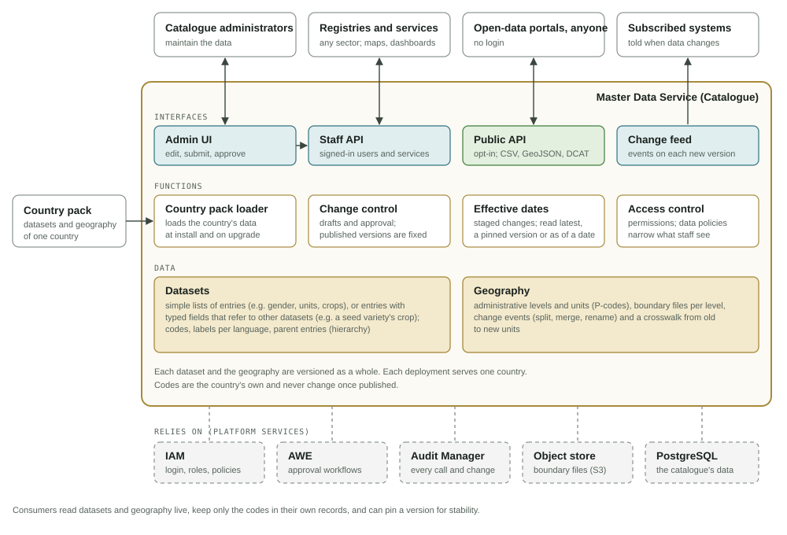

# Master Data Service (Catalogue)

A **catalogue** is the single, governed home of a country's **reference data**:
the datasets and geography that many systems use but none of
them owns. Examples are genders, education levels, units of measure, benefit
types, crops or administrative areas.

The **Master Data Service (MDS)** is OpenG2P's catalogue. It defines each piece of
reference data once, for every service in the deployment. Every change is
approved before it is published, every published version is kept, and a consumer
can always say exactly which version it used. MDS is generic: it serves any sector
(social protection, agriculture, health, …). The examples on these pages use one
country pack (Ethiopia) and a few sectors.

<figure><figcaption>
What MDS holds, what it does, and who uses it
</figcaption></figure>

## What it holds

MDS holds reference data only:

| | What it is | Example |
|---|---|---|
| **Datasets** | A country's own lists. A dataset holds **entries**: each a code and labels, and optionally typed fields that refer to other datasets. Each dataset has a **theme** (Core, or a sector) | Gender, units of measure, disability type; a seed variety with its crop and maturity days |
| **Geography** | The administrative hierarchy: levels, every unit with its code (P-code), and its boundaries | Country → region → zone → woreda |
| **Releases** | Named sets of pinned dataset and geography versions | "2027.1" for a census round |
| **Sample people** | A few dozen made-up people and households from the country pack, for **testing and demos only** | — |

MDS holds no partners (see [Partner Management](../partner-management/README.md))
and no registry records. All data first arrives from a **country pack**; see
[Country Packs](country-packs.md).

## Key features

| Feature | In one line | More |
|---|---|---|
| **Versioned datasets and geography** | Every dataset, and the geography, has numbered versions. A consumer reads the latest, pins a version, or reads as of a date | [Concepts](concepts.md#reading-latest-pinned-as-of-release) |
| **Effective dates and staged changes** | A version can be approved now and take effect on a future date | [Concepts](concepts.md#effective-dates) |
| **Change control with approvals** | Edits go into a draft, which is submitted and approved by another person (maker-checker) or through the Approval Workflow Engine | [Change Control](change-control.md) |
| **Codes fixed once published** | Labels can change; codes cannot. A recode is a retire plus an add. Entries are retired, never deleted | [Concepts](concepts.md#codes-are-fixed-once-published) |
| **Typed fields and references** | Entries can carry typed fields, a parent (hierarchy) and references to other datasets (cross-classification) | [Concepts](concepts.md#typed-attributes) |
| **Multilingual labels** | Labels per language for datasets, entries and units | [Concepts](concepts.md#multilingual-labels) |
| **Geography with boundary changes** | Splits, merges and renames are recorded as change events. A crosswalk maps old codes to new. Boundaries are kept per version | [Geography](geography.md) |
| **Change feed** | Every change is in an ordered feed; new and effective versions are also published to the WebSub hub | [For Consumers](consumers.md#following-changes) |
| **Public catalogue (opt-in)** | Datasets marked public can be read anonymously, with downloads, DCAT and SKOS, each with its [data licence](public-catalogue.md#data-licence) | [Public Catalogue](public-catalogue.md) |
| **Audit** | Every change and every API call is sent to the Audit Manager | [Change Control](change-control.md#audit) |
| **Data policies for staff** | Some reads are filtered by the caller's IAM data policy (for example, which geography units a staff member sees) | [API Reference](api-reference.md#authentication-and-permissions) |
| **One deployment per country** | A deployment is seeded with exactly one country pack. A second country needs a second deployment, so registry images stay country-neutral | [Deployment](deployment.md) |

Why MDS is built this way is on [Design Decisions](design-decisions.md). The
standards it uses are on [Standards](standards.md).

## Who uses it

| Consumer | Uses |
|---|---|
| **Registries** | Datasets and geography for data entry and validation, read live |
| **Other OpenG2P services** (PBMS, Bridge, SPAR, reporting) | Geography and dataset lookups |
| **Maps** | Boundary files per level and version |
| **Open-data portals and other websites** | Public datasets and geography, through the [public catalogue](public-catalogue.md) |

How to read, cache, pin and follow changes is on [For Consumers](consumers.md).
Catalogue administrators manage the data in the admin UI; the
[Admin Guide](admin-guide.md) explains it and has the common tasks.

## Deployment

MDS ships inside the **`commons-services`** Helm chart; it is not installed on
its own. The country pack is chosen in the chart's **Country Pack** group. See
[Deployment](deployment.md).

## Source code and versions

* **Repository:** [`github.com/OpenG2P/master-data-service`](https://github.com/OpenG2P/master-data-service)
  (API, admin UI, Helm chart and country-pack loader).
* **Versions and changelog:** [Versions](versions.md).

## Pages

| Page | What it covers |
|---|---|
| [Concepts](concepts.md) | Datasets and entries, versions, effective dates, reads, retired entries, fixed codes, typed fields, labels, releases, the change log |
| [Design Decisions](design-decisions.md) | Why reference data needs versions, and why MDS is designed as it is |
| [Geography and Boundary Changes](geography.md) | How geography and boundaries are represented, change events, the crosswalk |
| [Change Control and Approvals](change-control.md) | Drafts, approval modes, permissions, audit |
| [Country Packs](country-packs.md) | What a country pack is, how to build one, and how it loads |
| [For Consumers](consumers.md) | Who reads MDS, and how to read, cache, pin and follow changes |
| [Admin Guide](admin-guide.md) | The admin UI, who can do what, and the common tasks |
| [Public Catalogue](public-catalogue.md) | The opt-in, anonymous catalogue for other websites |
| [Deployment](deployment.md) | Installing MDS and its settings |
| [API Reference](api-reference.md) | Every endpoint |
| [Standards](standards.md) | The standards MDS uses |
| [Versions](versions.md) | Chart and image versions, and the changelog |
