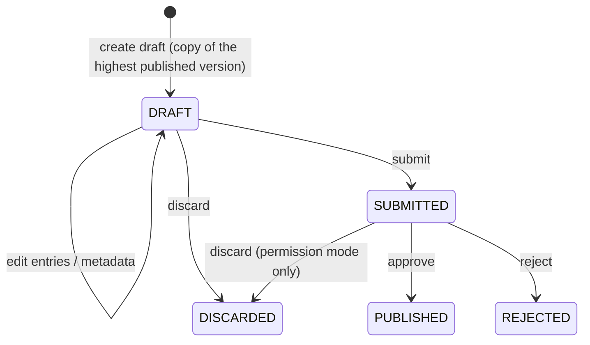

# API Reference

This is the API reference for the whole Master Data Service (MDS). One OpenAPI
spec covers every endpoint. It is generated from the code by
`master-data-api/scripts/generate_openapi.py` into
[`docs/openapi/openapi-master-data.json`](https://github.com/OpenG2P/master-data-service/blob/develop/docs/openapi/openapi-master-data.json).
A running instance also serves its own spec at `/openapi.json`, with interactive
docs at `/docs`.

## Audiences

MDS has two audiences: staff and the public. One API deployment serves both.

| Audience | Base path / host | Auth | Section |
|---|---|---|---|
| Staff | `/catalogue`, `/attributes`, `/geo`, `/samples` on the MDS API host | Keycloak bearer token (staff realm); permissions on writes | [Staff API](#staff-api) |
| Agent | — | — | — |
| Partner | — | — | — |
| Beneficiary | — | — | — |
| Public | `/public` on the MDS API host | None (anonymous); off by default | [Public API](#public-api) |

Two endpoints serve no audience: the [AWE callback](#awe-callback) (called by
the Approval Workflow Engine, HMAC-signed) and [Health](#health) (`/ping`). See
[Service endpoints](#service-endpoints).

The standards behind the API (OpenAPI, ISO 8601, JSON Schema, DCAT, SKOS, …)
are listed on [Standards](standards.md).

## Conventions

### Authentication and permissions

* Every endpoint except `/ping`, `/public/...` and the AWE callback needs a
  **bearer token** from the deployment's Keycloak.
* **Reads** need authentication only. Some reads are also filtered by the
  caller's **data policy** (said on the operation).
* **Writes** need a permission under the MDS Keycloak client (`master-data` by
  default; see [Deployment](deployment.md#settings-at-install)):
  `referenceData:create|edit|delete|publish` for
  datasets and releases, `geo:create|edit|delete|publish` for geography. Each
  operation below names its permission. See
  [Change control: permissions](change-control.md#permissions).
* The approve, reject and publish operations also enforce **maker ≠ checker**,
  compared by stable user id.
* With CSRF protection on (the default; see
  [Deployment](deployment.md#settings-at-install)), a `POST` also
  needs the double-submit CSRF token (cookie plus `X-CSRF-Token` header) that the
  admin UI sends. The **reads** of `/catalogue`, `/attributes`, `/geo` and
  `/samples` (all but `get_geo_settings`) and the AWE callback are exempt, so
  services can call them with a bearer token only.
* Every authenticated call, and every failed anonymous call, is recorded in the
  Audit Manager (see [Change control: audit](change-control.md#audit)).

### The envelope

Every `POST` uses the OpenG2P envelope, including reads:

```json
{
  "request_header": {
    "sender_app_mnemonic": "my-service",
    "sender_app_url": "http://my-service",
    "request_id": "11111111-1111-1111-1111-111111111111",
    "request_timestamp": "2026-10-01T10:00:00Z"
  },
  "request_body": {
    "request_payload": { "list_code": "GENDER" },
    "pagination_request": { "current_page": 1, "page_size": 100 }
  }
}
```

The response is `{ response_header, response_body }`, with the result in
`response_body.response_payload` and, for paged reads,
`response_body.pagination_response` (`number_of_items`, `number_of_pages`).
`pagination_request` is optional; paged reads default to 1000 per page.

`/public/...` (`GET`, plain JSON), the AWE callback and `/ping` do not use the
envelope.

### Errors

A business error comes back **inside the envelope with HTTP 200**:
`response_status` is `ERROR`, with a code in `response_error_code` and a message
in `response_error_message`. Check the status, not only the HTTP code. HTTP 401,
403 and 422 still come from authentication, permissions and request validation.

| Code | Meaning |
|---|---|
| `G2P-CAT-400` | Validation failed: bad entry, schema or `x-list-ref`; no changes to submit; `effective_from` earlier than the latest published version's |
| `G2P-CAT-403` | Maker ≠ checker refused, or no bearer token to forward to AWE |
| `G2P-CAT-404` | Dataset, entry, version, unit, release or draft not found |
| `G2P-CAT-409` | State conflict: a draft is already open, wrong draft status, approval runs through AWE, no boundary store, a boundary key used by another version, or a write to a published (immutable) row (message starts `immutable:`) |
| `G2P-CAT-CODE-IMMUTABLE` | The code of an entry that is in a published version cannot change. Retire the entry and add a new one instead. Returned by `upsert_draft_values`, `/attributes/update_attribute_value`, submit and approve; the database refuses it on publish too, and the country-pack loader stops a dataset's load with it |
| `G2P-CAT-502` | AWE could not be reached |
| `G2P-CAT-500` | Unexpected error |
| `G2P-ATTR-*`, `G2P-GEO-*` | The same, from the original `/attributes` and `/geo` endpoints |

### Choosing a version

Every read that returns versioned data takes **at most one** of:

| Field | Value | Returns |
|---|---|---|
| `version` | a number, `"latest"` (default) or `"draft"` | That version; the latest published version in effect; or the open draft |
| `as_of` | ISO 8601 date-time | The published version in effect at that moment |
| `release` | a release code | The version that release pins |

Every such response has a `version` object (`version_no`, `status`,
`base_version_no`, `effective_from`, `published_at`, `is_latest`, notes, and who
created, submitted and decided it); see [Version statuses](#version-statuses).
Reading a dataset that the named release does not pin is an error. See
[Concepts](concepts.md#reading-latest-pinned-as-of-release).

### Names in the API

The admin UI uses catalogue words; the API keeps its field names.

| Admin UI | API |
|---|---|
| Dataset | list: `list_id`, `list_code` (a request may give either as `list_code`) |
| Entry | value: `value_id`, `value_code`, `display` |
| Theme | `domain` |
| Publisher | `owner_org` |

## Data model

The fields, statuses and rules behind the operations below. The ideas are on
[Concepts](concepts.md). Field names are the API's: a dataset is a *list* and an
entry a *value* (see [Names in the API](#names-in-the-api)).

### Dataset fields

| Field | Meaning | Versioned? |
|---|---|---|
| `list_id` | Stable identifier | — |
| `list_code` | The dataset's code, e.g. `BENEFIT_TYPE`. A request may name a dataset by code or by id | Yes |
| `display`, `display_i18n` | Title, and titles per language | Yes |
| `is_hierarchical` | Whether entries may have a parent entry | Yes |
| `attribute_schema` | Optional schema for each entry's typed fields (see [Typed fields schema](#typed-fields-schema)) | Yes |
| `description` | What the dataset is for | No: applied at once |
| `owner_org` | The publisher. Defaults to the deployment's default publisher (see [Deployment](deployment.md#settings-at-install)); in `awe` mode it is sent to AWE with the [approval request](change-control.md#awe-through-the-approval-workflow-engine) | No: applied at once |
| `domain` | The theme: `core` for a country pack's core datasets, the pack domain (such as `agriculture`), or what a maker set; `null` (*Other*) when unknown | No: applied at once |
| `visibility`, `licence_uri`, `licence_label` | `private` or `public`, and the [data licence](public-catalogue.md#data-licence) | No: applied at once |

Versioned fields change only through a draft and are published with it. Reads of
a dataset also return `current_version_no` (the published version in effect now),
`latest_published_version_no` (the highest published version, which may be
future-effective), `open_draft_version_no`, `open_draft_status` and an
`attribute_schema_summary` (field names, required fields, dataset references).

### Entry fields

| Field | Meaning |
|---|---|
| `value_id` | Stable across versions, so a diff follows an entry from one version to the next |
| `value_code` | The code a registry stores; fixed once published |
| `display`, `display_i18n` | Label, and labels per language (e.g. `{"am": "በቆሎ", "om": "Boqqolloo"}`); geography units use `name`, `name_i18n` |
| `parent_code` | Parent entry, for hierarchical datasets |
| `sort_order` | Display order |
| `attributes` | Typed fields |
| `roles` | Role tags a country pack gives the entry (see [Country Packs](country-packs.md#semantic-roles)) |
| `status` | `ACTIVE` or `RETIRED` |

### Version statuses

| Status | Meaning | Readable by consumers? | Editable? |
|---|---|---|---|
| `DRAFT` | Being edited | By number, or with `version: "draft"` | Yes |
| `SUBMITTED` | Sent for approval; frozen while it waits | By number, or with `version: "draft"` | No |
| `PUBLISHED` | Approved. **Immutable** from here on | Yes | No, never |
| `REJECTED` | Approval refused. Kept for the record | By number | No |
| `DISCARDED` | Thrown away by its maker before it was published. Kept, with its content | By number | No |



* **One open version.** At most one `DRAFT` or `SUBMITTED` version per dataset,
  and for the geography.
* **Base version.** A draft starts from the highest published version and records
  it as `base_version_no`, so a diff always has something to compare with. To
  bring older content forward (for example to rework a rejected draft), a new
  draft can copy another version with `copy_from_version`; its base is still the
  highest published version.
* **Numbers are never reused**, so the published sequence may have gaps. A draft
  takes one more than the highest number ever used for that dataset (or the
  geography), counting rejected and discarded versions and the change log, so the
  change log, audit trail and boundary files of two versions cannot be confused.
* **Immutability is enforced in the database** by triggers, not only in the
  service, so no script, loader or direct SQL can alter a published version or its
  entries.
* **Who and when.** Each version records who created, last edited, submitted and
  decided it, and when, with the change note, decision note and approval
  reference. `*_by` holds the stable user id (the token's `sub`) or a system name
  such as `country-pack-loader`; `*_by_name` the display name at the time (`null`
  for a system).
* **Releases** are `DRAFT` while their members are chosen and `PUBLISHED` once
  fixed. A draft release can be deleted; a published one cannot be changed or
  deleted. A release must pin at least one dataset or a geography version. Who
  may publish it is on
  [Change Control](change-control.md#releases).

### Taking effect

`effective_from` can be set when the draft is created, edited later
(`update_list_draft`), given on submit, or overridden on approval. When a
future-effective version's date comes, MDS refreshes the current state (on
start, on every publish, and at a regular interval; see
[Deployment](deployment.md#settings-at-install)) and writes a
`list.version.effective` (or `geo.version.effective`) event, which is announced
like any other.

### Retired entries and recodes

* Reads leave retired entries out unless `include_retired: true`.
  `get_list_value` resolves a code and returns retired entries too.
* Retiring an entry that has active children fails unless `cascade: true`.
* An entry added in the open draft and never published is removed when retired.
  Upserting a retired code in a draft brings it back (`ACTIVE`).
* An entry only in the open draft, never published, may still change its code.
  A change to a published code is refused with `G2P-CAT-CODE-IMMUTABLE` (see
  [Errors](#errors)).

### Typed fields schema

A dataset's typed fields are declared in its **`attribute_schema`**, a JSON Schema
that every entry's `attributes` object must satisfy (see [Standards](standards.md)).
Entries are validated as they are written to a draft, again on submit, and again
on approval. A dataset without a schema takes `attributes` as free JSON.

A field refers to another dataset with **`x-list-ref`**:

```json
{
  "type": "object",
  "required": ["crop", "maturity_days"],
  "properties": {
    "crop":          { "type": "string", "x-list-ref": "CROP_COMMODITY" },
    "maturity_days": { "type": "integer", "minimum": 30, "maximum": 300 },
    "release_year":  { "type": "integer" },
    "agro_ecological_zones": {
      "type": "array",
      "items": { "type": "string", "x-list-ref": "AGRO_ECOLOGICAL_ZONE" }
    }
  }
}
```

An entry of `SEED_VARIETY` then looks like:

```json
{
  "value_code": "MAIZE_BH661",
  "display": "BH-661",
  "attributes": {
    "crop": "MAIZE",
    "maturity_days": 160,
    "release_year": 2011,
    "agro_ecological_zones": ["M2", "SH2"]
  }
}
```

#### Lists of references

An array whose `items` carry `x-list-ref` holds **several** codes of another
dataset, like `agro_ecological_zones` above. This is how an entry is
cross-classified: a crop keeps one parent in its own hierarchy and lists its
groups in a field:

```json
{
  "type": "object",
  "properties": {
    "groups": {
      "type": "array",
      "items": { "type": "string", "x-list-ref": "CROP_GROUP" },
      "uniqueItems": true
    }
  }
}
```

```json
{ "value_code": "MAIZE", "display": "Maize", "attributes": { "groups": ["CEREAL", "FODDER"] } }
```

* Every code in the array is checked, like a single reference; the error names
  the missing codes. The rest of the schema applies too (`minItems`,
  `uniqueItems`, …).
* Reads return the array as stored. `attribute_filters` matches entries whose
  array contains the given codes: `{"groups": ["FODDER"]}` finds `MAIZE`.

See [Design decisions](design-decisions.md#classification-hierarchy) for why
cross-classification is a field rather than a second parent.

#### Which version a reference is checked against

An `x-list-ref` code must be an **`ACTIVE`** entry of the referenced dataset's
version **in effect**:

* normally, the latest published version in effect now;
* for a draft with a **future** `effective_from`, the version in effect **on that
  date**;
* when a [release](concepts.md#catalogue-release) is published, the version
  **pinned in the release**, if it pins one.

**Drafts never count** (see [Concepts: typed fields](concepts.md#typed-fields)). A
failure is `G2P-CAT-400`, naming the referenced dataset, the missing codes and the
version checked.

### Change log entries

Each change-log entry has a monotonically increasing `event_id`, an `event_type`
(such as `list.version.published`; see
[Change feed and configuration](#change-feed-and-configuration)), a
`subject_type` (`list`, `geo` or `release`), a `subject_id`, the version number,
the `actor` (stable user id or a system name), `actor_name`, the time and
details. Every event goes to the Audit Manager, whoever wrote it: the API, the
country-pack loader, or the database itself (`*.version.effective`). `get_changes`
reads the log with a cursor (the last `event_id` seen). Delivery is at least
once; see [Change Control: audit](change-control.md#audit).

### Database tables

For developers. The schema is in the
[repository](https://github.com/OpenG2P/master-data-service)
(`models/g2p_catalogue.py`, `catalogue_sql.py`).

| Tables | Hold |
|---|---|
| `g2p_attributes` | Datasets and their administrative fields |
| `g2p_list_versions`, `g2p_list_version_values` | Dataset versions and their entries |
| `g2p_geo_versions`, `g2p_geo_version_levels`, `g2p_geo_version_units`, `g2p_geo_changes` | Geography versions, levels, units and change events |
| `g2p_catalogue_releases`, `g2p_catalogue_release_members` | Releases and their members |
| `g2p_catalogue_change_log` | The append-only change log, also the delivery outbox |
| `g2p_catalogue_awe_events`, `g2p_catalogue_state` | AWE callbacks received; catalogue settings and schema version |
| `g2p_attribute_values`, `g2p_geo_levels`, `g2p_geo_level_values` | The current published state (active entries and units only), refreshed from the versions |

Change data through drafts, the admin UI or a country-pack load, never directly
in these tables: a direct change is overwritten the next time that dataset or the
geography is published.

## Staff API

For staff in the MDS admin UI and the registry staff UIs. Calls need a bearer
token from the deployment's Keycloak. Writes need a permission (named on each
operation). Reads marked so are filtered by the caller's IAM data policy.
Registry backends also call the reads, with a service account token.

| Group | Prefix | For |
|---|---|---|
| [Datasets](#datasets) | `/catalogue` | Versioned datasets and their entries; drafts and approval |
| [Geography](#geography) | `/catalogue` | Versioned levels, units, change events, crosswalk and boundaries |
| [Releases](#releases) | `/catalogue` | Named sets of pinned dataset and geography versions |
| [Change feed and configuration](#change-feed-and-configuration) | `/catalogue` | What changed, and how this catalogue is set up |
| [Original endpoints](#original-endpoints) | `/attributes`, `/geo` | The current published state, for existing consumers |
| [Sample people](#sample-people-testing-and-demos-only) | `/samples` | Testing and demos only |

### Datasets

Reads and the draft workflow for datasets. Every write that edits a draft opens
one (a copy of the highest published version) if none is open. Approve and
reject work only in `permission` approval mode. See
[Concepts](concepts.md) and
[Change control](change-control.md).

| Operation | Permission | Summary |
|---|---|---|
| `POST /catalogue/get_lists` | Authenticated | All datasets |
| `POST /catalogue/get_list` | Authenticated | One dataset at a version |
| `POST /catalogue/get_list_values` | Authenticated | Entries (values) of a dataset at a version |
| `POST /catalogue/get_list_value` | Authenticated | One entry by code at a version |
| `POST /catalogue/get_list_versions` | Authenticated | Version history of a dataset |
| `POST /catalogue/get_list_diff` | Authenticated | Differences between two versions |
| `POST /catalogue/create_list` | `referenceData:create` | Create a dataset |
| `POST /catalogue/update_list` | `referenceData:edit` | Update a dataset's metadata |
| `POST /catalogue/create_list_draft` | `referenceData:edit` | Open a draft |
| `POST /catalogue/update_list_draft` | `referenceData:edit` | Set a draft's change note / effective date |
| `POST /catalogue/upsert_draft_values` | `referenceData:edit` | Add or change entries in the draft (batch) |
| `POST /catalogue/retire_draft_values` | `referenceData:delete` | Retire entries in the draft |
| `POST /catalogue/discard_draft` | `referenceData:edit` | Discard the open draft |
| `POST /catalogue/submit_draft` | `referenceData:edit` | Submit the draft for approval |
| `POST /catalogue/approve_draft` | `referenceData:publish` | Approve and publish (permission mode) |
| `POST /catalogue/reject_draft` | `referenceData:publish` | Reject the submitted draft (permission mode) |


[OpenAPI master-data-api](https://raw.githubusercontent.com/OpenG2P/master-data-service/develop/docs/openapi/openapi-master-data.json)



[OpenAPI master-data-api](https://raw.githubusercontent.com/OpenG2P/master-data-service/develop/docs/openapi/openapi-master-data.json)



[OpenAPI master-data-api](https://raw.githubusercontent.com/OpenG2P/master-data-service/develop/docs/openapi/openapi-master-data.json)



[OpenAPI master-data-api](https://raw.githubusercontent.com/OpenG2P/master-data-service/develop/docs/openapi/openapi-master-data.json)



[OpenAPI master-data-api](https://raw.githubusercontent.com/OpenG2P/master-data-service/develop/docs/openapi/openapi-master-data.json)



[OpenAPI master-data-api](https://raw.githubusercontent.com/OpenG2P/master-data-service/develop/docs/openapi/openapi-master-data.json)



[OpenAPI master-data-api](https://raw.githubusercontent.com/OpenG2P/master-data-service/develop/docs/openapi/openapi-master-data.json)



[OpenAPI master-data-api](https://raw.githubusercontent.com/OpenG2P/master-data-service/develop/docs/openapi/openapi-master-data.json)



[OpenAPI master-data-api](https://raw.githubusercontent.com/OpenG2P/master-data-service/develop/docs/openapi/openapi-master-data.json)



[OpenAPI master-data-api](https://raw.githubusercontent.com/OpenG2P/master-data-service/develop/docs/openapi/openapi-master-data.json)



[OpenAPI master-data-api](https://raw.githubusercontent.com/OpenG2P/master-data-service/develop/docs/openapi/openapi-master-data.json)



[OpenAPI master-data-api](https://raw.githubusercontent.com/OpenG2P/master-data-service/develop/docs/openapi/openapi-master-data.json)



[OpenAPI master-data-api](https://raw.githubusercontent.com/OpenG2P/master-data-service/develop/docs/openapi/openapi-master-data.json)



[OpenAPI master-data-api](https://raw.githubusercontent.com/OpenG2P/master-data-service/develop/docs/openapi/openapi-master-data.json)



[OpenAPI master-data-api](https://raw.githubusercontent.com/OpenG2P/master-data-service/develop/docs/openapi/openapi-master-data.json)



[OpenAPI master-data-api](https://raw.githubusercontent.com/OpenG2P/master-data-service/develop/docs/openapi/openapi-master-data.json)


### Geography

The geography is versioned as one dataset: levels, units (`unit_id` is the
P-code), change events and boundaries together. `get_geo_units` is paged and
filtered by `GEO` data policies. See
[Geography and boundary changes](geography.md).

| Operation | Permission | Summary |
|---|---|---|
| `POST /catalogue/get_geo_versions` | Authenticated | Geography version history |
| `POST /catalogue/get_geo_levels` | Authenticated | Levels of a geography version |
| `POST /catalogue/get_geo_units` | Authenticated | Units of a geography version |
| `POST /catalogue/get_geo_unit` | Authenticated | One unit, with its ancestors |
| `POST /catalogue/get_geo_changes` | Authenticated | Change events (lineage) between versions |
| `POST /catalogue/get_geo_crosswalk` | Authenticated | Map a unit across versions |
| `POST /catalogue/get_geo_boundary` | Authenticated | Boundary GeoJSON of a level |
| `POST /catalogue/get_geo_settings` | Authenticated | Geography settings (visibility, licence) |
| `POST /catalogue/create_geo_draft` | `geo:edit` | Open a geography draft |
| `POST /catalogue/update_geo_draft` | `geo:edit` | Set the geography draft's note / effective date / owner |
| `POST /catalogue/update_geo_settings` | `geo:edit` | Set the geography's visibility / licence |
| `POST /catalogue/upsert_draft_levels` | `geo:edit` | Add or change levels in the geography draft |
| `POST /catalogue/upsert_draft_units` | `geo:edit` | Add or change units in the geography draft (batch) |
| `POST /catalogue/retire_draft_units` | `geo:delete` | Retire units in the geography draft |
| `POST /catalogue/record_geo_change` | `geo:edit` | Record a change event in the geography draft |
| `POST /catalogue/delete_geo_change` | `geo:edit` | Remove a change event from the geography draft |
| `POST /catalogue/upload_draft_boundary` | `geo:edit` | Upload a level's boundary GeoJSON to the draft |
| `POST /catalogue/submit_geo_draft` | `geo:edit` | Submit the geography draft for approval |
| `POST /catalogue/approve_geo_draft` | `geo:publish` | Approve and publish the geography draft (permission mode) |
| `POST /catalogue/reject_geo_draft` | `geo:publish` | Reject the geography draft (permission mode) |
| `POST /catalogue/discard_geo_draft` | `geo:edit` | Discard the geography draft |


[OpenAPI master-data-api](https://raw.githubusercontent.com/OpenG2P/master-data-service/develop/docs/openapi/openapi-master-data.json)



[OpenAPI master-data-api](https://raw.githubusercontent.com/OpenG2P/master-data-service/develop/docs/openapi/openapi-master-data.json)



[OpenAPI master-data-api](https://raw.githubusercontent.com/OpenG2P/master-data-service/develop/docs/openapi/openapi-master-data.json)



[OpenAPI master-data-api](https://raw.githubusercontent.com/OpenG2P/master-data-service/develop/docs/openapi/openapi-master-data.json)



[OpenAPI master-data-api](https://raw.githubusercontent.com/OpenG2P/master-data-service/develop/docs/openapi/openapi-master-data.json)



[OpenAPI master-data-api](https://raw.githubusercontent.com/OpenG2P/master-data-service/develop/docs/openapi/openapi-master-data.json)



[OpenAPI master-data-api](https://raw.githubusercontent.com/OpenG2P/master-data-service/develop/docs/openapi/openapi-master-data.json)



[OpenAPI master-data-api](https://raw.githubusercontent.com/OpenG2P/master-data-service/develop/docs/openapi/openapi-master-data.json)



[OpenAPI master-data-api](https://raw.githubusercontent.com/OpenG2P/master-data-service/develop/docs/openapi/openapi-master-data.json)



[OpenAPI master-data-api](https://raw.githubusercontent.com/OpenG2P/master-data-service/develop/docs/openapi/openapi-master-data.json)



[OpenAPI master-data-api](https://raw.githubusercontent.com/OpenG2P/master-data-service/develop/docs/openapi/openapi-master-data.json)



[OpenAPI master-data-api](https://raw.githubusercontent.com/OpenG2P/master-data-service/develop/docs/openapi/openapi-master-data.json)



[OpenAPI master-data-api](https://raw.githubusercontent.com/OpenG2P/master-data-service/develop/docs/openapi/openapi-master-data.json)



[OpenAPI master-data-api](https://raw.githubusercontent.com/OpenG2P/master-data-service/develop/docs/openapi/openapi-master-data.json)



[OpenAPI master-data-api](https://raw.githubusercontent.com/OpenG2P/master-data-service/develop/docs/openapi/openapi-master-data.json)



[OpenAPI master-data-api](https://raw.githubusercontent.com/OpenG2P/master-data-service/develop/docs/openapi/openapi-master-data.json)



[OpenAPI master-data-api](https://raw.githubusercontent.com/OpenG2P/master-data-service/develop/docs/openapi/openapi-master-data.json)



[OpenAPI master-data-api](https://raw.githubusercontent.com/OpenG2P/master-data-service/develop/docs/openapi/openapi-master-data.json)



[OpenAPI master-data-api](https://raw.githubusercontent.com/OpenG2P/master-data-service/develop/docs/openapi/openapi-master-data.json)



[OpenAPI master-data-api](https://raw.githubusercontent.com/OpenG2P/master-data-service/develop/docs/openapi/openapi-master-data.json)



[OpenAPI master-data-api](https://raw.githubusercontent.com/OpenG2P/master-data-service/develop/docs/openapi/openapi-master-data.json)


### Releases

A release pins a set of published dataset versions and at most one geography
version. A published release is immutable. Its publisher must be neither its
creator nor whoever last set its members. See
[Concepts: catalogue release](concepts.md#catalogue-release).

| Operation | Permission | Summary |
|---|---|---|
| `POST /catalogue/get_releases` | Authenticated | All catalogue releases |
| `POST /catalogue/get_release` | Authenticated | One release with its members |
| `POST /catalogue/create_release` | `referenceData:edit` | Create a draft release |
| `POST /catalogue/set_release_members` | `referenceData:edit` | Pin dataset versions and a geography version |
| `POST /catalogue/publish_release` | `referenceData:publish` | Publish a release (immutable) |
| `POST /catalogue/delete_release` | `referenceData:delete` | Delete a draft release |


[OpenAPI master-data-api](https://raw.githubusercontent.com/OpenG2P/master-data-service/develop/docs/openapi/openapi-master-data.json)



[OpenAPI master-data-api](https://raw.githubusercontent.com/OpenG2P/master-data-service/develop/docs/openapi/openapi-master-data.json)



[OpenAPI master-data-api](https://raw.githubusercontent.com/OpenG2P/master-data-service/develop/docs/openapi/openapi-master-data.json)



[OpenAPI master-data-api](https://raw.githubusercontent.com/OpenG2P/master-data-service/develop/docs/openapi/openapi-master-data.json)



[OpenAPI master-data-api](https://raw.githubusercontent.com/OpenG2P/master-data-service/develop/docs/openapi/openapi-master-data.json)



[OpenAPI master-data-api](https://raw.githubusercontent.com/OpenG2P/master-data-service/develop/docs/openapi/openapi-master-data.json)


### Change feed and configuration

`get_changes` reads the append-only change log after a cursor (the last
`event_id` processed), oldest first. Call again with `next_cursor` while
`has_more` is true. `newest: true` returns the newest events instead, for an
activity view. See [For consumers](consumers.md#following-changes).

| Subject | Event types |
|---|---|
| Datasets | `list.created`, `list.updated`, `list.deleted` (never-published only), `list.draft.created`, `list.draft.updated`, `list.draft.metadata_changed`, `list.draft.values_changed`, `list.draft.values_retired`, `list.draft.submitted`, `list.approval.requested`, `list.draft.approved`, `list.draft.rejected`, `list.draft.discarded`, `list.version.published`, `list.version.effective` |
| Geography | `geo.draft.created`, `geo.draft.updated`, `geo.draft.levels_changed`, `geo.draft.level_removed`, `geo.draft.units_changed`, `geo.draft.units_retired`, `geo.change.recorded`, `geo.change.deleted`, `geo.draft.boundary_uploaded`, `geo.draft.submitted`, `geo.approval.requested`, `geo.draft.approved`, `geo.draft.rejected`, `geo.draft.discarded`, `geo.settings.updated`, `geo.version.published`, `geo.version.effective` |
| Releases | `release.created`, `release.members_set`, `release.published`, `release.deleted` |

When a WebSub hub is configured, MDS also publishes to these topics (prefix
`openg2p.master-data` by default). Delivery is at least once: de-duplicate on
`event_id`.

| Topic | Sent on |
|---|---|
| `<prefix>.list.published`, `<prefix>.geo.published` | `*.version.published` |
| `<prefix>.list.effective`, `<prefix>.geo.effective` | `*.version.effective`: a future-effective version came into effect |
| `<prefix>.release.published` | `release.published` |

| Operation | Permission | Summary |
|---|---|---|
| `POST /catalogue/get_changes` | Authenticated | Change feed |
| `POST /catalogue/get_catalogue_config` | Authenticated | How this catalogue is configured |


[OpenAPI master-data-api](https://raw.githubusercontent.com/OpenG2P/master-data-service/develop/docs/openapi/openapi-master-data.json)



[OpenAPI master-data-api](https://raw.githubusercontent.com/OpenG2P/master-data-service/develop/docs/openapi/openapi-master-data.json)


### Original endpoints

The `/attributes` and `/geo` endpoints serve existing consumers (the registry
staff UI fills dropdowns from them).

* **Reads** return the **current published** state, cached per API worker, and
  filtered by the caller's data policy. `/attributes` reads add
  `current_version_no` and `list_versions`. For other versions use the
  `/catalogue` reads.
* **Writes** do not change published data: they edit the open **draft**
  (opening one from the highest published version if none is open), which must
  then be submitted and approved. They return the changed object, not the draft,
  and fail while the draft is `SUBMITTED`. A write is not visible to reads until
  the draft is approved: a script that adds an entry and reads it back at once
  will not find it.

| Endpoint | What it does |
|---|---|
| `add_attribute` | Creates the dataset with an empty draft (version 1). It appears in `get_all_attributes` at once, with `current_version_no: null` and no entries |
| `update_attribute` | Changes the code, label or hierarchy flag in the draft |
| `delete_attribute` | Deletes a dataset never published. A published dataset is never deleted: all its entries are retired in the draft. Existing entries block it unless `cascade` is set |
| `add_attribute_value` | Adds the entry to the draft |
| `update_attribute_value` | Changes the entry in the draft. A published entry's code is refused (`G2P-CAT-CODE-IMMUTABLE`) |
| `delete_attribute_value` | Retires the entry in the draft (removes it if new in the draft); refused while it has active children |
| `add_geo_level`, `update_geo_level`, `delete_geo_level` | Change the levels in the geography draft; a level is removed only if it has no child levels and no units |
| `add_geo_level_value`, `update_geo_level_value`, `delete_geo_level_value` | Add, change or retire the unit in the geography draft |

| Operation | Permission | Summary |
|---|---|---|
| `POST /attributes/get_all_attributes` | Authenticated | All datasets (current published version) |
| `POST /attributes/get_attribute_values` | Authenticated | Entries of datasets (current published version) |
| `POST /attributes/add_attribute` | `referenceData:create` | Add a dataset (into a draft) |
| `POST /attributes/update_attribute` | `referenceData:edit` | Update a dataset (in its draft) |
| `POST /attributes/delete_attribute` | `referenceData:delete` | Delete a dataset |
| `POST /attributes/add_attribute_value` | `referenceData:create` | Add an entry (into the draft) |
| `POST /attributes/update_attribute_value` | `referenceData:edit` | Update an entry (in the draft) |
| `POST /attributes/delete_attribute_value` | `referenceData:delete` | Retire an entry (in the draft) |
| `POST /geo/get_all_geo_levels` | Authenticated | All geography levels (current published version) |
| `POST /geo/get_geo_level_values` | Authenticated | Units of a geography level (current published version) |
| `POST /geo/add_geo_level` | `geo:create` | Add a geography level (into the draft) |
| `POST /geo/update_geo_level` | `geo:edit` | Update a geography level (in the draft) |
| `POST /geo/delete_geo_level` | `geo:delete` | Delete a geography level (in the draft) |
| `POST /geo/add_geo_level_value` | `geo:create` | Add a geography unit (into the draft) |
| `POST /geo/update_geo_level_value` | `geo:edit` | Update a geography unit (in the draft) |
| `POST /geo/delete_geo_level_value` | `geo:delete` | Retire a geography unit (in the draft) |


[OpenAPI master-data-api](https://raw.githubusercontent.com/OpenG2P/master-data-service/develop/docs/openapi/openapi-master-data.json)



[OpenAPI master-data-api](https://raw.githubusercontent.com/OpenG2P/master-data-service/develop/docs/openapi/openapi-master-data.json)



[OpenAPI master-data-api](https://raw.githubusercontent.com/OpenG2P/master-data-service/develop/docs/openapi/openapi-master-data.json)



[OpenAPI master-data-api](https://raw.githubusercontent.com/OpenG2P/master-data-service/develop/docs/openapi/openapi-master-data.json)



[OpenAPI master-data-api](https://raw.githubusercontent.com/OpenG2P/master-data-service/develop/docs/openapi/openapi-master-data.json)



[OpenAPI master-data-api](https://raw.githubusercontent.com/OpenG2P/master-data-service/develop/docs/openapi/openapi-master-data.json)



[OpenAPI master-data-api](https://raw.githubusercontent.com/OpenG2P/master-data-service/develop/docs/openapi/openapi-master-data.json)



[OpenAPI master-data-api](https://raw.githubusercontent.com/OpenG2P/master-data-service/develop/docs/openapi/openapi-master-data.json)



[OpenAPI master-data-api](https://raw.githubusercontent.com/OpenG2P/master-data-service/develop/docs/openapi/openapi-master-data.json)



[OpenAPI master-data-api](https://raw.githubusercontent.com/OpenG2P/master-data-service/develop/docs/openapi/openapi-master-data.json)



[OpenAPI master-data-api](https://raw.githubusercontent.com/OpenG2P/master-data-service/develop/docs/openapi/openapi-master-data.json)



[OpenAPI master-data-api](https://raw.githubusercontent.com/OpenG2P/master-data-service/develop/docs/openapi/openapi-master-data.json)



[OpenAPI master-data-api](https://raw.githubusercontent.com/OpenG2P/master-data-service/develop/docs/openapi/openapi-master-data.json)



[OpenAPI master-data-api](https://raw.githubusercontent.com/OpenG2P/master-data-service/develop/docs/openapi/openapi-master-data.json)



[OpenAPI master-data-api](https://raw.githubusercontent.com/OpenG2P/master-data-service/develop/docs/openapi/openapi-master-data.json)



[OpenAPI master-data-api](https://raw.githubusercontent.com/OpenG2P/master-data-service/develop/docs/openapi/openapi-master-data.json)


### Sample people (testing and demos only)


**For testing and demos only; do not use in production.** These endpoints serve
the made-up sample people a country pack ships, so that several registries in a
demo share the same people. They are not reference data: not versioned, not
approved. A production deployment should not load them.


Any authenticated caller. Paged. Empty unless the deployment loaded the pack's
samples.

| Operation | Permission | Summary |
|---|---|---|
| `POST /samples/get_individuals` | Authenticated | Sample people (testing and demos only) |
| `POST /samples/get_households` | Authenticated | Sample households (testing and demos only) |


[OpenAPI master-data-api](https://raw.githubusercontent.com/OpenG2P/master-data-service/develop/docs/openapi/openapi-master-data.json)



[OpenAPI master-data-api](https://raw.githubusercontent.com/OpenG2P/master-data-service/develop/docs/openapi/openapi-master-data.json)


## Public API

For anyone. No login.

Anonymous `GET` endpoints, **off by default** (every `/public` path answers 404
until the deployment enables it). Only datasets and geography marked public, at
their **published** versions. Plain JSON (JSON-LD for DCAT and SKOS); errors are
`{"detail": "…"}` with 400, 404 or 429. Responses carry `ETag`,
`Last-Modified` and `Cache-Control`, allow any origin (CORS), and are rate
limited per client IP. See [Public catalogue](public-catalogue.md).

* **Version:** `version` (a published version number, or `latest`, the default)
  or `as_of` (date-time). `version=draft` is refused (400). Retired entries and
  units are left out unless `include_retired=true`. Entries and units are paged
  (`page_size` up to 5000).
* **Caching:** `If-None-Match` gives 304; `Last-Modified` is the version's
  publication time and `If-Modified-Since` is honoured;
  `Cache-Control: public, max-age=<seconds>`.
* **Rate limit:** per client IP and API worker; the limit per minute is also the
  burst. Over it, 429 with `Retry-After`. The client IP is read from
  `X-Forwarded-For`, counting the trusted proxy hops from the right. The limits
  are set on [Deployment](deployment.md#public-catalogue-host).
* **Audit:** anonymous failures (404, 429) are sent to the Audit Manager;
  successes are not.
* **Links** in DCAT, SKOS and JSON are absolute: based on the configured public
  base URL when set, else on the request (`X-Forwarded-Proto`,
  `X-Forwarded-Host`). Plain labels in SKOS and DCAT are tagged with the
  deployment's default language. Both are set on
  [Deployment](deployment.md#public-catalogue-host).

| Download | Columns / content |
|---|---|
| Dataset CSV | `code`, `label`, `label_<lang>` per language, `parent_code`, `sort_order`, `status`, `attributes` (JSON), `roles` (JSON) |
| Dataset JSON | As `entries`, for the whole version |
| Units CSV | `unit_id`, `name`, `name_<lang>` per language, `level`, `parent_unit_id`, `status`, `valid_from`, `valid_to` |
| Boundaries GeoJSON | The version's boundary file for the level, as loaded, streamed from the object store |

Downloads are named like `CROP_COMMODITY-v4.csv` and
`geography-v2-woreda.geojson`, and are generated or streamed on request; no
bucket is made public.

| Operation | Permission | Summary |
|---|---|---|
| `GET /public/catalog` | None (anonymous) | DCAT catalogue (JSON-LD) |
| `GET /public/datasets` | None (anonymous) | Public datasets |
| `GET /public/datasets/{code}` | None (anonymous) | One public dataset |
| `GET /public/datasets/{code}/entries` | None (anonymous) | Entries of a public dataset |
| `GET /public/datasets/{code}/entries/{entry_code}` | None (anonymous) | One entry of a public dataset |
| `GET /public/datasets/{code}/download.csv` | None (anonymous) | Download a version as CSV |
| `GET /public/datasets/{code}/download.json` | None (anonymous) | Download a version as JSON |
| `GET /public/datasets/{code}/skos` | None (anonymous) | SKOS concept scheme (JSON-LD) |
| `GET /public/geography` | None (anonymous) | Public geography |
| `GET /public/geography/levels` | None (anonymous) | Geography levels |
| `GET /public/geography/units` | None (anonymous) | Geography units |
| `GET /public/geography/levels/{level}/units.csv` | None (anonymous) | Units of a level as CSV |
| `GET /public/geography/levels/{level}/boundaries.geojson` | None (anonymous) | Boundaries of a level (GeoJSON) |
| `GET /public/releases` | None (anonymous) | Published releases |
| `GET /public/releases/{code}` | None (anonymous) | One published release |


[OpenAPI master-data-api](https://raw.githubusercontent.com/OpenG2P/master-data-service/develop/docs/openapi/openapi-master-data.json)



[OpenAPI master-data-api](https://raw.githubusercontent.com/OpenG2P/master-data-service/develop/docs/openapi/openapi-master-data.json)



[OpenAPI master-data-api](https://raw.githubusercontent.com/OpenG2P/master-data-service/develop/docs/openapi/openapi-master-data.json)



[OpenAPI master-data-api](https://raw.githubusercontent.com/OpenG2P/master-data-service/develop/docs/openapi/openapi-master-data.json)



[OpenAPI master-data-api](https://raw.githubusercontent.com/OpenG2P/master-data-service/develop/docs/openapi/openapi-master-data.json)



[OpenAPI master-data-api](https://raw.githubusercontent.com/OpenG2P/master-data-service/develop/docs/openapi/openapi-master-data.json)



[OpenAPI master-data-api](https://raw.githubusercontent.com/OpenG2P/master-data-service/develop/docs/openapi/openapi-master-data.json)



[OpenAPI master-data-api](https://raw.githubusercontent.com/OpenG2P/master-data-service/develop/docs/openapi/openapi-master-data.json)



[OpenAPI master-data-api](https://raw.githubusercontent.com/OpenG2P/master-data-service/develop/docs/openapi/openapi-master-data.json)



[OpenAPI master-data-api](https://raw.githubusercontent.com/OpenG2P/master-data-service/develop/docs/openapi/openapi-master-data.json)



[OpenAPI master-data-api](https://raw.githubusercontent.com/OpenG2P/master-data-service/develop/docs/openapi/openapi-master-data.json)



[OpenAPI master-data-api](https://raw.githubusercontent.com/OpenG2P/master-data-service/develop/docs/openapi/openapi-master-data.json)



[OpenAPI master-data-api](https://raw.githubusercontent.com/OpenG2P/master-data-service/develop/docs/openapi/openapi-master-data.json)



[OpenAPI master-data-api](https://raw.githubusercontent.com/OpenG2P/master-data-service/develop/docs/openapi/openapi-master-data.json)



[OpenAPI master-data-api](https://raw.githubusercontent.com/OpenG2P/master-data-service/develop/docs/openapi/openapi-master-data.json)


## Service endpoints

These are not for an audience. They are called by other services or by the
platform.

### AWE callback

In `awe` approval mode, AWE posts its decision here
(`POST /catalogue/awe/callback`). It is for AWE only: no user token and no
envelope, but an HMAC signature, as in the
[registry's AWE integration](../approval-workflow-engine/integration-with-registry.md):
`X-Approval-Signature: sha256=HMAC_SHA256(secret, "<X-Approval-Timestamp>." + body)`,
with `X-Approval-Timestamp` (within 300 s) and `X-Approval-Event-Id`. The body is
AWE's webhook event. `request_approved` publishes the version;
`request_rejected` and `request_cancelled` mark it `REJECTED`. The decision is
recorded with the actor AWE reports (or `awe`). Idempotent on `event_id`; answers
401 for a bad signature and 422 for an event that cannot be applied.

| | Datasets | Geography |
|---|---|---|
| Policy key (default; see [Deployment](deployment.md#approval-through-awe)) | `master_data.list_version.v1` | `master_data.geo_version.v1` |
| Artifact type | `master_data.list_version` | `master_data.geo_version` |
| Artifact id | `<list_id>:<version_no>` | `geography:<version_no>` |
| Context | `list_code`, `list_id`, `version_no`, `owner_org`, `change_note` | `version_no`, `owner_org`, `country`, `change_note` |

See [Change control: AWE](change-control.md#awe-through-the-approval-workflow-engine).


[OpenAPI master-data-api](https://raw.githubusercontent.com/OpenG2P/master-data-service/develop/docs/openapi/openapi-master-data.json)


### Health

`GET /ping` answers `pong` while the service is up. No token, no envelope.


[OpenAPI master-data-api](https://raw.githubusercontent.com/OpenG2P/master-data-service/develop/docs/openapi/openapi-master-data.json)

