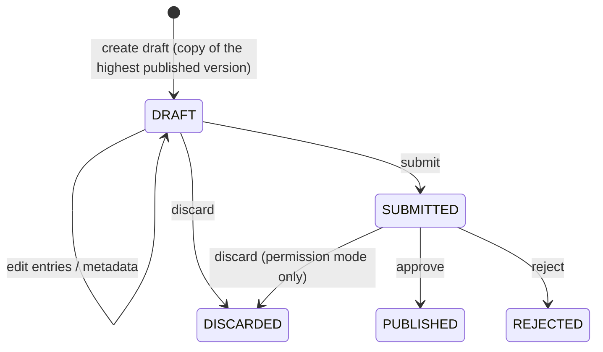

# Concepts

## Dataset

A **dataset** is one set of reference data: `GENDER`, `CROP_COMMODITY`,
`SEED_VARIETY`, `UNIT_OF_MEASURE`. Its items are **entries**. In the API a
dataset is a *list* (`list_id`, `list_code`) and an entry is a *value*; in the
database a dataset is a row in `g2p_attributes`.

| Field | Meaning | Versioned? |
|---|---|---|
| `list_id` | Stable identifier. Defaults to the code when the dataset is created through `/catalogue`; a random id when created through `/attributes/add_attribute` | — |
| `list_code` | The dataset's code, e.g. `SEED_VARIETY`. A request may name a dataset by code or by id | Yes |
| `display`, `display_i18n` | Title, and titles per language | Yes |
| `is_hierarchical` | Whether entries may have a parent entry | Yes |
| `attribute_schema` | Optional schema for each entry's typed fields (see [Typed attributes](#typed-attributes)) | Yes |
| `description` | What the dataset is for | No: applied at once |
| `owner_org` | The department that owns it (the **Publisher** in the UI) | No: applied at once |
| `domain` | Its **theme** (`core`, `agriculture`, …) | No: applied at once |
| `visibility`, `licence_uri`, `licence_label` | Whether the [public catalogue](public-catalogue.md) may show it, and its licence | No: applied at once |

"Versioned" fields change only through a draft and are published with it; the
others are administrative and take effect at once. Reads of a dataset also return
`current_version_no` (the published version in effect now),
`latest_published_version_no` (the highest published version, which may be
future-effective), `open_draft_version_no`, `open_draft_status` and an
`attribute_schema_summary` (field names, required fields, dataset references).

Each **entry** in a version has a stable `value_id`, a `value_code` (what a
registry stores), `display`, `display_i18n`, an optional `parent_code` (for
hierarchical datasets), `sort_order`, `attributes` (typed fields), `roles` (the
role tags a country pack gives an entry) and a `status` of `ACTIVE` or
`RETIRED`. Because `value_id` is stable, an entry's code can change between
versions and the diff still sees it as the same entry.

The **geography** (levels, units and boundaries) is versioned the same way but as
a single dataset, not one per level. See
[Geography and boundary changes](geography.md).

## Version

A **version** is a numbered state of a dataset: version 1, 2, 3, … Each version
has a status:

| Status | Meaning | Readable by consumers? | Editable? |
|---|---|---|---|
| `DRAFT` | Being edited | By number, or with `version: "draft"` | Yes |
| `SUBMITTED` | Sent for approval; frozen while it waits | By number, or with `version: "draft"` | No |
| `PUBLISHED` | Approved. **Immutable** from here on | Yes | No, never |
| `REJECTED` | Approval refused. Kept for the record | By number | No |
| `DISCARDED` | Thrown away by its maker before it was published. Kept, with its content, so its number is never used again | By number | No |

A dataset has **at most one open version** (`DRAFT` or `SUBMITTED`) at a time,
enforced by a unique index; so does the geography.



A draft always starts from the **highest published version**, which it records as
`base_version_no`, so a diff always has something to compare with. To bring older
content forward (for example to rework a rejected draft), a new draft can copy
another version's content with `copy_from_version`; its base is still the highest
published version.

Each version records who created, last edited, submitted and decided it, and
when, plus the change note, the decision note and the approval reference. The
`*_by` fields hold the person's **stable user id** (the token's `sub`) or a system
name such as `country-pack-loader`; the `*_by_name` fields hold the person's
display name as it was when they acted. A system actor has no name (`null`).


**Version numbers are never reused, so the published sequence may have gaps.** A
draft takes one more than the highest number ever used for that dataset (or the
geography), counting rejected and discarded versions and the change log. So the
change log, the audit trail and the boundary files of one version can never be
confused with another's.


A dataset that is no longer used keeps its versions; its entries can be retired
in a new version. (The status `RETIRED` exists for versions but nothing sets it.)

### Published means immutable

Once a version is `PUBLISHED`, neither the version nor its entries can be changed
or deleted. This is enforced **in the database by triggers**, not only in the
service code, so no script, loader or direct SQL can alter a published version by
accident. Every change, however small, is a new version.

## Effective dates

Every published version has an `effective_from` date and time:

* By default it is the moment of publishing.
* It may be in the **future**: new woredas that come into force on 2027-01-01 can
  be approved and published in October 2026.
* It can only **move forward**: not earlier than the `effective_from` of the
  latest published version.

It can be set when the draft is created, edited later (`update_list_draft`), given
on submit, or overridden on approval.

A future-effective version is published and immutable, and can be read by number,
but it is **not yet `latest`**. When its date comes, MDS refreshes the
current-state tables (on start, on every publish, and every
`catalogue.effectiveRefreshSeconds`, 300 by default) and writes a
`list.version.effective` (or `geo.version.effective`) event. That event is
announced like any other, so a consumer learns when a version **takes effect**,
not only when it was published.

## Reading: latest, pinned, as of, release

Every read names which version it wants, in one of these ways (at most one):

| Read | Request | Returns |
|---|---|---|
| **Latest** (default) | `version: "latest"` or nothing | The latest **published** version whose `effective_from` is now or earlier |
| **Pinned** | `version: 3` | Exactly version 3, whatever has been published since |
| **As of** | `as_of: "2026-06-30T00:00:00Z"` | The latest published version whose `effective_from` is on or before that moment |
| **Release** | `release: "2027.1"` | The version that [catalogue release](#catalogue-release) pins |
| **Draft** | `version: "draft"` | The open draft, for review before approval |

**Every response says which version it came from**, in a `version` object
(`version_no`, `status`, `effective_from`, `is_latest`, notes, who and when). A
consumer never has to guess.

Data migrated from before the catalogue is version 1 with `effective_from`
1970-01-01, so an `as_of` read for any past date still resolves.

Which read to use is covered in
[For consumers](consumers.md#latest-pinned-or-as-of).

## Retired entries

A published entry is **never deleted**. When an entry should no longer be used,
the next version marks it `RETIRED`. It stays in that version and every later one,
so:

* records that hold the code still resolve to a label;
* a report can still show "Season: Summer (retired)";
* a pinned consumer reading an older version sees it as it was.

An entry added in the current draft and never published is simply removed when it
is retired. Upserting a retired code in a draft brings it back (`ACTIVE`).
Retiring an entry that has active children fails unless `cascade: true` is
passed.

Reads leave retired entries out unless asked (`include_retired: true`). A dropdown
for new data entry should leave them out; a screen that shows an existing record
should include them, or resolve the code with `get_list_value`, which returns
retired entries too.

Geography units are retired the same way; see
[Geography and boundary changes](geography.md).

## Typed attributes

Simple datasets need only a code and a label. Reference **entities** need more: a
seed variety has a crop, maturity days, release year and agro-ecological zones; an
input product has a type and unit.

A dataset may declare an **`attribute_schema`**, a JSON Schema that every entry's
`attributes` object must satisfy (see [Standards](../standards.md)). Entries are
validated against it as they are written to a draft, again on submit, and again
on approval.

A field may refer to another dataset with **`x-list-ref`**:

```json
{
  "type": "object",
  "required": ["crop", "maturity_days"],
  "properties": {
    "crop":          { "type": "string", "x-list-ref": "CROP_COMMODITY" },
    "maturity_days": { "type": "integer", "minimum": 30, "maximum": 300 },
    "release_year":  { "type": "integer" },
    "agro_ecological_zones": {
      "type": "array",
      "items": { "type": "string", "x-list-ref": "AGRO_ECOLOGICAL_ZONE" }
    }
  }
}
```

An entry of `SEED_VARIETY` then looks like:

```json
{
  "value_code": "MAIZE_BH661",
  "display": "BH-661",
  "attributes": {
    "crop": "MAIZE",
    "maturity_days": 160,
    "release_year": 2011,
    "agro_ecological_zones": ["M2", "SH2"]
  }
}
```

An `x-list-ref` code must be an **`ACTIVE`** entry of the referenced dataset's
version **in effect**, so a reference to a retired entry is rejected:

* normally, the referenced dataset's latest published version in effect now;
* for a draft with a **future** `effective_from`, the referenced dataset's version
  in effect **on that date**;
* when a [release](#catalogue-release) is published, the version **pinned in the
  release**, if the release pins it.

**Drafts never count**: a code that exists only in the referenced dataset's open
draft is not accepted. When two datasets change together (a new crop and its
varieties), **publish the referenced dataset first**, with the same or an earlier
effective date, then submit the one that refers to it. A failure is
`G2P-CAT-400`; the message names the referenced dataset, the missing codes and the
version they were checked against.

Changing a dataset's schema is itself a change and goes through a draft.

## Multilingual labels

Datasets, entries and geography levels carry a default label (`display`) and labels
per language (`display_i18n`); geography units carry `name` and `name_i18n`:

```json
{ "display": "Maize", "display_i18n": { "am": "በቆሎ", "om": "Boqqolloo" } }
```

Country packs carry these labels, and they are loaded as they are.

## Owner department and theme

Each dataset, and the geography, has an **`owner_org`**: the department
responsible for it, shown as the **Publisher**. Datasets and geography created
without one get the chart's `catalogue.defaultOwnerOrg` (or the loader's
`geoSeed.ownerOrg`). In `awe` approval mode it is passed to AWE with the approval
request (see
[Change control and approvals](change-control.md#awe-through-the-approval-workflow-engine)).

Each dataset also has a **theme** (`domain`): `core` for a country pack's core
datasets, the pack domain (such as `agriculture`) for a domain's datasets, or what
a maker set. It is `null` (*Other*) when unknown. The admin UI groups and filters
datasets by theme, and the public catalogue publishes it as the dataset's theme.

## Visibility and licence

Each dataset, and the geography, has a **`visibility`**: `private` (the default)
or `public`, and an optional **licence** (`licence_uri`, `licence_label`). Both
apply at once and are not part of a version. `public` lets the opt-in, anonymous
[public catalogue](public-catalogue.md) show the **published** versions;
authenticated reads, including the registries', ignore visibility. The
country-pack loader sets the geography's licence from the pack when none is set,
and never makes anything public.

## Catalogue release

Most consumers pin one or two datasets. Some need **everything** to be
consistent: a programme cycle, a survey, a national report. For them there are
**catalogue releases**.

A release is a named set of **dataset versions plus at most one geography
version**:

| Release `2027.1` | |
|---|---|
| `CROP_COMMODITY` | version 4 |
| `SEED_VARIETY` | version 7 |
| `UNIT_OF_MEASURE` | version 2 |
| Geography | version 3 |

A release is `DRAFT` while its members are chosen and `PUBLISHED` once fixed; a
draft release can be deleted, a published one cannot be changed or deleted.
Only published versions can be members, and a release must pin at least one
dataset or a geography version. A release is published by a user with the
publish permission who is **neither its creator nor whoever last set its
members**, compared by stable user id. Reading with `release: "2027.1"` gives each
dataset at the version the release names; reading a dataset the release does not
pin is an error.

## Change log and change feed

Every lifecycle step is recorded in an append-only **change log**
(`g2p_catalogue_change_log`): created, draft created, entries or units changed,
change events recorded, boundary uploaded, submitted, approval requested,
approved, rejected, published, come into effect, discarded, migrated, settings
changed, and the release events. Each entry has a monotonically increasing
`event_id`, an `event_type` (such as `list.version.published`), a `subject_type`
(`list`, `geo` or `release`), a `subject_id`, the version number, the `actor`
(stable user id, or a system name), the `actor_name`, the time and details. The
event types are listed in the
[API reference](../api-reference.md#change-feed-and-configuration).

The change log serves three purposes:

* **Audit.** Every event is sent to the
  [Audit Manager](../../audit-manager/README.md), whoever wrote it: the API, the
  country-pack loader, or the database itself (`*.version.effective`,
  `*.version.migrated`).
* **Change feed.** Consumers read it with `get_changes` and a cursor (the last
  event id they saw) to learn what was published since.
* **Push.** When a WebSub hub is configured, MDS also announces published and
  effective versions and published releases.

The change log is also the **outbox** for these deliveries, so delivery is **at
least once**. See [Change control: audit](change-control.md#audit) and
[For consumers](consumers.md#following-changes).

## Where it is stored

The authoritative schema is in the
[repository](https://github.com/OpenG2P/master-data-service)
(`models/g2p_catalogue.py` and `catalogue_sql.py`).

| Table | Holds |
|---|---|
| `g2p_attributes` (extended) | Datasets, with the columns `description`, `display_i18n`, `attribute_schema`, `owner_org`, `domain`, `visibility`, `licence_uri`, `licence_label`, `current_version_no` |
| `g2p_list_versions` | One row per dataset version: status, base version, the versioned metadata, change note, `effective_from`, who and when, decision, `approval_ref` |
| `g2p_list_version_values` | Entries per dataset version |
| `g2p_geo_versions` | Geography versions, with `country`, `owner_org`, `boundary_objects` (level → object key) and `boundary_checksums` |
| `g2p_geo_version_levels`, `g2p_geo_version_units` | Levels and units per geography version; units with status and `valid_from` / `valid_to` |
| `g2p_geo_changes` | Change events (lineage) per geography version |
| `g2p_catalogue_releases`, `g2p_catalogue_release_members` | Releases and their members |
| `g2p_catalogue_change_log` | The append-only change log, also the delivery outbox (`forwarded_at` is the only column that ever changes) |
| `g2p_catalogue_awe_events` | AWE callbacks received, for idempotency |
| `g2p_catalogue_state` | Catalogue schema version (`schema_version`, now 5), the geography version in effect, the geography's visibility and licence, and `legacy.generation` (bumped whenever the current-state tables are refreshed) |
| `g2p_attribute_values`, `g2p_geo_levels`, `g2p_geo_level_values` | Unchanged in shape: the materialised **current published** state, `ACTIVE` entries and units only |
