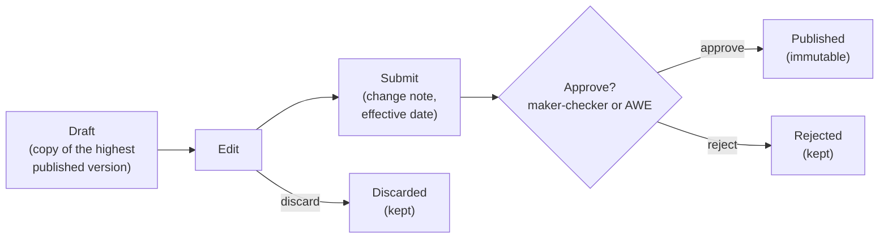

# Change Control and Approvals

In MDS, **published data is never edited**. Every change, to a dataset or to the
geography, follows the same path:

The steps in the Admin UI are in the [Admin Guide](admin-guide.md). The
operations for each step are in the API Reference:
[Datasets](api-reference.md#datasets), [Geography](api-reference.md#geography)
and [Releases](api-reference.md#releases).

## Draft

* A dataset has **at most one open draft** at a time; so does the geography.
* A draft starts as a copy of the **highest published version**. The first edit
  opens one if none is open.
* In a draft you can add, change and retire entries, and change the dataset's
  versioned details (code, labels, hierarchy, schema). For geography: levels,
  units, change events and boundary files.
* Some details are **administrative** and apply at once, outside the draft: a
  dataset's description, publisher, theme, visibility and licence, and the
  geography's visibility and licence.
* Entries are checked against the dataset's schema as they are written, so errors
  show while editing.
* An entry's **code cannot change** once it has been published. To recode, retire
  the entry and add a new one; see
  [Codes are fixed once published](concepts.md#codes-are-fixed-once-published).
* Consumers do not see a draft unless they ask for it.
* A draft can be **discarded**. It is kept, marked discarded, so its version number
  is never used again.

## Submit

Submitting freezes the draft and asks for approval. The submitter gives a
**change note** and, optionally, an **effective date** later than the approval
(never earlier than the latest published version's).

MDS checks the whole draft again: labels, the entry hierarchy, every entry against
the schema, references to other datasets (against their published versions; see
[Typed attributes](concepts.md#typed-attributes)), fixed codes, and for geography
the levels, units and change events. A draft with no changes is refused. For
geography, MDS also adds automatic change events for changes left without one; see
[Change events](geography.md#change-events).

## Approval modes

A deployment chooses one mode (see [Deployment](deployment.md#settings-at-install)):

| Mode | How a draft is approved |
|---|---|
| `permission` (default) | **Maker-checker inside MDS.** A user with the publish permission approves or rejects. A rejection needs a note |
| `awe` | **Through the [Approval Workflow Engine](../approval-workflow-engine/README.md).** MDS opens an approval request on submit; AWE's policy decides the stages and approvers, and calls MDS back with the decision |

### `permission`: maker-checker within MDS

**Maker ≠ checker** is enforced: the approver must not be the person who created,
last edited or submitted the draft. People are compared by their **stable user
id** (the token's `sub`), never by display name, since two people can share a name.
Versions keep display names beside the ids for people to read.

### `awe`: through the Approval Workflow Engine

* There is one AWE policy for datasets and one for geography. The draft's
  publisher (`owner_org`) and change note travel with the request, where the
  policy can use them.
* If AWE cannot be reached, submit fails and the draft stays a draft.
* AWE's approval **publishes** the version; a rejection or cancellation marks it
  **rejected**.
* MDS's own approve and reject operations are disabled. A submitted draft cannot
  be discarded in MDS; cancel the AWE request instead.

The callback and its signature are in the
[API Reference](api-reference.md#awe-callback); the chart setup is on
[Deployment](deployment.md#approval-through-awe).

### Releases

A [catalogue release](concepts.md#catalogue-release) is approved by permission in
both modes. Its publisher must be neither its creator nor whoever last set its
members.

## Publish

Publishing happens on approval. In one transaction, MDS checks the version once
more, marks it **published** with its effective date, dates new and retired
geography units, and, if the version is already in effect, refreshes the current
data that consumers read. From then on the database refuses any change to it.

The change is then announced on the change feed, to the Audit Manager and, if
configured, to WebSub. A version with a future effective date is announced again
when it **takes effect**.

## Retiring

An entry or unit is **retired** in a draft and stops being current when the draft
is published. It is never deleted. A dataset that is no longer used has all its
entries retired in a new version.

## Permissions

Permissions are held under the `master-data` Keycloak client and registered with
IAM by the chart. Reads need only a signed-in user.

| Permission | Allows |
|---|---|
| `referenceData:create` | Create datasets |
| `referenceData:edit` | Open, edit, submit and discard dataset drafts; change dataset details (including theme, visibility, licence); create releases and set their members |
| `referenceData:delete` | Retire entries in a draft; delete a draft release |
| `referenceData:publish` | Approve or reject dataset drafts (`permission` mode); publish releases |
| `geo:create` | Add levels and units through the original `/geo` endpoints only |
| `geo:edit` | Open, edit, submit and discard the geography draft; set the geography's visibility and licence |
| `geo:delete` | Retire units in the geography draft |
| `geo:publish` | Approve or reject geography drafts (`permission` mode) |

| Role | Permissions |
|---|---|
| `MASTER_DATA_ADMIN` | All of the above |
| `MASTER_DATA_APPROVER` | `referenceData:publish` and `geo:publish` only: approves, cannot edit |

## Audit

MDS sends two kinds of events to the [Audit Manager](../audit-manager/README.md):

* **every API call**: who called what, and the outcome. Anonymous calls are
  recorded only when they fail;
* **every catalogue change**: each step of each version (draft, submit, approve,
  publish, take effect, …), each release step, and each administrative change.

Every change is first written to MDS's own **change log**, append-only, in the
same transaction as the change. The change log feeds the
[change feed](consumers.md#following-changes) and is the **outbox** for delivery:
events are sent after the change commits, and a relay in the API retries any
that were not accepted (every 30 seconds by default). Delivery is therefore **at
least once**; receivers de-duplicate on the event id. Events reach the Audit
Manager as CloudEvents; see [Standards](standards.md#events-and-notifications).

| Event | Audit Manager | WebSub |
|---|---|---|
| Every change | Yes | — |
| A version published, a version taking effect, a release published | Yes | Yes |

The event types and the WebSub topics are in the
[API Reference](api-reference.md#change-feed-and-configuration).

## What the original write endpoints do now

The original `/attributes` and `/geo` write endpoints keep their paths and
payloads but **no longer change published data**. Each writes into the open draft
(opening one if needed), which must then be submitted and approved. Deleting a
published entry, unit or dataset **retires** it instead. A write is refused while
the draft is submitted.


**An original write is not visible until the draft is approved.** A script that
adds an entry and reads it back at once will not find it: reads return the
current published data.


Each endpoint's behaviour is in the
[API Reference](api-reference.md#original-endpoints).
