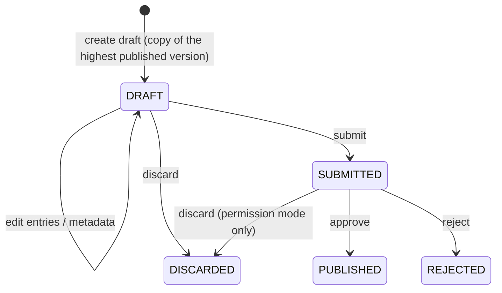

# Concepts

This page first explains the ideas, then gives the [details](#details) a
developer needs.

## What MDS holds

MDS holds two kinds of reference data: **datasets** and the **geography**.

| | A dataset | The geography |
|---|---|---|
| **How many** | Many: gender, disability type, units of measure, crops… | One per country |
| **Shape** | A list of entries, optionally a hierarchy | A hierarchy of levels (e.g. region → zone → woreda); each unit belongs to one unit of the level above |
| **Codes** | Chosen by the country | P-codes, which usually nest (a child's code starts with its parent's); MDS does not enforce this |
| **Extra content** | Optional typed fields | Boundaries (map shapes) per level |
| **How it changes** | Entries added, changed, retired (or brought back) | Change events: create, retire, rename, recode, split, merge, move to another parent, boundary change, with a crosswalk from old units to new |
| **Validity** | Retired entries are kept | Retired units are kept, and units also carry valid-from and valid-to dates |
| **Versioned** | Each dataset on its own | All levels together as one version, because a change at one level ripples to the others |

They are treated differently because they behave differently. A dataset is a
self-contained list that one department maintains. The geography is one connected
structure: splitting a woreda moves its kebeles and redraws the map, so its levels
must change together.

## Datasets and entries

A dataset is a list; each item in it is an **entry**, for example *Female* in the
Gender dataset.

Each entry has a **code** and a **label**. The code is what systems store (a
registry records `F`, not *Female*); the label is what people see, with a label
per language where needed (*Maize*, *በቆሎ*, *Boqqolloo*). Datasets and geography
units have labels per language in the same way.

Each dataset has a **theme** (core, agriculture, …) that groups it in the admin
UI and the public catalogue, and a **publisher**: the department responsible for
it.

A dataset may be **hierarchical**: each entry may have one parent entry in the
same dataset, as crop categories contain crops.

Some datasets need more than a code and a label. A seed variety has a crop,
maturity days and a release year; an input product has a type and a unit. Their
entries carry **typed fields**, which MDS checks against the dataset's rules. A
field may **refer to another dataset**: a seed variety's crop is an entry of the
Crops dataset. A field may also hold **a list of references**, which is how an
entry belongs to several groups at once (maize is both a cereal and a fodder
crop) while keeping a single parent. See [Typed attributes](#typed-attributes).

## The geography

The geography holds the country's administrative **levels**, every **unit** at
each level with its **P-code**, and each level's **boundaries**. When units are
split, merged, renamed, recoded or moved, the change is recorded as a **change
event**. The events form a **crosswalk**, so a record that holds an old unit's
code can be mapped to the units that replaced it. Units, like entries, are never
deleted. Worked examples are in
[Geography and Boundary Changes](geography.md).

## Versions

Every dataset, and the geography, has numbered **versions**: 1, 2, 3, …

A change is made in a **draft**, a copy of the latest published version. The
draft is submitted, and another person approves it (or rejects it). When it is
approved it is **published** as the next version. A published version **never
changes**: every later change, however small, is a new version. A dataset has at
most one draft at a time.

### Effective dates

Each published version has an **effective date**: the moment it takes effect. By
default that is when it is published, but it may be in the future. New woredas
that come into force on 1 January 2027 can be approved in October 2026: the
version is published and can be read by number, but it becomes the latest only on
1 January. Effective dates only move forward: a version cannot take effect before
the version published before it.

### Codes are fixed once published

Records hold codes, so once an entry has been published its **code never
changes**. Its labels, typed fields, parent and order can change in any later
version. To **recode**, retire the old entry and add a new one with the new code;
the old code still resolves. Geography follows the same rule: a new P-code is a
new unit, linked to the old one by a recode event.

### Retired entries

An entry that should no longer be used is **retired** in the next version, not
deleted. It stays in that version and every later one, so a record holding its
code still shows a label ("Season: Summer (retired)"), and a consumer reading an
older version sees it as it was. Lists for new data entry leave retired entries
out; a screen showing an existing record includes them. Geography units are
retired the same way.

## Reading: latest, pinned, as of, release

Every read says which version it wants:

* **Latest** (the default): the newest published version that has taken effect.
* **Pinned**: one version by number, whatever has been published since.
* **As of a date**: the version that was in effect at that moment, for example to
  check a record dated 30 June 2026 against the data of that day.
* **Release**: the version a named [catalogue release](#catalogue-release) pins.

Every answer says which version it came from. Which read to use is covered in
[For Consumers](consumers.md#latest-pinned-or-as-of).

### Catalogue release

Most consumers pin one or two datasets. Some need **everything** to be
consistent: a programme cycle, a survey, a national report. A **catalogue
release** is a named set of published versions of datasets, plus at most one
version of the geography:

| Release `2027.1` | |
|---|---|
| Crops | version 4 |
| Seed varieties | version 7 |
| Units of measure | version 2 |
| Geography | version 3 |

A release is put together as a draft and, once published, never changes. Reading
by release gives each dataset at the version the release names.

## Change log and change feed

Every step (a draft created, entries changed, submitted, approved, published, a
version taking effect) is recorded in an append-only **change log**. It is the
audit trail, and it is also the **change feed**: a consumer asks for everything
after the last event it saw, and so learns what was published or took effect.
When a WebSub hub is configured, MDS also pushes new and effective versions and
published releases to it. See
[For Consumers](consumers.md#following-changes).

## Visibility and licence

Each dataset, and the geography, is **private** (the default) or **public**, and
may carry a [data licence](public-catalogue.md#data-licence). Public data appears
in the anonymous [public catalogue](public-catalogue.md); signed-in reads,
including the registries', see everything regardless. Both settings apply at once
and are not part of a version.

## Details

This part is for developers. The API keeps its own field names: a dataset is a
*list* and an entry a *value* (see
[Names in the API](api-reference.md#names-in-the-api)).

### Dataset fields

| Field | Meaning | Versioned? |
|---|---|---|
| `list_id` | Stable identifier. Defaults to the code when the dataset is created through `/catalogue`; a random id when created through `/attributes/add_attribute` | — |
| `list_code` | The dataset's code, e.g. `SEED_VARIETY`. A request may name a dataset by code or by id | Yes |
| `display`, `display_i18n` | Title, and titles per language | Yes |
| `is_hierarchical` | Whether entries may have a parent entry | Yes |
| `attribute_schema` | Optional schema for each entry's typed fields (see [Typed attributes](#typed-attributes)) | Yes |
| `description` | What the dataset is for | No: applied at once |
| `owner_org` | The publisher. Defaults to the chart's `catalogue.defaultOwnerOrg` (for the geography, the loader's `geoSeed.ownerOrg`); in `awe` mode it is sent to AWE with the [approval request](change-control.md#awe-through-the-approval-workflow-engine) | No: applied at once |
| `domain` | The theme: `core` for a country pack's core datasets, the pack domain (such as `agriculture`), or what a maker set; `null` (*Other*) when unknown | No: applied at once |
| `visibility`, `licence_uri`, `licence_label` | `private` or `public`, and the licence | No: applied at once |

Versioned fields change only through a draft and are published with it. Reads of
a dataset also return `current_version_no` (the published version in effect now),
`latest_published_version_no` (the highest published version, which may be
future-effective), `open_draft_version_no`, `open_draft_status` and an
`attribute_schema_summary` (field names, required fields, dataset references).

### Entry fields

| Field | Meaning |
|---|---|
| `value_id` | Stable across versions, so a diff follows an entry from one version to the next |
| `value_code` | The code a registry stores; fixed once published |
| `display`, `display_i18n` | Label, and labels per language (e.g. `{"am": "በቆሎ", "om": "Boqqolloo"}`); geography units use `name`, `name_i18n` |
| `parent_code` | Parent entry, for hierarchical datasets |
| `sort_order` | Display order |
| `attributes` | Typed fields |
| `roles` | Role tags a country pack gives the entry |
| `status` | `ACTIVE` or `RETIRED` |

### Version statuses

| Status | Meaning | Readable by consumers? | Editable? |
|---|---|---|---|
| `DRAFT` | Being edited | By number, or with `version: "draft"` | Yes |
| `SUBMITTED` | Sent for approval; frozen while it waits | By number, or with `version: "draft"` | No |
| `PUBLISHED` | Approved. **Immutable** from here on | Yes | No, never |
| `REJECTED` | Approval refused. Kept for the record | By number | No |
| `DISCARDED` | Thrown away by its maker before it was published. Kept, with its content, so its number is never used again | By number | No |



* **One open version.** At most one `DRAFT` or `SUBMITTED` version per dataset,
  and for the geography, enforced by a unique index.
* **Base version.** A draft starts from the highest published version and records
  it as `base_version_no`, so a diff always has something to compare with. To
  bring older content forward (for example to rework a rejected draft), a new
  draft can copy another version with `copy_from_version`; its base is still the
  highest published version.
* **Numbers are never reused**, so the published sequence may have gaps. A draft
  takes one more than the highest number ever used for that dataset (or the
  geography), counting rejected and discarded versions and the change log, so the
  change log, audit trail and boundary files of two versions cannot be confused.
* **Immutability is enforced in the database** by triggers, not only in the
  service, so no script, loader or direct SQL can alter a published version or its
  entries.
* **Who and when.** Each version records who created, last edited, submitted and
  decided it, and when, with the change note, decision note and approval
  reference. `*_by` holds the stable user id (the token's `sub`) or a system name
  such as `country-pack-loader`; `*_by_name` the display name at the time (`null`
  for a system).
* A dataset no longer used keeps its versions; retire its entries in a new
  version. (A `RETIRED` version status exists but nothing sets it.)

### Taking effect

`effective_from` can be set when the draft is created, edited later
(`update_list_draft`), given on submit, or overridden on approval. When a
future-effective version's date comes, MDS refreshes the current-state tables (on
start, on every publish, and every `catalogue.effectiveRefreshSeconds`, 300 by
default) and writes a `list.version.effective` (or `geo.version.effective`)
event, which is announced like any other.

### Reading in the API

A read takes at most one of `version` (a number, `"latest"` or `"draft"`),
`as_of` (an ISO 8601 date-time) or `release` (a release code). Every response has
a `version` object (`version_no`, `status`, `effective_from`, `is_latest`, notes,
who and when). Reading a dataset that the named release does not pin is an error.
See [Choosing a version](api-reference.md#choosing-a-version).

A release is `DRAFT` while its members are chosen and `PUBLISHED` once fixed; a
draft release can be deleted, a published one cannot be changed or deleted. It
must pin at least one dataset or a geography version, and is published by a user
with the publish permission who is **neither its creator nor whoever last set its
members** (compared by stable user id).

### Retiring and recoding in the API

* Reads leave retired entries out unless `include_retired: true`.
  `get_list_value` resolves a code and returns retired entries too.
* Retiring an entry that has active children fails unless `cascade: true`.
* An entry added in the open draft and never published is removed when retired.
  Upserting a retired code in a draft brings it back (`ACTIVE`).
* An entry only in the open draft, never published, may still change its code.

A change to a published `value_code` is refused with
**`G2P-CAT-CODE-IMMUTABLE`**, whichever way it is attempted:

* `upsert_draft_values` with the entry's `value_id` and a new `value_code`;
* the original `/attributes/update_attribute_value` endpoint;
* on submit, for a draft changed in any other way;
* on publish, by the database function every publisher uses, including the
  [country-pack loader](country-packs.md);
* by the country-pack loader itself, before it writes anything, when a pack gives
  a published entry (same `value_id`) a new code.

The Admin UI shows the code of a published entry as read-only.

### Typed attributes

A dataset may declare an **`attribute_schema`**, a JSON Schema that every entry's
`attributes` object must satisfy (see [Standards](standards.md)). Entries are
validated as they are written to a draft, again on submit, and again on approval.
Changing the schema is itself a change and goes through a draft.

A field refers to another dataset with **`x-list-ref`**:

```json
{
  "type": "object",
  "required": ["crop", "maturity_days"],
  "properties": {
    "crop":          { "type": "string", "x-list-ref": "CROP_COMMODITY" },
    "maturity_days": { "type": "integer", "minimum": 30, "maximum": 300 },
    "release_year":  { "type": "integer" },
    "agro_ecological_zones": {
      "type": "array",
      "items": { "type": "string", "x-list-ref": "AGRO_ECOLOGICAL_ZONE" }
    }
  }
}
```

An entry of `SEED_VARIETY` then looks like:

```json
{
  "value_code": "MAIZE_BH661",
  "display": "BH-661",
  "attributes": {
    "crop": "MAIZE",
    "maturity_days": 160,
    "release_year": 2011,
    "agro_ecological_zones": ["M2", "SH2"]
  }
}
```

#### Lists of references

An array whose `items` carry `x-list-ref` holds **several** codes of another
dataset, like `agro_ecological_zones` above. This is how an entry is
cross-classified: a crop keeps one parent in its own hierarchy and lists its
groups in an attribute:

```json
{
  "type": "object",
  "properties": {
    "groups": {
      "type": "array",
      "items": { "type": "string", "x-list-ref": "CROP_GROUP" },
      "uniqueItems": true
    }
  }
}
```

```json
{ "value_code": "MAIZE", "display": "Maize", "attributes": { "groups": ["CEREAL", "FODDER"] } }
```

* Every code in the array is checked, like a single reference; the error names
  the missing codes. The rest of the schema applies too (`minItems`,
  `uniqueItems`, …).
* Reads return the array as stored. `attribute_filters` matches entries whose
  array contains the given codes: `{"groups": ["FODDER"]}` finds `MAIZE`.
* The Admin UI edits such a field as a multi-select.

See [Design decisions](design-decisions.md#classification-hierarchy) for why
cross-classification is an attribute rather than a second parent.

#### Which version a reference is checked against

An `x-list-ref` code must be an **`ACTIVE`** entry of the referenced dataset's
version **in effect**:

* normally, the latest published version in effect now;
* for a draft with a **future** `effective_from`, the version in effect **on that
  date**;
* when a [release](#catalogue-release) is published, the version **pinned in the
  release**, if it pins one.

**Drafts never count**: a code only in the referenced dataset's open draft is
rejected. When two datasets change together (a new crop and its varieties),
publish the referenced dataset first, with the same or an earlier effective date.
A failure is `G2P-CAT-400`, naming the referenced dataset, the missing codes and
the version checked.

### Change log entries

Each change-log entry has a monotonically increasing `event_id`, an `event_type`
(such as `list.version.published`), a `subject_type` (`list`, `geo` or
`release`), a `subject_id`, the version number, the `actor` (stable user id or a
system name), `actor_name`, the time and details. The event types and WebSub
topics are in the
[API reference](api-reference.md#change-feed-and-configuration).

* **Audit.** Every event goes to the [Audit Manager](../audit-manager/README.md),
  whoever wrote it: the API, the country-pack loader, or the database itself
  (`*.version.effective`, `*.version.migrated`).
* **Change feed.** `get_changes` with a cursor (the last `event_id` seen).
* **Delivery.** The change log is also the outbox for the Audit Manager and the
  WebSub hub, so delivery is at least once: de-duplicate on `event_id`. See
  [Change control: audit](change-control.md#audit).

The database tables are listed in
[Design decisions: storage](design-decisions.md#storage).
