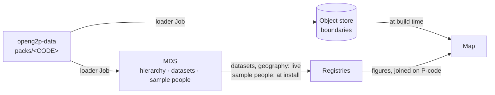

# Country Packs

A **country pack** is one folder holding everything country-specific the platform
needs: geography, datasets and a few sample people. MDS is the only service that
reads packs. Registries, maps and reports get the data from MDS.

So installing for a different country is a **configuration change, not a
rebuild**. The same registry image serves any country; only the pack MDS was
seeded with differs.

## What a pack is

### Contents

| Part | What it is | Required? |
|---|---|---|
| **Hierarchy** | The administrative levels and every unit, with its P-code. The number and names of levels belong to the country (for example _country → region → zone → woreda_) | Yes |
| **Boundaries** | The map shape of every unit, one GeoJSON file per level | Yes |
| **Datasets** | The country's own entries: gender, education level, water source and so on. **Themes** add sector datasets, such as crops under `agriculture` | No |
| **Sample people** | A few dozen individuals and households that belong to the country, for demos and tests | No |
| **Address format** | How an address is written below the lowest level | No |

A pack with only geography is valid for MDS. But a registry on it has **empty
coded dropdowns**: registries read datasets from MDS, and MDS gets them only from
the pack.

### Where packs live

Packs live in the [`openg2p-data`](https://github.com/OpenG2P/openg2p-data)
repository, under `packs/<CODE>`, where the code is usually the ISO 3166 alpha-3
code. There is no other way for country data to enter the platform.

Two packs ship today:

| Pack | Country | Levels | Units | Datasets | Samples | Licence | Used by |
|---|---|---|---|---|---|---|---|
| `XKM` | Kamuntu (**fictitious**) | country → region → district → ward → village | 884 | none | none | CC0-1.0 | Default of the MDS chart |
| `ETH` | Ethiopia | country → region → zone → woreda | 1,271 | core + `agriculture` theme | yes | CC BY-IGO (attribution required) | Default of `commons-services` |


`XKM` is the MDS chart default on purpose: an unconfigured install shows a country
that does not exist, so invented figures are never attached to a real place. But
it is **geography only**. For a registry you can fill in, use a pack with
datasets (today, `ETH`).


### P-codes

A **P-code** (place code) is a published identifier for an administrative area,
such as `ET0101` for one zone. OCHA publishes them so that every organisation uses
the same code for the same area (see
[Common Operational Datasets](https://cod.unocha.org/)).

* **P-codes nest.** A child's code starts with its parent's: `ET` → `ET01` →
  `ET0101` → `ET010101`.
* **The P-code is the identifier.** A unit's id in the pack is its P-code; no
  second internal id is minted.

So the code a registry stores on a record, the key of the map shape and the
column a report groups by are the same value. Nothing needs translating.

### Sources and licence

| Pack type | Source | Licence |
|---|---|---|
| Real country | **OCHA COD-AB** (Common Operational Datasets – Administrative Boundaries), fetched from **HDX**, the Humanitarian Data Exchange. Hierarchy, P-codes and shapes all come from it | **CC BY-IGO: attribution required** wherever the map is shown |
| Fictitious country (`XKM`) | Generated by `generate_synthetic_pack.py`: invented coastline and place names, codes from the ISO user-assigned range | CC0-1.0 |

Each pack records its source, licence and upstream version in `manifest.json`.
COD-AB boundaries are **operational**: they are not a statement on the legal or
political status of any territory.

### Pack file layout

| Path | What it holds |
|---|---|
| `manifest.json` | Source, licence, version, level names, unit counts |
| `levels.json` | The levels: id, name, parent level |
| `values.json` | Every unit: id (its P-code), level, parent, name |
| `boundaries/<level>.geojson` | Simplified map shapes for one level, keyed on P-code |
| `codelists/<attribute>.json` | Core datasets |
| `domains/<theme>/*.json` | Theme datasets, for example `domains/agriculture/` |
| `address.json` | The address parts below the lowest level |
| `samples/individuals.json`, `samples/households.json` | Sample people and their households |
| `changes.json` | Optional: real geography change events for the next load (see [Later loads](#later-loads-drafts-not-overwrites)) |

Next to the packs, `openg2p-data` holds `packs/roles.json` (the role vocabulary)
and the tooling in `scripts/packs/`.

### Semantic roles

Reports ask about meaning, not literal values: "is this person the head of the
household?", "is this an improved water source?". A literal such as `'SELF'`
breaks silently when a country uses another code.

So a pack's dataset entries may carry **roles** from `packs/roles.json`, a closed
vocabulary. Each role names its dataset and whether one entry holds it
(`head_of_household`) or many may (`improved_water`; which sources count as
improved is a national definition).


**Stored and served, not yet used.** MDS keeps each entry's roles when it loads a
pack and returns them with the entry in dataset reads (catalogue and public
catalogue). No API filters by role, and no registry or report reads them yet:
reporting views still test literal codes. Keep roles in packs (they are
validated), but do not build on them yet.


### Addresses

**An address is a P-code plus what is written below it, never both.** The P-code
already gives the whole chain of units, so no address repeats it as text.
`address.json` declares only the parts below the lowest level (for Ethiopia:
kebele and house number). Storing unit names beside the P-code holds the same fact
twice, and one copy goes wrong when a unit is renamed.

## How a pack reaches the services



Who reads what, and how, is on [For Consumers](consumers.md#who-reads-mds-and-how).
The registry side is in
[Country data & seeding](../../../products/registry/registry/deployment-and-extension/country-data-and-seeding.md);
the map side in [Map drill-down](../reporting-and-analytics/map-drill-down.md).

## Setting up a new country

### 1. Fetch the geography

For a country with a COD-AB dataset on HDX:

```bash
cd openg2p-data/scripts/packs
python3 fetch_country_pack.py --country <ISO3> \
    --level-names <level1>,<level2>,<level3> --out ../../packs/<ISO3>
```

It downloads the boundaries, derives the hierarchy from the P-codes, simplifies
and repairs the shapes, and writes provenance and licence to the manifest.

* `--level-names`: the country's names for the levels below `country` (default
  `adm1`, `adm2`, …). Labels only; the hierarchy comes from the data.
* `--max-depth`: the deepest level to include (default `3`).

### 2. Add the country's content

Add the datasets, any themes, the address format and a few dozen sample people
(see [Pack file layout](#pack-file-layout)). Use the role vocabulary where an
entry has a role.

### 3. Validate

```bash
python3 validate_pack.py ../../packs/<ISO3>
```

Run it before committing a pack. It checks:

* the hierarchy: one root, no orphans or cycles, unit counts match the manifest;
* P-codes: each extends its parent's;
* shapes: one per unit, valid rings, every child inside its parent, and a
  parent's children covering its area;
* datasets, roles, the address format and samples, including that each sample
  lies inside the unit its P-code names.

A wrong pack does not fail loudly. It seeds orphans or draws a map with holes,
and the figures stop adding up later.

### 4. Point MDS at it

Set `masterData.geoSeed.countryPack` in `commons-services` (Rancher: **Country
Pack**), and the themes in `geoSeed.domains`. See
[Deployment: settings at install](deployment.md#settings-at-install).

### 5. Verify

* MDS holds the number of units the manifest gives.
* Coded dropdowns in the staff portal list the country's entries, including any
  theme's (for example crops).
* Geo dropdowns populate at every level.
* The map renders and drills down.

## Loading and upgrading in MDS

The rule is: **a pack never overwrites published data.**

The loader runs as a Job in the MDS chart, after the API has prepared the
database. It handles each dataset, and the geography, on its own.

### First load: version 1, published

A dataset that does not exist yet, or the geography when it has no version yet,
is loaded as **version 1** and **published at once**. Nothing is published yet, so
no approval is needed.

This also applies to a dataset that appears later (added in a newer pack, or a
theme turned on after install). Labels in every language, codes, typed fields,
schemas, descriptions and the publisher are kept as the pack gives them. Each
dataset gets its theme from its pack folder (Core, or the theme's name).

### Later loads: drafts, not overwrites

When a dataset or the geography already has a published version, the loader
compares the pack with it:

| Pack compared with the published version | What the loader does |
|---|---|
| Unchanged | Nothing. Re-running is safe |
| Different | Creates a **draft**: new entries or units added, changed ones updated, missing ones **retired** (never deleted). Changed boundary files go into the draft |
| An open draft already exists | Skips it |

Drafts are **not submitted**. Someone reviews, submits and approves them like any
other change (see [Change Control and Approvals](change-control.md)); consumers
see nothing until then. Steps:
[Admin Guide](admin-guide.md#load-a-newer-country-pack-version).

* **Codes are fixed once published.** A pack that gives a published entry a new
  code stops that dataset's load with an error. To recode, give the new code a
  new entry id and drop the old entry. See
  [Codes are fixed once published](concepts.md#codes-are-fixed-once-published).
* **References between datasets.** An entry that refers to a code only in
  another dataset's draft cannot be approved until that draft is published.
  Approve the referenced dataset first (for example, crops before seed varieties).
* **A pack is a snapshot.** It says which units exist, not that one was split.
  Record the real events (split, merge, recode, …) in the draft, or ship them in
  `changes.json`; the loader checks them with the API's rules and stops the
  geography load if one is invalid. See
  [Geography: change events](geography.md#change-events).

### Loader settings

| Chart value (`geoSeed.`) | Default | What it does |
|---|---|---|
| `countryPack` | `XKM` (MDS chart), `ETH` (`commons-services`) | Which pack to load |
| `load.geo`, `load.codelists`, `load.samples` | all on | Which parts to load |
| `domains` | `agriculture` | Themes to load besides the core datasets. A theme the pack lacks is skipped with a warning |
| `publishInitial` | on | Publish a first load as version 1. Off: leave it as a draft |
| `autoPublish` | off | Publish later drafts at once, without approval. **Development and test only** |
| `ownerOrg` | none | Publisher recorded on what the loader creates |

Each setting also has a command-line flag and environment variable (see the
chart's `values.yaml`). Every load step is written to the change log with
`country-pack-loader` as the actor, and sent to the Audit Manager and WebSub like
any other change. Boundary files go to the object store; see
[Geography: boundaries per version](geography.md#boundaries-per-version) and
[Deployment](deployment.md#object-store-for-boundaries).

### Licence

When the manifest names a licence, the loader sets the geography's licence from
it, unless an administrator already set one. The loader never makes anything
public: what it loads stays **private** until someone marks it public (see
[Public Catalogue](public-catalogue.md)).

### Migrating an existing MDS

An MDS installed before versioning is converted on start:

* every existing dataset becomes **version 1, published**, with the entries it had;
* the geography becomes **geography version 1, published**;
* both are **effective from 1970-01-01**, so a read as of any past date finds them;
* a migration event is written to the change log for each.

The migration runs on every start and skips anything already versioned. Later
schema upgrades add new fields in place. The migrated geography has **no boundary
files**; the next pack load with an object store adds them in a draft.


**Nothing changes for consumers on migration.** The same endpoints return the same
data.


After migration, change data through drafts, the Admin UI or a pack load, never in
the database. A direct change is overwritten the next time that dataset or the
geography is published.
