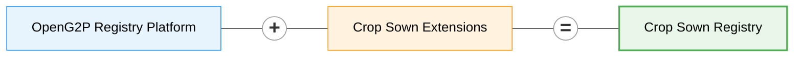

# Crop Sown Registry


**Source:** [github.com/OpenG2P/crop-sown-registry](https://github.com/OpenG2P/crop-sown-registry)


A farmer registry says who farms and which plots they hold. It does not say what was grown on those plots this season, how much was sown, or what came of it. Ministries need that every season: to estimate production, to target seed and fertiliser, to see where pests and drought hit, and to give a bank or a subsidy programme evidence that a crop is really in the ground.

The **OpenG2P Crop Sown Registry** (CSR) keeps that record. Development agents, cooperatives and field apps record what happens to each crop on each plot: the plan, land preparation, sowing, field observations, pests, damage and the harvest. The registry keeps every entry, works out each crop's current state, and sums it up per farmer and per area.

It is built on the [OpenG2P Registry Platform](../registry/README.md) and adds only the crop domain.



## At a glance

| | |
| --- | --- |
| **What it records** | Events in the life of a crop: one crop, on one plot, in one season |
| **How it stores them** | An [activity register](../registry/features/activity-register.md): entries are only added, never overwritten. A mistake is corrected by a new entry |
| **Who it is about** | Farmers, by their Farmer Registry ID. The national ID (Fayda FAN in the reference setup) is kept alongside |
| **Where data comes from** | The staff portal, partner systems over the signed partner API, and ODK Central |
| **What it gives back** | Each crop season's current state, each farmer's season summary, indicators by crop and area, reporting views, and DCI search for partners |
| **Country settings** | Calendar, seasons, administrative levels, units and lists are set per country. See [Customisation](customisation.md) |

## Who uses it

| User | Uses it to |
| --- | --- |
| **Development agents** and data clerks | Record plans, sowings, field visits, pests, damage and harvests, one at a time or in batches |
| **Supervisors** | Verify sowings and harvests, and follow up on the work list of activities that are due |
| **District and regional offices** | Read indicators: area sown, production and yield, by crop and area |
| **Cooperatives and other partner systems** | Send entries for their members, and correct their own entries |
| **Banks, insurers and subsidy programmes** | Read a farmer's crop seasons and season summaries over DCI, with the farmer's consent |
| **Cluster programme staff** | Register production clusters and see which plots joined them |

Farmers are the subjects of the records, not users of the software.

## Registers

The registry has two registers.

| Register | Kind | Holds |
| --- | --- | --- |
| **Crop Sown** (`CropSown`) | Activity register | Every activity on every crop season. No functional IDs and no change requests |
| **Cluster** (`Cluster`) | Entity register | Production clusters: groups of smallholders farming one crop together in a district |

What an activity register is, and how it differs from an entity register, is explained in [Activity register](../registry/features/activity-register.md) and its [design](../registry/design/activity-register.md). This page says only what the Crop Sown Registry records in it.

### The crop season

A **crop season** is one crop on one plot in one season. It is identified by four values:

```
<plot ID>|<crop year>|<season>|<crop>        e.g.  LAND-0007-1|2019|SEASON_MEHER|CROP_TEFF
```

* **Intercropping** is two crop seasons on the same plot.
* **A changed crop** is a new crop season that names the one it replaces. The old one is closed, and each points to the other.
* **The crop year** is a year in the configured calendar. The seasons are set per country (Meher, Belg and Irrigation in the shipped configuration, with the Ethiopian calendar).
* **The location** is the plot's district, the lowest administrative level (woreda in the shipped configuration). It is required on the plan and on the sowing. Later activities take it from their crop season.

### Activities

| Activity | Records | Rules |
| --- | --- | --- |
| **Crop planned** | Variety, planned area, cropping system, planned sowing date, planned seed and fertilisers, expected yield | Once per crop season |
| **Land prepared** | Preparation method, area, irrigation source and method, soil fertility | Once. A warning if there is no plan |
| **Sown** | Area, variety, seed type, source and quantity, sowing method, fertilisers, compost or manure, machinery, a photo | Once. A warning if there is no plan. Due 0–60 days after the plan. **Verified by a supervisor** |
| **Joined a cluster** | The Cluster ID | Once. The cluster must exist in the Cluster register |
| **Growth observed** | Growth stage, crop condition, area under crop, estimated yield, a photo | Repeatable. Needs a sowing first |
| **Pest, disease or weed reported** | Type, agent (e.g. fall armyworm, wheat rust, striga), severity, area, damage %, action taken, pesticide | Repeatable. Needs a sowing first |
| **Crop damage reported** | Cause (drought, flood, hail, frost, wind, wildlife…), area, loss % | Repeatable. Needs a sowing first |
| **Harvested** | Area, quantity in the configured unit (quintals ship), yield (computed), post-harvest loss, stored, sold, consumed and kept as seed, sale price | Once. Needs a sowing first. Due 90–180 days after sowing. **Verified by a supervisor** |

Each activity also carries the farmer ID, the plot ID, the development agent's ID and, if known, a GPS point.

The fields follow the FAO World Programme for the Census of Agriculture 2020 crop module and Ethiopia's CSA Agricultural Sample Survey.

**Plausibility warnings.** These never block an entry. They flag it for review:

* area sown more than 1.5 × the area planned;
* an observation, report or harvest covering more than the area sown;
* a yield above the configured limit (150 quintals per hectare ships);
* stored, sold, consumed and seed quantities adding up to more than the harvest less losses.

**Lists.** Every coded field (crop, season, variety, seed type, fertiliser, pest, severity, damage cause…) is checked against **Master Data** when the entry is made. The registry keeps no lists of its own. They come from the agriculture domain of the country pack in use (ETH ships). See [Customisation](customisation.md#lists-in-master-data).

### Cluster register

A cluster is an ordinary entity register, maintained like the Farmer Registry's registers:

* **fields:** Cluster ID, programme cluster code, name, crop, district, agro-ecological zone, water source, area, number of smallholders, year established, coordinator's name and phone;
* **Cluster ID:** generated when the registration is approved, e.g. `CL-4729318560`. Staff never type it. The cluster programme's own code (e.g. `CL-ET0406-001`) is kept in the searchable **Programme Cluster Code** field;
* **changes:** a new cluster is registered through an intake form; later changes are change requests. Both are approved in two stages in the Approval Workflow Engine (AWE).

A plot joins a cluster with a **Joined a cluster** activity.

## What the registry works out

From the activities, the registry keeps four things up to date. Staff see them in the staff portal; partners read the first two over DCI.

| Output | One per | Holds |
| --- | --- | --- |
| **Crop season status** | Crop season | Furthest stage reached (planned → land prepared → sown → growing → harvested), planned and sown area, sowing date, seed type, whether sowing and harvest were verified, latest growth stage and condition, pest and damage counts with the worst severity and loss, harvest, yield, activities awaiting verification, and the crop season it replaced or was replaced by |
| **Farmer's season summary** | Farmer, crop year and season | Across all the farmer's plots and crops: crop seasons, plots, planned, sown and harvested area, quantity, yield, pest and damage counts, and a breakdown by crop |
| **Indicators** | Crop year and season | Area sown, quantity harvested and average yield by crop; crops by stage; farmers reporting; crops with pests, diseases or weeds. Also area sown by each administrative level; harvest and yield by the top level; farmers reporting by district |
| **Reporting views** | Crop season, or crop and area | `csr_rpt_crop_season` and `csr_rpt_crop_performance_region`, `_zone`, `_woreda`, for Superset and SQL users |

**The season summary** covers the season's window in the crop year. The shipped configuration uses these windows:

| Season | Window |
| --- | --- |
| Meher | Meskerem – Yekatit (September – February) |
| Belg | Megabit – Pagume (March – August) |
| Irrigation | Hidar – Ginbot (November – May) |

It is recomputed after every change, including corrections, and its history is kept. A crop season's state is updated as each activity is saved; the season summary follows in the background, within seconds (every 20 seconds by default). It becomes **final** when an administrator locks the period in the register's **Settings**. A programme that pays on a season's figures should read final summaries.


**Not built yet:** Superset dashboards and Insights maps on the reporting views. The views are in place and need no refresh.


## How data comes in

| Channel | How | Notes |
| --- | --- | --- |
| **Staff portal** | **Activity registers → Crop Sown → Record**, one entry or a batch. A batch carries the crop year, season and development agent from row to row | Roles decide who can record, correct and verify. See below |
| **Partner systems** | Signed calls to the partner API: `/partner/activity/append_activities` and `/partner/activity/correct_activities` | A partner can correct or void only what it sent. Each message is idempotent |
| **ODK Central** | The `crop_sowing` form, pulled every five minutes. Each submission becomes a **Sown** activity | **Off by default.** The registry ships the field mapping, not the form. See [Deploying on Rancher](deployment/rancher.md#collecting-sowings-with-odk-central) |
| **Cluster intake form** | Staff portal, approved in AWE | Clusters only |

**Who can do what.** The activity permissions come with the platform's staff roles:

| Permission | Lets a user | Roles that have it |
| --- | --- | --- |
| `activity:view` | See activities, crop seasons, summaries, indicators | All roles below |
| `activity:create` | Record activities | Intake Officer, Data Editor, Data Supervisor, Technical Administrator |
| `activity:correct` | Correct or void an activity | Data Editor, Data Supervisor, Technical Administrator |
| `activity:verify` | Verify or reject a sowing or harvest | Intake Validator, Data Validator, Data Supervisor, Technical Administrator |
| `activity:configure` | Lock periods, rebuild crop season status | Operations Administrator, Technical Administrator |

## What it shares

### DCI search

Partners search the Crop Sown register over DCI, synchronously, by farmer ID. The record type they ask for decides what comes back:

| `reg_record_type` | Returns | Typical use |
| --- | --- | --- |
| `spdci-extensions-agri:CropActivity` | The farmer's activities, each with its verification status | Evidence and audit |
| `spdci-extensions-agri:CropSeason` | Each crop season's current state | A decision on one crop, e.g. an input subsidy or a crop loan |
| `spdci-extensions-agri:ActivityAggregate` | The farmer's season summaries, with `is_final` | A decision on the farmer's whole season |

A search can add filters, e.g. one crop year and season, or a stage. Results come newest first. A partner the operator allow-lists can also search **season summaries across farmers**, e.g. every final summary for one season for a subsidy run. See [Deploying on Rancher](deployment/rancher.md#settings-only-in-yaml).

Signature checks and consent enforcement are on by default. The request format is in [DCI search](../registry/design/partner-register-search/dci-search.md).

A search carries the partner's signed consent, or none when the farmer's consent is held by the Consent Manager: the registry then asks its Consent Manager to find it, for a search of one farmer by identifier (the DCI type `UIN` is sent as `FAYDA_FAN`, `global.consentSubjectIdTypes`). See [Consent-aware data sharing](../registry/features/consent-aware-data-sharing.md).

### Data scopes

A consent and a partner's access policy name the registry's data scopes, `crop-sown-registry.<scope>`: [Data Scopes](data-scopes.md).

## How it relates to the Farmer Registry

The two registries share identifiers, not code or databases.

* **The farmer** is the [Farmer Registry](../farmer-registry/README.md) farmer ID. The national ID is carried alongside. A consent given for the national ID also covers a search by farmer ID.
* **The plot** is a Farmer Registry land record ID.
* **Entities first.** The farmer and plot are registered in the Farmer Registry before crop activities are recorded. Temporary plot IDs are not accepted.
* **Format only.** The Crop Sown Registry checks that a farmer ID or plot ID looks right. It does not look them up, because the Farmer Registry may run on another installation. An unknown ID never blocks an entry.
* **The district is entered**, for the same reason: the registry cannot read the plot's location from the Farmer Registry.

The development agent's ID is also checked for format only.

## Using it on its own

The Crop Sown Registry needs no other registry to run. It needs commons-services: Master Data with the agriculture domain, Keycloak, AWE for clusters, and, for partners, Partner Management and the Consent Manager.

Used alone, farmer and plot IDs are whatever the operator uses, as long as they match the format (letters, digits and dashes, 3–64 characters).

## How it is packaged

The Crop Sown Registry is a thin extension of the Registry Platform. How domain registries are packaged in general: [Packaging & the reference registry](../registry/deployment-and-extension/packaging-and-reference-registry.md#domain-registry-charts). What is specific to this one:

* **Four images**, each a `FROM` of the matching platform image plus the `crop-sown-extension` package:

  | Image | Runs as | Adds |
  | --- | --- | --- |
  | `staff-api` | Staff portal API | The crop domain. Creates the activity tables and the Cluster tables on start |
  | `partner-api` | Partner API | Partner activities, DCI search, data scopes |
  | `celery` | Celery worker and beat | The activity outbox (crop season status, season summaries), the ODK pull, the sample crop seasons |
  | `db-seed` | Install and upgrade Job | The seed SQL, DCI templates, Cluster approval policies and the sample cluster loader |

  The staff portal UI and the sanity tests are the platform's images, used as is. The sanity tests run the platform's smoke tier only.
* **The chart** `openg2p-crop-sown-registry` has no templates of its own. It is a values overlay that sets the registry variant (`crop-sown-registry`, also the consent data controller), the four images, the ID generator with one pool (`cluster`), IAM registration as a regular Job, and the ODK pull and sample crop seasons switches (both off). Its own questions (**Crop Sown Registry** group) are in `questions.own.yaml`.
* **No dashboards yet.** The reporting views are plain SQL views created by db-seed; they need no refresh Job.
* **Extra CI checks**, without Docker: the generated seed SQL matches `scripts/activity_definitions.py`, and every list and code the activity definitions use is in the shipped country pack (ETH).

## In Agri Stack

In [Agri Stack](../../../open-agri-stack/README.md), the Crop Sown Registry is the crop department's registry. The Agri Stack Composite reads its crop seasons and season summaries, with consent tokens from the Agri Stack Exchange, alongside the Farmer Registry. Its role there: [Registries in Agri Stack](../../../open-agri-stack/architecture/registries.md#crop-sown-registry). How it is set up for Agri Stack is in [Agri Stack → Deployment → Crop Sown Registry](../../../open-agri-stack/deployment/crop-sown-registry.md).

## In this section

| | |
| --- | --- |
| [**Data Scopes**](data-scopes.md) | The scopes partners' consents and access policies name, and how to read the live catalogue |
| [**Customisation**](customisation.md) | What a country or programme changes — lists, activities, rules, scopes — and how |
| [**Deployment**](deployment/README.md) | Install order and the Jobs that run on install |
| [**Deploying on Rancher**](deployment/rancher.md) | Prerequisites, the choices to make, sample data, ODK, checks after install, uninstall |
| [**Versions**](versions/README.md) | Where releases and changelogs are published |
