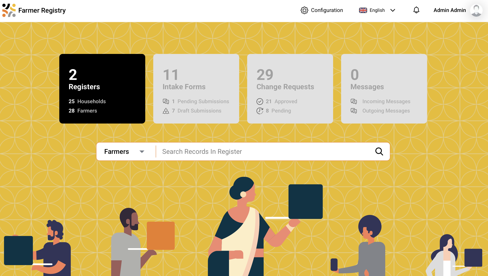
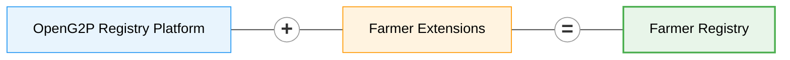

# Farmer Registry


**Source:** [github.com/OpenG2P/farmer-registry](https://github.com/OpenG2P/farmer-registry)


<figure><figcaption></figcaption></figure>

Farmer Registry is a manifestation of [OpenG2P Registry Platform](../registry/) with specifics related to a farmer registry.

This registry contains the following [**registers**](../registry/concepts.md#register):

1. Farmer Register
2. Household Register

The domain models for these registers live in the [`farmer-extension`](https://github.com/OpenG2P/farmer-registry/tree/develop/farmer-extension) package of the `farmer-registry` repository.

The Farmer Registry inherits all the [features of the registry platform](../registry/features/).

## How it is packaged

The Farmer Registry is a thin **extension** of the Registry Platform. The platform publishes the runnable images and the `openg2p-registry` Helm chart. The `farmer-registry` repository adds only the farmer domain:

* the `farmer-extension` package (models, schemas, services, seed metadata, DCI templates, data scopes);
* six images, each a `FROM` of the matching platform image plus the extension: `staff-api`, `partner-api`, `celery`, `db-seed`, `sanity-tests`, `agent-portal-api`. The staff portal UI is the platform's image, used as is;
* the `openg2p-farmer-registry` chart, a wrapper over the platform chart. Beyond the platform it adds the [reporting and dashboards](#reporting-and-dashboards) templates, the map content and the [credential](#farmer-credentials) card designs.

How domain registries are packaged in general: [Packaging & the reference registry](../registry/deployment-and-extension/packaging-and-reference-registry.md#domain-registry-charts).

## Domain models

Two **registers** hold the main records: **Farmer** and **Household**. The other models are **sections** linked to a farmer or household (a farmer has many lands, livestock entries and so on). Every model also has a history table (`g2p_register_history_*`) and an intake-form table (`g2p_intake_form_*`).

**Inherited from the platform** (not repeated below): `G2PRegister` gives every record its IDs (`internal_record_id`, `functional_record_id`), `record_name`, status, link to its parent and change-management fields; `G2PPerson` adds name, date of birth, `gender`, `marital_status`, foundational ID (the Fayda FAN), email and phone; `G2PGeo` adds the location (geography unit, latitude/longitude, address). See the [registry platform models](https://github.com/OpenG2P/registry-platform/tree/develop/core/openg2p-registry-core/src/openg2p_registry_core/models).

**Coded fields** take their values from a [Master Data](../../../platform/platform-services/master-data-service/README.md) dataset at run time (shown in brackets), or from fixed options in the form (marked *form*). Yes/no fields are booleans.

| Model (table) | Kind | Fields |
| --- | --- | --- |
| **Farmer** (`g2p_register_farmers`) | Register | `estimated_age`, `has_personal_phone`, `disabled` (*form*), `disability_type` (`DISABILITY_DOMAIN`), `disability_severity` (`DISABILITY_SEVERITY`), `source_of_income` (`SOURCE_OF_INCOME`), `source_of_income_other`, `language_spoken`, `education_level` (`EDUCATION_LEVEL`), `national_id_masked`, `main_crops` (`CROP_COMMODITY`, list); plus inherited `gender` (`GENDER`) and `marital_status` (`MARITAL_STATUS`) |
| **Household** (`g2p_register_households`) | Register | `household_head`, `number_of_male_members`, `number_of_female_members`, `number_of_children`, `number_of_elderly_members`, `size_of_group`, `other_land_owner` |
| **Household member** (`g2p_register_household_members`) | Section of Household | `is_head`, `relationship_to_the_head` (`RELATIONSHIP_TO_HEAD`), `is_disabled`; plus inherited person fields |
| **Land** (`g2p_register_lands`) | Section of Farmer | `land_size` (number), `unit` (*form*), `land_ownership_type` (*form*), `means_of_acquisition` (`MEANS_OF_ACQUISITION`), `year_of_acquisition`, `current_land_use` (*form*), `farming_type` (*form*), `soil_fertility` (*form*), `certificate_storage_id`; plus inherited location and parcel shape |
| **Livestock** (`g2p_register_livestocks`) | Section of Farmer | `livestock_type` (`LIVESTOCK_TYPE`), `breed` (`LIVESTOCK_BREED`), `head_count`, `livestock_system` (*form*) |
| **Farm inputs** (`g2p_register_farm_inputs`) | Section of Farmer | `fertilizer_use`, `improved_seed_use`, `pesticide_use`, `insecticide_use`, `access_to_machinery`, `access_to_finance`, `water_source` (`WATER_SOURCE`) |
| **Membership details** (`g2p_register_membership_details`) | Section of Farmer | `is_primary_cooperative_member`, `primary_cooperative_name`, `is_cooperative_union_member`, `cooperative_union_name`, `is_farmer_cluster_member`, `farmer_cluster_role` (*form*) |


The **Crop** register (`g2p_register_crops`) is retired: the crops a farmer grows are declared as `main_crops` on the Farmer record, and crops actually sown each season are recorded in the [Crop Sown Registry](../crop-sown-registry/README.md). Existing installs are migrated by the `zz-upgrades` seed SQL.


### Poverty score

The poverty score is **not a register table**. It is a score computation the extension contributes to the platform's scoring mechanism:

* `G2PScoreComputeServicePoverty` ([`score_compute/services/poverty.py`](https://github.com/OpenG2P/farmer-registry/blob/develop/farmer-extension/src/openg2p_registry_farmer_extension/score_compute/services/poverty.py)) implements the core `G2PScoreComputeInterface` and computes a vulnerability score for **Household** records — a higher score means higher vulnerability.
* It is bound to the Household register by seed metadata: `g2p_register_score_definitions.sql` (score type `POVERTY`) and `g2p_register_score_contributing_attributes.sql`, which name the attributes that feed the calculation.
* `G2PRegisterSchemaPovertyScore` exposes `poverty_score` and `poverty_score_type` on the API.

Because the score is defined in seed metadata rather than code, the contributing attributes and their weights can be changed without a code release.

## Sharing with partners

Partners read farmers through [DCI search](../registry/design/partner-register-search/dci-search.md), register `Farmer`. A farmer can be found by Fayda FAN (`foundational_id`, identifier type `UIN`) or by Farmer ID (`functional_record_id`). The record comes with the farmer's linked records: land, household and livestock.

The DCI farmer record carries both identifiers in `farmer_personal_details.member_identifier`: the Fayda FAN as `UIN` and the Farmer ID as `FARMER_ID` (e.g. `FR-0007`). Another registry keyed on the Farmer ID, such as the [Crop Sown Registry](../crop-sown-registry/README.md), can then be searched with the Farmer ID read from this record.

### Data scopes

A consent names the registry's [data scopes](../registry/design/data-scopes.md). The consent data controller is `farmer-registry` (`global.consentDataController`, by default the registry variant), so scope IDs are `farmer-registry.<name>`. The extension ships them in `meta_data/data-scopes/data_scopes.json`; partners read the catalogue with the signed `POST /partner/data_scopes`.

| Scope | Label | Fields |
| --- | --- | --- |
| `farmer_identifiers` | Farmer ID and national ID | Farmer ID, Fayda FAN, registration and last-approval dates |
| `personal_details` | Personal details | Section `fr_farmer_personal_info` (name, sex, birth date or estimated age, marital status, education) and language spoken |
| `contact` | Contact details | Phone numbers, has a personal phone, emails |
| `location` | Farmer's address and location | Section `fr_farmer_location` |
| `main_crops` | Main crops | Declared main crops |
| `socio_economic_and_health` | Socio-economic and health details | Section `fr_farmer_socio_and_health` |
| `land` | Land parcels | Section `fr_farmer_land` and the parcel ID, without location |
| `land_location` | Land parcel locations | Parcels' address, administrative area, GPS point and boundary |
| `livestock` | Livestock | Section `register_fr_farmer_livestocks` |
| `farm_inputs` | Farm inputs | Section `register_fr_farmer_farm_input` |
| `memberships` | Cooperative and cluster memberships | Section `fr_farmer_membership` |
| `household` | Household details | Sections `fr_household_information`, `hh_information` and the household ID |
| `household_location` | Household address and location | Section `fr_household_location` |
| `household_members` | Household members | Section `fr_household_members` |
| `poverty_score` | Household poverty score | Section `hh_score` |

* **Named scopes only.** The default one-scope-per-section is off (`exclude_section_scopes: true`). Scope IDs are permanent, while section mnemonics are UI names and the Household register repeats the Farmer register's sections. Each scope names its section (`section:<mnemonic>`), so it follows the section's fields, and a renamed section makes the catalogue fail to load rather than silently retiring a scope.
* **Finer than a section:** contact details, main crops and the farmer and parcel identifiers are scopes of their own. A partner can get main crops without the disability fields of the same section.
* **Never shared:** the record header (status, approvers, image), documents, ID authentication, the farmer–household link (internal IDs), the intake-only farm-input and livestock sections, and the Household register's copies of the Farmer sections.

## Data the registry can create

The platform defines three kinds of data an install can create: sample, bulk and sanity data ([Country data & seeding](../registry/deployment-and-extension/country-data-and-seeding.md#three-different-kinds-of-data)). All three are for demos and tests, and all are off by default. In the Farmer Registry:

| | What it is |
| --- | --- |
| **Sample data** | Master Data's sample people from the country pack, each given farmer fields from the registry's own overlay (`docker/db-seed/seed-data/*.json`: farmers, lands, livestock, farm inputs, household members, memberships, scores). A few dozen farmers, records a person reads |
| **Bulk data** | 100,000 invented farmers by default, with land, main crops and livestock, so reports and dashboards have volume. Names are invented; every record still points at a real administrative unit read from Master Data |
| **Sanity data** | The e2e test's own fixtures: the farmer `SANITY-FARMER-0001`, a Keycloak user and an approver rule. Never deleted |

**Sample IDs follow the sample people.** Sample person `ETH-IND-0007` becomes farmer `FR-0007`, and that person's lands are `LAND-0007-1`, `LAND-0007-2`… in the person's lowest administrative unit. The [Crop Sown Registry](../crop-sown-registry/README.md) numbers its sample farmers and plots the same way, so a demo of both shows the same farmers and plots. Neither registry reads the other.

**Coded fields** read their options live from Master Data (see [Domain models](#domain-models)). `SOURCE_OF_INCOME` and the crop list `CROP_COMMODITY` come from the pack's `agriculture` domain; the others from its core lists. Without the `agriculture` domain those dropdowns are empty.

## Reporting and dashboards

Dashboards and maps never read the register tables. They read **reporting views**, `fr_rpt_*`, one per entity, with geography and workflow columns and no personal data ([Reporting views](../../../platform/platform-services/reporting-and-analytics/reporting-views.md)).

* **Generated views.** Most views are generated at install by the platform's generator, from this registry's schema, its short declaration `reporting.yaml`, and the country's hierarchy in Master Data.
* **Hand-written views.** `fr_rpt_farmer` and `fr_rpt_land` are written by hand in `reporting_views.sql`. They turn a free-text land size into hectares, roll parcels, crops, livestock and inputs up onto the farmer, and set the age bands and what "uses modern inputs" means.
* **Refresh.** Some views are materialized. Postgres does not update them when the tables change, so a CronJob of this chart refreshes them, hourly by default. Farmers registered since the last refresh are not in any report yet.
* **Dashboards.** The dashboard bundle ships in this registry's chart. An install Job imports it into the environment's Superset, points it at this registry's database, and enables embedding. If Superset is not reachable, the import is skipped and the registry still installs.
* **Maps.** The chart ships the map content that G2P Insights uses for drill-down ([Map drill-down](../../../platform/platform-services/reporting-and-analytics/map-drill-down.md)).

## Farmer credentials

The Farmer Registry turns on the platform's [Agent Portal](../registry/features/agent-portal.md) and [verifiable credential issuance](../registry/design/vc-issuance.md), which are off on the bare platform. An agent issues a **Farmer Credential** to a farmer who has authenticated with their national ID through eSignet. It carries the Farmer ID, name, date of birth and gender, as a printed card with a signed QR code or into the farmer's wallet. The card design ships in the chart (`files/pdf-templates/`). The Agent Portal can also verify a credential someone presents.

## Sanity tests

The Farmer Registry's sanity image runs the platform's suite unchanged and adds the farmer **field-specific** tests ([Testing & the sanity suite](../registry/deployment-and-extension/testing-and-sanity-suite.md)). Four files in [`test/sanity`](https://github.com/OpenG2P/farmer-registry/tree/develop/test/sanity) replace the reference registry's:

| File | What is farmer-specific |
| --- | --- |
| `sanity/fixtures.py` | The seeded test farmer and the `g2p_register_farmers` tables |
| `sanity/data_seed.py` | Inserting that farmer into `g2p_register_farmers` |
| `tests/test_e2e_dci.py` | The farmer DCI template, which nests demographics under `<scope>.demographic_info` |
| `tests/test_e2e_change_request.py` | Checking the register and history rows in the farmer tables |

The register, DCI record type, search text, consent scopes and the tab and section the change request edits are chart values (`registry.sanity.*`), not code.

## In Agri Stack

In [Agri Stack](../../../open-agri-stack/README.md), the Farmer Registry is the agriculture department's registry and holds the link between the Fayda FAN and the Farmer ID. Its role there: [Registries in Agri Stack](../../../open-agri-stack/architecture/registries.md#farmer-registry). How it is set up for Agri Stack is in [Agri Stack → Deployment → Farmer Registry](../../../open-agri-stack/deployment/farmer-registry.md).

## In this section

| | |
| --- | --- |
| [**Deployment**](deployment/README.md) | Prerequisites, install order, the choices to make, and checks after install |
| [**Data seeding**](deployment/data-seeding.md) | Turning on sample, bulk and sanity data, reporting views and dashboards; the install Jobs in order |
| [**Sanity testing**](deployment/sanity-testing.md) | Running the sanity suite and reading its results |
| [**Versions**](versions/README.md) | Where releases and changelogs are published |
