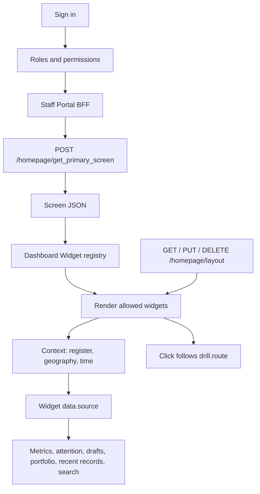

# Role-based screen

After sign-in, every staff user gets one homepage: search, act, and open the work behind a figure. The same homepage serves every domain. A new role is a new composition of the same widgets.

The backend chooses the screen, enforces permissions, and returns the data. Staff Portal renders the screen. A check in the browser only hides a widget. The API checks again. An unknown widget type is skipped. A forbidden deep link shows nothing.

## Architecture



| Piece | Owns |
| --- | --- |
| Staff Portal API | Roles, the screen, permissions, and widget data |
| Staff Portal (`ui/staff-ui`) | Sign-in, BFF, homepage host, navigation |
| `@openg2p/dashboard-widgets` | Widget components, grid, and layout |

`data.source` is a key, such as `intake.pending`. It is not a URL. The host maps the key to a homepage data call. Every data call sends `register`, `geography`, `time_window`, and `comparison`.

## How it works

1. Staff Portal loads the user's permissions, then asks for the primary screen.
2. The backend returns one screen JSON. Several roles resolve to one screen by configured precedence.
3. Staff Portal applies this user's saved layout, then drops widgets the role cannot see.
4. The widget registry renders each `type` on a 12-column grid (`row`, `col`, `span`, `rowSpan`).
5. The context bar sets register, geography, time, and comparison. Only widgets that declare a scope follow it. The choice is saved per screen.
6. A click follows `drill.route` and its filters, then returns to the same screen and context. No route means the figure is not clickable.

## Layout

The role screen is the default. Each user can change their own homepage and save it.

On **Configuration → Page customization → Dashboard**, the user moves, resizes, adds, and removes widgets from the ones their screen allows. Save writes that arrangement with `PUT /homepage/layout`. The next visit loads it with `GET /homepage/layout` and places it on top of the role screen. Reset (`DELETE /homepage/layout`) returns the role default.

The saved layout is personal. It does not change the screen for anyone else. Widgets the role cannot see stay hidden after the layout is applied.

## Screens

One primary screen per role.

| Role | Screen |
| --- | --- |
| Intake Officer | Intake |
| Intake Validator | Queue |
| Data Editor | Locate |
| Data Validator | Queue |
| Data Supervisor | Command |
| Operations Administrator | Command |
| Integration Manager | Messages |
| Schema Designer | Operations |
| Integration Specialist | Operations |
| Reference Data Specialist | Operations |
| Technical Administrator | Operations |

| Screen | What it shows |
| --- | --- |
| Intake | Volume and channels; failed import or export, blocked drafts, missing documents |
| Locate | At most one count; the user's tasks, if any |
| Queue | Pending, overdue, and SLA; the user's queue and aging |
| Command | Volume, lifecycle, coverage, quality, and registry-wide pressure |
| Messages | Channels and unresolved inbound |
| Operations | Failed jobs, import and export, stale as-of, and health |

## Screen JSON

`POST /homepage/get_primary_screen` returns the screen. A widget carries `id`, `type`, `position`, `config`, `permission`, `scope`, `data.source`, and `drill`.

```json
{
  "id": "pending",
  "type": "metric",
  "position": { "row": 7, "col": 1, "span": 6, "rowSpan": 4 },
  "permission": { "action": "intakeSubmission:view" },
  "data": { "source": "intake.pending" },
  "scope": { "register": true, "time": true },
  "drill": { "route": "/intake-form", "filters": { "status": "pending" } }
}
```

An Intake Officer has intake permissions and no `register:view`, so search, portfolio, and recent records are not on that screen.

## APIs

The browser calls `/api/homepage/*`. The BFF proxies to the Staff Portal API.

| Call | Returns |
| --- | --- |
| `POST /homepage/get_primary_screen` | This user's screen JSON |
| `POST /homepage/get_metrics` | Metric values for the requested sources |
| `POST /homepage/get_attention` | Attention items |
| `POST /homepage/get_drafts` | Drafts |
| `POST /homepage/get_portfolio` | Register cards |
| `POST /homepage/get_recent_records` | Recent records |
| `POST /homepage/search_suggest` | Search suggestions |
| `GET` / `PUT` / `DELETE /homepage/layout` | This user's saved positions |

## Widgets

| Type | Role on the screen |
| --- | --- |
| `identity` | Name, type, authority, jurisdiction, logos. Training and staging are marked. |
| `context_bar` | Register, geography, time, comparison, refresh |
| `search` | One search row. Suggestions overlay the field. |
| `metric` | One figure: label, value, delta, status, drill |
| `action_bar` | Permitted actions on this screen |
| `attention` | Tasks and alerts. The empty state stays visible. |
| `chart` | Chart, plus a table. No map without geography. |
| `data_table` | Table |
| `quality` | Scorecard |
| `activity` | Activity counts. No names. |
| `portfolio` | One card per register. Choosing one sets scope. |
| `operations` | Operational pulses |
| `drafts` | Drafts and intake |
| `recent_records` | Recently opened records this role may open |
| `config_shortcuts` | Configuration links. Operations only. |

## Permissions

The homepage uses a subset of the permission catalog. The rest appear only as configuration shortcuts. Scope, such as one district, limits selectors, metrics, search, attention, and drill-through.

| Use | Permission |
| --- | --- |
| Search, portfolio, recent records, register metrics | `register:view` |
| Export | `register:export` |
| History | `registerHistory:view` |
| Add record, drafts | `intakeSubmission:edit`, `intakeSubmission:view` |
| Approve submission | `intakeSubmission:approve` |
| Intake form | `intakeFormDefinition:view` |
| Verify submission | `verificationIntakeForm:view`, `verificationIntakeForm:create` |
| Change request | `changeRequest:view`, `changeRequest:create` |
| Approve change | `changeRequest:approve` |
| Verify change | `verificationChangeRequest:view`, `verificationChangeRequest:create` |
| Scores | `registerScore:view` |
| Messages | `incomingMessage:view`, `outgoingMessage:view` |
| Subscriptions | `ingestSubscription:view`, `ingestSubscription:create` |
| Open a protected record | `register:authenticate` |

## Where it lives

**Staff Portal (`ui/staff-ui`)**

* `src/app/[locale]/page.tsx` — homepage route
* `src/app/[locale]/configuration/page-customization/dashboard/` — layout editor
* `src/features/homepage/HomepageDashboard.tsx` — loads the screen, applies layout, filters by permission, handles drill
* `src/features/homepage/contracts.ts` — screen and data contracts
* `src/app/api/homepage/` — BFF routes

**Dashboard widgets (`ui/dashboard-widgets`)**

* `ScreenRenderer` — grid and widget lookup
* `filterScreenByPermission` — display-only permission filter
* `src/widgets/` — built-in homepage widgets
