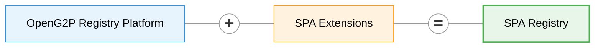

# SPA Registry

The **SPA Registry** (Social Payment Accounts Registry) records where each beneficiary can be paid. A beneficiary has one or more **financial addresses**: a bank account, a mobile wallet, a UPI address. Each address is validated, ranked by priority and kept under change control. Payment systems ask the registry for a beneficiary's addresses and pay the first one that works.

It replaces the SPAR mapper service. SPAR held one ID-to-address mapping as a flat string built by "strategies". The SPA Registry keeps each address as structured, validated, versioned data instead.

It is built on the [OpenG2P Registry Platform](../registry/README.md) and adds only the payment-account domain.

## At a glance

| | |
| --- | --- |
| **What it records** | The financial addresses of each beneficiary, and whether each has been validated |
| **Registers** | `Beneficiary` (the register) and `FinancialAddress` (a table of addresses under each beneficiary) |
| **Address types** | Set by configuration, for example an IFSC bank account, an IBAN account, a UPI address, a wallet or a phone-number alias. Each type names the handler that checks it. |
| **Providers** | A configured list of the banks, wallet operators and UPI handles the programme can pay |
| **Priority** | Each address has a priority. 1 is tried first. Addresses are never deleted, only made inactive. |
| **Validation** | A penny-drop payment through G2P Bridge for bank accounts, or an account lookup for UPI and wallet addresses |
| **Search** | Partners search by ID and receive all active addresses of the beneficiary, in priority order, over the DCI partner API |
| **Protection** | The identifier can be encrypted at rest. A keyed hash supports exact-match search. |
| **Changes** | Every change goes through the approval workflow. Nothing is auto-approved. |

## What the platform provides, and what this adds

| From the registry platform | Added by the SPA Registry |
| --- | --- |
| Change requests and the approval workflow | Beneficiary and financial address models and schemas |
| Version history | Financial address types and providers (configuration tables) |
| Partner API and DCI search | Handlers that normalize and validate each address type |
| Metadata-driven staff UI | Domain services with the payment-account rules |
| Consent-aware data sharing | Validation jobs: penny drop and lookup |
| | A few new UI widgets and one new search filter type |

## Related components

| Component | Role |
| --- | --- |
| [G2P Bridge](../../../g2p-bridge/README.md) | Sends penny-drop payments from a dedicated sponsor account and reconciles the bank statements. Needs a new `ACCOUNT_VALIDATION` envelope type. |
| Master Data Service | Holds the bank and branch directory, so staff and beneficiaries pick a bank and a branch instead of typing an IFSC |
| [SPAR](../../../spar/README.md) | The service this registry replaces |

## Documentation

| Page | Content |
| --- | --- |
| [Requirements](requirements/spa-registry-requirements.md) | Models, tables, services, validation, the Bridge interface and changes, UI, jobs and the partner search |

## Status

Under design. The requirements page lists the decisions taken and the items still open.
